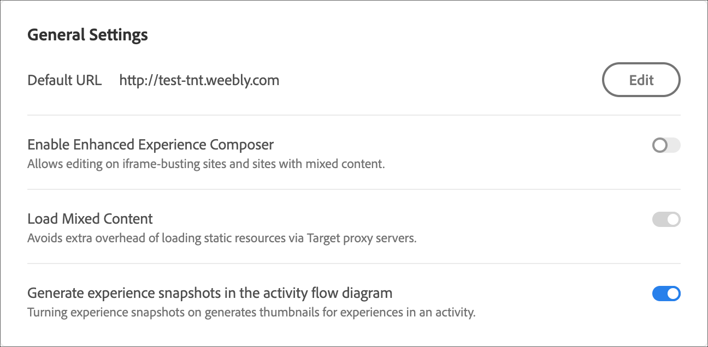

# 設定視覺化體驗撰寫器(VEC)

使用&#x200B;**[!UICONTROL 管理]**&#x200B;下的&#x200B;**[!UICONTROL 視覺化體驗撰寫器]**&#x200B;索引標籤，設定[!DNL Adobe Target] [!UICONTROL 視覺化體驗撰寫器] (VEC)的全帳戶預設值。 當作者在VEC中建立或預覽體驗時，這些設定即適用。

**設定總覽**

1. [一般設定](#general-settings)：預設URL、增強體驗撰寫器、混合式內容和體驗快照。
1. [行動檢視區設定](#mobile-viewport-configuration)：預覽回應式體驗的裝置（僅限[Target Premium](/help/main/c-intro/intro.md#premium)）。
1. [CSS選取器](#css)： Target如何產生內容傳遞的選取器。

若要開啟設定頁面，請按一下&#x200B;**[!UICONTROL 管理]** > **[!UICONTROL 視覺化體驗撰寫器]**。

>[!NOTE]
>
>此頁面上的設定適用於整個[!DNL Target]帳戶。

## 一般設定 {#general-settings}

在&#x200B;**[!UICONTROL 一般設定]**&#x200B;區段中，設定您開啟VEC時使用的預設值。

有以下設定可使用：

* **預設URL**

  設定[!UICONTROL 可視化體驗撰寫器]所使用的預設 URL。 這是每當您為每個新增活動設定體驗時會使用的預設頁面 (例如您的首頁)。 如果您不設定預設的 URL，則必須在建立活動時，為每個活動輸入 URL。

* **啟用增強體驗撰寫器**

  允許在 iframe-busting 網站以及含有混合內容的網站上編輯。 部分網站可能與增強型版本不相容。 取消選取此選項以還原至原始[!UICONTROL 視覺化體驗撰寫器]。 此選擇不會影響網站上的活動傳送。

  請注意，[!DNL Safari]不支援[!UICONTROL 增強體驗撰寫器]。

  如需詳細資訊，請參閱[疑難排解可視化體驗撰寫器](/help/main/c-experiences/c-visual-experience-composer/r-troubleshoot-composer/troubleshoot-composer.md)。

  您也可以在活動層級啟用[!UICONTROL 增強體驗撰寫器]。 請參閱[瞭解如何在活動層級](/help/main/c-experiences/c-visual-experience-composer/experience-composer-best-practices.md)啟用增強體驗撰寫器。

* **載入混合的內容**

  使用[!UICONTROL 增強體驗撰寫器] (EEC)開啟網站時啟用混合內容。 啟用此選項可避免透過[!DNL Target]個Proxy伺服器載入靜態資源的額外負荷。

  例如，如果發生下列情況，此選項會很有幫助：

  * 您的內容安全性原則(CSP)標頭允許載入混合內容，而不需使用已啟用EEC的Proxy伺服器。
  * 您的HTTP網站在EEC中的載入時間增加，其中JavaScript、影像等內容需要花較長的時間透過Proxy載入。

* **在活動流程圖表中產生體驗快照**

  啟用體驗快照會在活動工作流程圖表中產生您的體驗的縮圖。 停用快照可能對部分使用者造成較快速的效能。

## 行動檢視區設定 {#mobile-viewport-configuration}

>[!NOTE]
>
>**[!UICONTROL 行動檢視區組態]**&#x200B;設定是[Target Premium](/help/main/c-intro/intro.md#premium)功能。

新增要在預覽體驗時使用的裝置。 每個裝置有相關聯的對象。

使用下列步驟新增行動檢視區：

1. 按一下「**[!UICONTROL 新增]**」。
1. 指定行動檢視區的描述性名稱、指定寬度和高度，然後選取所需的作業系統。
1. 按一下&#x200B;**[!UICONTROL 「儲存」]**。

如需預覽和對象詳細資料，請參閱[瞭解如何將行動檢視區用於回應式體驗](/help/main/c-experiences/c-visual-experience-composer/mobile-viewports.md)。

## CSS 選取器 {#css}

指定 [!DNL Target] 如何產生 CSS 選取器。

這些選項可幫助 [!DNL Target] 瞭解您網站的結構，以為內容傳送產生更好的 CSS 選取器。 依預設，[!DNL Target] 會根據頁面上的元素 ID 產生選取器。 如果您的網站在相同頁面上使用一些 ID 或重複的 ID，那麼，使用類別可能是較好的選項。

您可以選擇以下的一或兩個選項:

* **使用專案ID**

  如果將相同的 ID 用於多個元素，或如果元素 ID 可能在頁面載入時變更，請取消選取此選項。

* **使用元素類別**

  依預設，[!DNL Target] 僅使用元素 ID。 不過，如果您的頁面設計成使用類別來識別元素，例如使用[!DNL Adobe Experience Manager]建立的頁面，您也應該選取&#x200B;**[!UICONTROL 使用元素類別]**。 一般而言，使用ID時選取器的正確性最高，使用類別時較低，但若未選取任何選項，則最低值。 在VEC中測試您的頁面，以確認選取器正確無誤。

  您可以按一下&#x200B;**[!UICONTROL 設定]**&#x200B;齒輪圖示並選取&#x200B;**[!UICONTROL CSS選取器]**，為每個活動覆寫此設定，這在相同帳戶中的網站設定不同時很有用。 在&#x200B;**[!UICONTROL Automated Personalization]**&#x200B;或&#x200B;**[!UICONTROL Multivariate Testing]**&#x200B;活動中無法使用每個活動的覆寫。 如需選取器行為和疑難排解，請參閱視覺化體驗撰寫器中使用的[元素選取器](/help/main/c-experiences/c-visual-experience-composer/vec-selectors.md)。

## 訓練影片：帳戶偏好設定(7:33) 

>[!BEGINSHADEBOX]

[!DNL Target] **[!UICONTROL 管理]**&#x200B;功能表UI （先前稱為&#x200B;**[!UICONTROL 安裝程式]**）已經過重新設計，可提供改良的效能、縮短發布新功能所需的維護時間，並改善整個產品的使用者體驗。 以下影片中的資訊通常是正確的，但是選項的位置可能略有不同。 我們很快就會發佈更新的影片。

>[!ENDSHADEBOX]

此影片包括關於帳戶偏好設定的資訊。

* 說明 中可用的帳戶設定[!DNL Target Standard]

>[!VIDEO](https://video.tv.adobe.com/v/17379)
