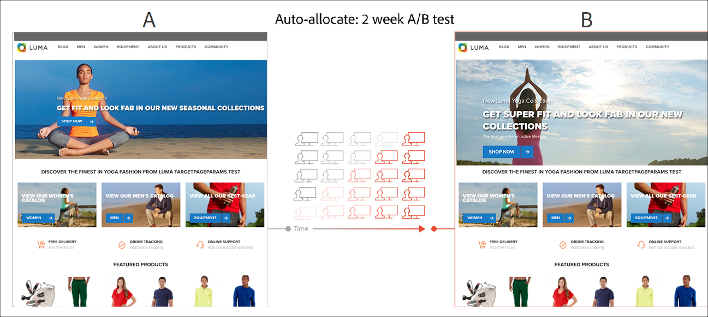

# [!UICONTROL 自動分配]如何勝過手動測試 {#faster-results-higher-revenue}

>[!BEGINSHADEBOX]

**在此頁面上：**&#x200B;瞭解為什麼&#x200B;**[!UICONTROL 自動分配]**&#x200B;活動可以提供比手動A/B測試更快的結果和更高的收入、其運作方式，以及何時手動流量分配仍然是更好的選擇。

>[!ENDSHADEBOX]

使用手動A/B活動時，您可能會失去轉換，因為您無法在活動完成前將成功體驗傳送給整個對象。 即使在您認識到某些體驗勝過其他體驗，以及活動必須執行其整個課程才能對獲勝者採取行動之後，您的流量分配仍會維持固定。

## 自動分配流量 {#auto-allocating-traffic}

如果您想要更頻繁和更早地在活動中提供成功體驗，同時移除或減少挑選樣本大小、信賴等級和其他統計概念的設定和計算成本，則&#x200B;**[!UICONTROL 自動分配]**&#x200B;是您的最佳選項。

## [!UICONTROL 自動分配]如何運作？ {#how-it-works}

**[!UICONTROL 自動分配]**&#x200B;使用多臂吃角子老虎機的原則。 單臂吃角子老虎機是老虎機的通俗用語。 將流量自動分配想像成一組插槽機，在此案例中是測試變數，其控制代碼在開始時是等量提取的。 一段時間後，一台或多台電腦或測試變數可能會比其他電腦支付更多費用。 當這種情況發生時，賭徒自然會開始拉取較常獲勝的機器的把手。 在流量配置詞語中，[!DNL Target]會為更多訪客提供勝出更多的體驗或體驗。

下圖顯示為期兩週的A/B活動。 透過&#x200B;**[!UICONTROL 自動分配]**，當成功體驗出現時，[!DNL Target]會在測試初期將更多流量轉給該成功者。

## [!UICONTROL 自動分配]如何提供更快的結果？ {#faster-results}

更多訪客會看到績效最佳的變數。 由於單一變數領先時，會有更多訪客在測試仍在執行時轉向該成功體驗。 如果A/B活動是在核心業務時刻（例如假日、產品上市或全球新聞事件）執行，此方法特別實用。

## [!UICONTROL 自動分配]如何提供更高的收入？ {#higher-revenue}

**[!UICONTROL 自動分配]**&#x200B;找到獲勝者的速度比手動A/B分割更快，可讓您立即利用獲勝者，擷取在傳統或手動方法中會失去的上行收入。 **[!UICONTROL 自動分配]**&#x200B;會將更多流量導向轉換率最高的體驗，這樣就能在活動執行和學習時增加您的收入。

在下列範例中，**[!UICONTROL 自動分配]**&#x200B;透過將更多流量(40%)推送至轉換率最高的體驗D，在測試期間獲得更多收入。

## 在哪些情況下我應該堅持手動流量分配？ {#manual-allocation}

手動A/B測試是最適用的選項，因為您必須針對每個體驗的執行方式，相對於其他體驗進行排名。 **[!UICONTROL 自動分配]**&#x200B;會尋找並開發表現最佳的體驗，但無法保證表現較差的體驗之間的差異。 使用手動流量分配，以完全控制有多少訪客流量會看到每個測試變體，並自訂與您的業務相關的統計臨界值。

## 開始使用 {#get-started}

準備好啟動您的第一個&#x200B;**[!UICONTROL 自動分配]**&#x200B;活動嗎？ 請參閱[建立自動分配活動](/help/main/c-activities/automated-traffic-allocation/create-auto-allocate-activity.md)和[自動分配總覽](/help/main/c-activities/automated-traffic-allocation/automated-traffic-allocation.md)。
