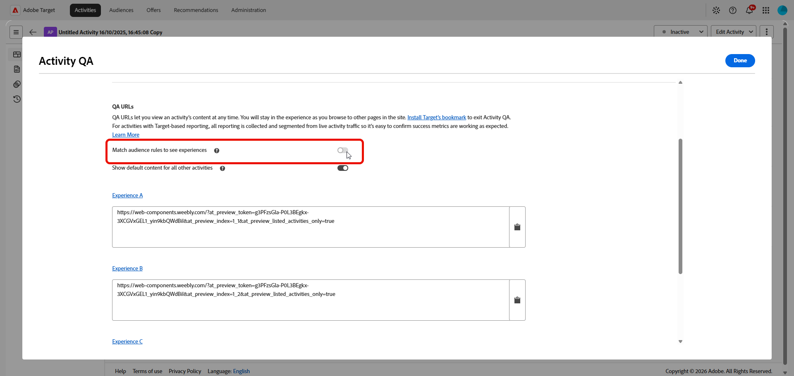

# 開始使用活動問答 {#activity-qa}

>[!BEGINSHADEBOX]

**在此頁面上：**&#x200B;瞭解如何使用活動QA連結來端對端測試活動、檢閱QA報表，以及從QA模式中釋出自己。

>[!ENDSHADEBOX]

**[!UICONTROL 活動QA]**&#x200B;可讓您在將[!DNL Adobe Target]活動啟動為即時之前，先對其進行完整測試，使用永不變更的預覽連結、可選對象鎖定目標以及與即時活動資料分開的QA報表。 **[!UICONTROL 活動QA]**&#x200B;功能包括：

* **永久連結：**&#x200B;與永不變更或需要重新產生的團隊成員共用連結，無論對體驗或活動進行的更新為何。
* **選用的對象鎖定目標：**&#x200B;測試鎖定目標條件，或忽略這些條件以檢查體驗的外觀，而不一定必須符合對象條件。
* **個別的QA報告：**&#x200B;確認量度如預期般增加。 QA報表資料和生產報表（適用於非A4T報表）分開。
* **使用其他活動預覽：**&#x200B;單獨預覽體驗，或使用符合傳遞條件（頁面/[!DNL Target]請求/對象）的其他已上線活動預覽。
* **完整使用者歷程：**&#x200B;使用QA連結存取您的網站一次，然後在&#x200B;**[!UICONTROL 活動QA]**&#x200B;中瀏覽整個網站。 在您結束工作階段或使用[QA Target書籤小程式](/help/main/c-activities/c-activity-qa/activity-qa-bookmark.md)強迫自己離開之前，您會一直留在&#x200B;**[!UICONTROL 活動QA]**。 如果您的活動橫跨多個網頁，則此功能相當實用。

  >[!NOTE]
  >
  >此功能適用於2.*x*&#x200B;版或更新版本的at.js實作。 針對at.js 1.*x*&#x200B;實作，只有在訪客的瀏覽器未封鎖第三方Cookie時，才能使用此功能。

## 存取和共用問答URL {#section_1C59BAA247B247BDB125D1BE8EAD4547}

活動QA連結可讓您和您的團隊在活動上線之前，檢視網站上活動的每個體驗。 QA流量會與即時流量分開報告，因此測試不會影響即時報表。

1. 從活動的&#x200B;**[!UICONTROL 總覽]**&#x200B;頁面，按一下&#x200B;**[!UICONTROL 活動QA]**。

   概觀頁面](../assets/activity-qa.png)活動位置區段中的![活動QA按鈕

1. 設定&#x200B;**[!UICONTROL 符合對象規則以檢視體驗]**，以選擇測試者是否必須符合對象的資格。 開啟以確認您的對象比對有效果，或關閉以檢查活動的外觀。

   * **於：**&#x200B;測試者必須符合目標定位需求，才能檢視體驗。 體驗鎖定目標(XT)活動會提供單一活動URL，而您看到的體驗取決於您符合資格的鎖定目標規則。
   * **關閉：**&#x200B;無論您是否符合資格，連結都會顯示體驗。 在QA期間，您可以隨時在兩項設定之間切換。

   

1. 設定&#x200B;**[!UICONTROL 顯示所有其他活動的預設內容]**，以選擇其他已上線活動是否出現在頁面上。

   * **在：**&#x200B;顯示所有其他活動的預設內容。 單獨顯示預覽，而不考慮相同頁面/[!DNL Target]請求上的其他已上線活動。
   * **關閉：**&#x200B;如果您正在測試的活動與其他已上線的活動之間發生衝突，請套用[一般優先順序規則](/help/main/c-activities/priority.md#priority)，這樣您就看不到您要QA的活動。 已檢視的活動會增加量度，但僅限於 QA 報表環境中。

1. 按一下&#x200B;**[!UICONTROL 「完成」]**&#x200B;以儲存變更。

1. 與您的組織成員共用活動連結URL以進行測試。

   每個連結URL （適用於體驗A、體驗B等）都會從對應的體驗開始使用者旅程。 即使體驗橫跨多個頁面 (範本測試或多頁測試)，每個體驗也只會產生一個 URL。

   連結永不過期，對活動或體驗的變更不需要您重新傳送。 不過，如果您套用與&#x200B;**[!UICONTROL 對象庫]**&#x200B;不同的對象，而非編輯活動，則會產生您必須再次共用的新連結。

1. 按一下體驗的URL，然後正常瀏覽您的網站以檢視多個頁面上的體驗（如果存在多個頁面）。

   您可以瀏覽網站以檢視其他頁面，因為&#x200B;**[!UICONTROL 活動QA]**&#x200B;模式會跨頁面持續存在。 這適用於2.*x*&#x200B;版或更新版本的at.js實作。 針對at.js 1.*x*&#x200B;實作，只有在訪客的瀏覽器未封鎖第三方Cookie時，才會發生這種情況。

1. 若要檢視從活動連結URL產生的報表，請存取活動的&#x200B;**[!UICONTROL 報表]**&#x200B;頁面，按一下&#x200B;**[!UICONTROL 設定]**&#x200B;圖示(  )，然後從&#x200B;**[!UICONTROL 環境]**&#x200B;下拉式清單中選取&#x200B;**[!UICONTROL QA模式流量]**。

   報表設定的環境清單中的

## 退出活動QA模式

**[!UICONTROL 活動QA]**&#x200B;模式會持續存在，直到您結束為止。 在&#x200B;**[!UICONTROL 活動QA]**&#x200B;中瀏覽網站後，您會一直保持QA模式，直到[!DNL Target]工作階段到期或強迫自己離開為止。 您必須先退出，才能像一般訪客一樣檢視您的網站。

### at.js 2.*x*

如果您的網站已部署at.js 2.*x*，請使用[Target QA書籤小程式](/help/main/c-activities/c-activity-qa/activity-qa-bookmark.md)強制自己離開&#x200B;**[!UICONTROL 活動QA]**。 在網站上載入具有空白值的頁面（如下一節所述），在部署at.js 2.*x*&#x200B;時，*不會*&#x200B;從瀏覽器中移除QA Cookie。

### at.js 1.*x*

如果您的網站已部署at.js 1.*x*，則除了使用[Target QA書籤小程式](/help/main/c-activities/c-activity-qa/activity-qa-bookmark.md)之外，您還可以手動強迫自己離開，方法是在網站上載入頁面，並將`at_preview_token`引數設定為空白值。 例如：

`https://www.mysite.com/?at_preview_token=`

### [!DNL Adobe Experience Platform Web SDK]

如果您的網站已部署[[!UICONTROL Platform Web SDK]](https://experienceleague.adobe.com/docs/target-dev/developer/client-side/aep-web-sdk.html){target=_blank}，您可以手動強迫自己離開，方法是在網站上載入`at_qa_mode`引數設為空值的頁面。 例如：

`https://www.mysite.com/?at_qa_mode=`

## 考量事項 {#section_B256EDD7BFEC4A6DA72A8A6ABD196D78}

### 可用性與限制 {#availability}

+++ Automated Personalization體驗預覽URL

**[!UICONTROL 活動QA]**&#x200B;現在可用於所有[!DNL Target]活動型別，因此不再需要「使用體驗預覽URL預覽Automated Personalization活動」功能。

+++

+++ Analytics作為報表來源(A4T)

**[!UICONTROL 活動QA]** URL可用於使用[Analytics作為報告來源](/help/main/c-integrating-target-with-mac/a4t/a4t.md) (A4T)的活動。 使用&#x200B;**[!UICONTROL 活動QA]**&#x200B;執行QA時產生的點選數會流向相同的報表套裝，即使活動上線後，活動資料也會流經該報表套裝。

+++

+++ 已封存或已結束的活動

**[!UICONTROL 活動QA]**&#x200B;未顯示已封存活動或超過結束日期之活動的內容。 如果您停用已結束的活動，則必須再次儲存活動，以便&#x200B;**[!UICONTROL 活動QA]**&#x200B;能夠運作。

+++

+++ 匯入的活動

匯入至[!DNL Target Standard/Premium]的活動（例如，從[!DNL Target Classic]）不支援QA URL。

+++

+++ 自動分配和Recommendations模型

在&#x200B;**[!UICONTROL 自動分配]**&#x200B;與&#x200B;**[!UICONTROL Recommendations]**&#x200B;活動中，模型不會受&#x200B;**[!UICONTROL 活動QA]**&#x200B;中擷取的造訪影響。

+++

### 連結和瀏覽 {#links-and-browsing}

+++ 具有「URL為」條件的活動

如果您在表單式撰寫器](/help/main/c-experiences/form-experience-composer.md)的[細分或視覺化體驗撰寫器](/help/main/c-experiences/c-visual-experience-composer/viztarget-options.md)的[頁面傳送選項中建立活動時指定「URL是」，則QA URL無法運作，因為&#x200B;**[!UICONTROL 活動QA]**&#x200B;會附加URL引數。 若要解決此問題，請按一下 QA URL 前往您的網站，從 URL 中移除附加的參數，然後載入新的 URL。

+++

+++ 封鎖第三方Cookie的瀏覽器(at.js 1.*x*)

如果您有at.js 1.*x*，如果您使用Safari或其他封鎖第三方Cookie的瀏覽器，**[!UICONTROL 活動QA]**&#x200B;模式不會在頁面之間持續存在。 在這些情況下，您必須將預覽引數新增至您導覽到的每個URL。 如果您已實作[CNAME](https://experienceleague.adobe.com/docs/target-dev/developer/implementation/implement-cname-support-in-target.html){target=_blank}，也同樣如此。

+++

+++ 具有多個體驗對象的活動

如果活動使用多個體驗對象（例如，相同活動中包含的US和UK網站），則這四個組合（體驗A/US網站、體驗A/UK網站、體驗B/US網站、體驗B/UK網站）不會產生QA連結。 只會建立兩個QA連結（體驗A和體驗B），使用者必須符合適當的對象資格才能檢視頁面。 英國QA人員看不到美國網站。

+++

+++ 多頁活動

**[!UICONTROL Target QA模式]** UI僅顯示多頁活動中體驗的第一個URL。 假設您要建立歷程測試，並從URL1移至URL2。 不過，如果您想要單獨前往URL2，請復製為URL1提供的所有URL引數，並在放置「？」後將其套用至URL2， 如您在URL1中所見。

+++

### 預覽未載入的連結 {#preview-not-loading}

+++ 太多已儲存的活動

如果帳戶中有太多已儲存的活動，已儲存活動的&#x200B;**[!UICONTROL 活動QA]**&#x200B;預覽連結可能會無法載入。 重試預覽連結。 為避免此問題重複發生，請封存已儲存且不再主動使用的活動。

+++

+++ 雙編碼預覽引數

所有 `at_preview` 參數和值皆已完成 URL 編碼。 大部分時間，一切都如預期般運作。 不過，有些客戶會使用負載平衡器或Web伺服器，嘗試再次將查詢字串引數編碼。

使用此雙重編碼時，[!DNL Target]在嘗試解碼`at_preview_token`時無法擷取正確的權杖值，所以預覽無法運作。

[!DNL Adobe]建議您洽詢IT團隊，確定所有預覽引數皆已加入允許清單，因此這些值絕不會轉換。

下表列出可在您的網域中列入允許清單的引數：

| 參數 | 類型 | 值 | 說明 |
|--- |--- |--- |--- |
| `at_preview_token` | 加密的字串 | 強制；無預設值 | 一種加密實體，包含可在QA模式中執行的促銷活動ID清單。 |
| `at_preview_index` | 字串 | 空白 | 引數格式為`<campaignIndex>`或`<campaignIndex>_< experienceIndex>` 兩個索引的開頭皆為1。 |
| `at_preview_listed_activities_only` | 布林值 (true/false) | 預設值: false | 若設為「true」，則 `at_preview_index` 參數中指定的所有促銷活動都會經過處理。 若設為「false」，即使預覽 Token 中未指定促銷活動，頁面的所有促銷活動都會經過處理。 |
| `at_preview_evaluate_as_true_audience_ids` | 字串 | 空白 | 以底線分隔的(「_」)區段ID清單，在[!DNL Target]請求的範圍內，應該一律（在目標定位和報告層級）評估為「true」。 |
| `_AT_Debug` | 字串 | 視窗或主控台 | 主控台記錄或新視窗。 |
| `adobe_mc_ref` |  |  | 將預設頁面的轉介 URL 傳給新頁面。 與 `AppMeasurement.js` 2.1 版 (或更新版) 一起使用時，[!DNL Adobe Analytics] 會在新頁面上將此參數值當作轉介 URL。 |
| `adobe_mc_sdid` |  |  | 將[!DNL Supplemental Data Id] (SDID)和[!DNL Experience Cloud Org Id]從預設頁面傳給新頁面。 傳遞這些ID可讓[!UICONTROL Analytics for Target] (A4T)將預設頁面上的[!DNL Target]要求與新頁面上的[!DNL Analytics]要求「拼接」起來。 |

+++

## Target JavaScript資料庫[!UICONTROL QA模式]相容性 {#compatibility}

[!DNL Target]支援下列JavaScript資料庫：

* [at.js 1.x](https://experienceleague.adobe.com/docs/target-dev/developer/client-side/at-js-implementation/at-js/how-atjs-works.html)
* [at.js 2.x](https://experienceleague.adobe.com/docs/target-dev/developer/client-side/at-js-implementation/at-js/how-atjs-works.html)
* [Adobe Experience Platform Web SDK](https://experienceleague.adobe.com/docs/target-dev/developer/client-side/aep-web-sdk.html)

下表列出各種活動型別，並指出每個程式庫是否支援&#x200B;**[!UICONTROL 活動QA]**&#x200B;模式：

| 活動類型 | at.js 1.x | at.js 2.x | 平台網頁SDK |
| --- | --- | --- | --- |
| [!UICONTROL A/B 測試] | 是 | 是 | 是 |
| [!UICONTROL 自動分配] | 是 | 是 | 是 |
| [!UICONTROL 自動鎖定目標] | 是 | 是 | 是 |
| [!UICONTROL Automated Personalization] (AP) | 是 | 是 | 是 |
| [!UICONTROL 體驗鎖定] (XT) | 是 | 是 | 是 |
| [!UICONTROL 多變數測試] (MVT) | 是 | 是 | 是 |
| [!UICONTROL 推薦] | 是 | 是 | 是 |
