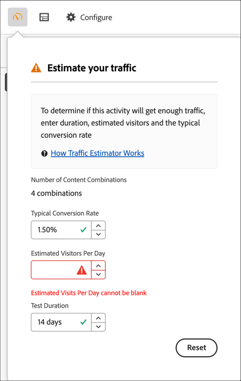

# 預估成功的[!UICONTROL 多變數測試]活動所需的流量 {#traffic-estimator}

>[!BEGINSHADEBOX]

**在此頁面上：**&#x200B;瞭解如何使用&#x200B;**[!UICONTROL 流量估算程式]**，以檢查您的&#x200B;**[!UICONTROL 多變數測試]**&#x200B;活動是否有足夠的流量可以成功。

>[!ENDSHADEBOX]

多變數測試會比較多個體驗，因此瞭解需要多少流量才能提供有意義的結果非常重要。 **[!UICONTROL 流量估算程式]**&#x200B;會使用您頁面的相關統計資料，以及正在測試的體驗數目，來估算流量和測試成功所需的測試持續時間。 它也會提供意見回饋，讓您知道您是否擁有足夠的流量來執行您專為成功而設計的測試。

**[!UICONTROL 流量估算程式]**&#x200B;預測確保下列專案所需的樣本大小：

* **95%信賴度。** 此統計數字表示沒有實際提升度時回報誤判的機會為5% （100% — 信賴水準）。
* **80%統計檢定力。** 此統計值表示測試偵測到真正提升度25%或以上的機率為80%。
* **25%最低可靠偵測提升度。** [!DNL Target]會計算80%機率偵測到25%或以上的真正提升所需的流量量。

此測試使用 Bonferroni 校正來對多個比較進行更正。 此方法已知較為保守，它是利用強制執行相對大的最小可靠可偵測提升度來平衡。

## 使用流量估算程式 {#use-traffic-estimator}

當您設計&#x200B;**[!UICONTROL 多變數測試]**&#x200B;時，**[!UICONTROL 流量估算程式]**&#x200B;可讓您檢查進入頁面的流量是否足以提供您計畫測試的體驗數目。 在啟動測試之前執行此檢查可協助您避免測試無法觸及足夠訪客以產生有意義的結果，並示範如何在流量不足時調整組合數量或測試持續時間。

1. 在&#x200B;**[!UICONTROL 多變數]**&#x200B;活動的&#x200B;**[!UICONTROL 視覺化體驗撰寫器]**&#x200B;的&#x200B;**[!UICONTROL 體驗]**&#x200B;頁面中，按一下頁面左上角的&#x200B;**[!UICONTROL 流量]**&#x200B;圖示（  ）。

   **[!UICONTROL 流量估算程式]**&#x200B;開啟。 若要隱藏它，請再次按一下圖示。

   

   在&#x200B;**[!UICONTROL 流量估算程式]**&#x200B;頂端附近，會計算您輸入的值並顯示結果。

1. （選用）提供一般轉換率、預估每日訪客人數和測試持續時間。

   **[!UICONTROL 流量估算程式]**&#x200B;會使用這些統計資料來決定執行成功測試所需的調整。

   | 量度 | 說明 |
   | --- | --- |
   | **[!UICONTROL 內容組合數目]** | 此量度會在任何排除後，根據要隨活動建立的體驗數量自動計算。 |
   | **[!UICONTROL 一般轉換率]** | 此量度會根據您的估計或來自您分析系統的過去資料而以百分比表示。 |
   | **[!UICONTROL 預計每日訪客數]** | 此量度是根據鎖定目標條件，可能檢視此頁面的訪客數量。 此數字可能以您的分析資料為基礎。 |
   | **[!UICONTROL 測試持續時間]** | 活動要執行的天數。 |

1. 檢閱結果。 當您變更數量時，預估即會變更。

   例如，如果您正在測試許多體驗，而您的轉換率和曝光率太低，**[!UICONTROL 流量估算器]**&#x200B;會顯示測試必須執行多久才能成功。 或者，如果您的流量很低，**[!UICONTROL 流量估算程式]**&#x200B;可能會建議使用較少的體驗，以便您執行所需天數的測試。

1. 如果您沒有足夠的流量，請執行下列其中一項或兩項操作：

   * 減少產品建議組合的數量和位置的數量。
   * 增加測試的持續時間。

1. 調整數字，直到&#x200B;**[!UICONTROL 流量估算程式]**&#x200B;指出您有足夠的流量，然後相應地設計測試。
