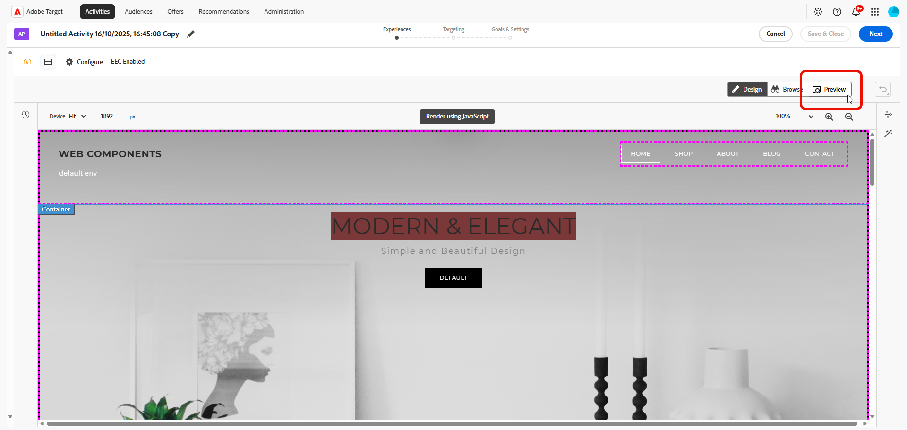

# 在[!UICONTROL 視覺化體驗撰寫器] (VEC)的[!UICONTROL Automated Personalization]活動中預覽體驗 {#preview-ap-experiences}

>[!BEGINSHADEBOX]

**在此頁面上：**&#x200B;瞭解如何預覽&#x200B;**[!UICONTROL 視覺化體驗撰寫器]**&#x200B;中&#x200B;**[!UICONTROL Automated Personalization]**&#x200B;活動的每個體驗，以及如何排除或包含體驗。

>[!ENDSHADEBOX]

[!DNL Adobe Target] **[!UICONTROL Automated Personalization]** (AP)活動會比較頁面上的多個選件，因此預覽每個體驗的頁面會很有幫助。 預覽會顯示選件在每個體驗中的結合方式，因此您可以決定要保留還是排除它。

1. 在&#x200B;**[!UICONTROL 視覺化體驗撰寫器]** (VEC)中，按一下&#x200B;**[!UICONTROL 預覽]**。

   

1. 按一下&#x200B;**[!UICONTROL 顯示體驗]**&#x200B;圖示（）以顯示左側框架中的所有體驗清單。

   

1. 按一下清單中的特定體驗來檢視該體驗。

1. （選擇性）若要排除或包含體驗，請按一下&#x200B;**[!UICONTROL 管理內容]**&#x200B;圖示（）以顯示&#x200B;**[!UICONTROL 管理內容]**&#x200B;對話方塊。

   

1. 您可能會選擇排除顯示發生衝突變數的體驗，或是審美觀點上不平衡的體驗。 然後執行下列任一項作業：

   * 若要排除一個體驗，請按一下體驗旁的&#x200B;**[!UICONTROL 更多動作]**&#x200B;圖示（），然後按一下&#x200B;**[!UICONTROL 排除]**。
   * 若要排除多個體驗，請選取體驗的核取方塊，然後按一下[排除]。**&#x200B;**
   * 若要包含已排除的多個體驗，請選取體驗的核取方塊，然後按一下&#x200B;**[!UICONTROL 包含]**。
