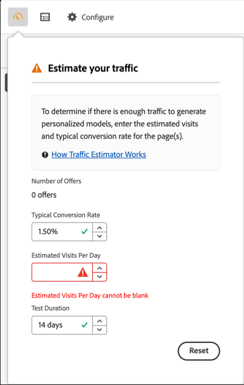

# 預估成功所需的流量 {#traffic-estimator}

>[!BEGINSHADEBOX]

**在此頁面上：**&#x200B;瞭解如何使用&#x200B;**[!UICONTROL 流量估算程式]**，以檢查您的&#x200B;**[!UICONTROL Automated Personalization]**&#x200B;活動是否有足夠的流量可以成功。

>[!ENDSHADEBOX]

[!DNL Adobe Target] **[!UICONTROL 流量估算程式]**&#x200B;提供的意見回饋可讓您知道您的&#x200B;**[!UICONTROL Automated Personalization]** (AP)活動是否有足夠的流量可以成功。 AP活動會使用多個選件組合，因此瞭解需要多少流量才能提供有意義的結果是很重要的。 **[!UICONTROL 流量估算程式]**&#x200B;會使用您頁面的相關統計資料，以及正在測試的體驗數目，來估算讓活動成功所需的流量和測試持續時間。

**[!UICONTROL 流量估算程式]**&#x200B;會比較預估的頁面曝光次數和頁面的一般轉換率，以判斷是否有足夠的流量產生個人化模型。 理想上，對於成功的活動，正確的樣本大小可確保個人化內容會在活動持續期間的 50% 或 14 天內就緒 (以較少者為準)。 此程式可讓您有充足的時間取得個人化內容，並瞭解要傳送哪些內容。

[!DNL Target]會隨機提供體驗，直到建立個人化演演算法為止。 每個優惠方案旁的勾號圖示會顯示該優惠方案的模型何時準備就緒，[!DNL Target]何時可以開始提供個人化內容。 只有在模型準備就緒後，才會預期提升度，因此視覺指示可讓您設定正確的預期。 使用&#x200B;**[!UICONTROL 視覺化體驗撰寫器]** (VEC)中的&#x200B;**[!UICONTROL 流量估算器]**，取得模型準備就緒時的指引。

>[!NOTE]
>
>即使您的流量足夠，個人化模型也不一定都會部署。 [!DNL Target]會建置及測試模型，但只有在模型執行效果優於隨機選取的體驗時，才會部署模型。 如果模式並不比隨機好，選件彼此之間的差異可能並不足夠。 在這種情況下，如果訊息內容類似，請讓選件在視覺上更不同，或是變更訊息本身。

## 使用流量估算程式 {#use-traffic-estimator}

當您建置&#x200B;**[!UICONTROL Automated Personalization]**&#x200B;活動時，**[!UICONTROL 流量估算程式]**&#x200B;可讓您檢查進入頁面的流量是否足以讓個人化模型及時準備就緒。 在啟動活動之前執行此檢查可協助您避免測試無法觸及足夠訪客以提供個人化內容，並示範如何在流量不足時調整優惠方案組合數量或活動持續時間。

1. 從您的&#x200B;**[!UICONTROL Automated Personalization]**&#x200B;活動，存取**[!UICONTROL 視覺化體驗撰寫器]的&#x200B;**[!UICONTROL 體驗]**&#x200B;頁面。

1. 按一下&#x200B;**[!UICONTROL 流量]**&#x200B;圖示（）。

   **[!UICONTROL 流量估算程式]**&#x200B;開啟。 若要結束視窗，請再次按一下圖示。

   

1. 指定一般轉換率（或您從此活動預期的轉換率）、預估每日活動曝光次數和測試持續時間。

   **[!UICONTROL 流量估算程式]**&#x200B;會使用這些量度來決定執行成功測試所需的調整。

   | 量度 | 說明 |
   | --- | --- |
   | **[!UICONTROL 選件數目]** | 此量度會在任何排除後，根據要隨活動建立的體驗數量自動計算。 |
   | **[!UICONTROL 一般轉換率]** | 此量度會根據您的估計或來自您分析系統的過去資料而以百分比表示。 |
   | **[!UICONTROL 預估每日造訪次數]** | 此量度是根據鎖定目標條件，從能夠檢視活動的訪客得到的每日造訪次數。 此量度可以根據您的分析資料。 此數字必須是造訪次數，而非不重複訪客。 |
   | **[!UICONTROL 測試持續時間]** | 您要活動執行的天數。 |

1. 檢閱結果。 當您變更數量時，預估即會變更。

   例如，如果您要測試許多組合，而您的轉換率和曝光率太低，**[!UICONTROL 流量估算程式]**&#x200B;會顯示測試必須執行多久才能成功。 或者，如果您的流量低，**[!UICONTROL 流量估算程式]**&#x200B;可能會建議較少的選件組合數量，以便您執行所需天數的測試。

   

1. 如果您沒有足夠的流量，請考慮下列選項：

   * 使用[**[!UICONTROL 自動鎖定目標]**](/help/main/c-activities/auto-target/auto-target-to-optimize.md)活動（而非&#x200B;**[!UICONTROL Automated Personalization]**）來建立體驗，讓一個體驗變數中有數個選件變更。
   * 減少&#x200B;**[!UICONTROL Automated Personalization]**&#x200B;活動中的選件組合數量。
   * 增加活動的持續時間。

1. 調整數字，直到&#x200B;**[!UICONTROL 流量估算程式]**&#x200B;指出您有足夠的流量，然後相應地設計測試。

   如果流量足夠，**[!UICONTROL 流量]**&#x200B;圖示會顯示綠色檢查。 如果流量不足，圖示會顯示紅色的警告標籤。

   
