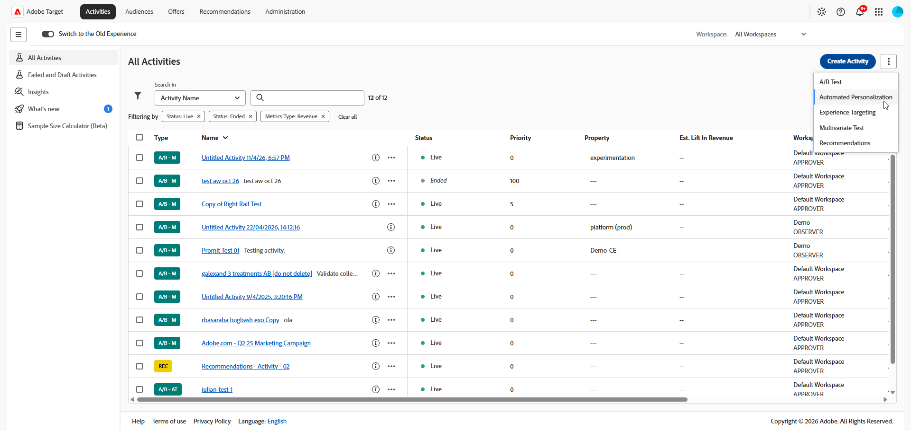
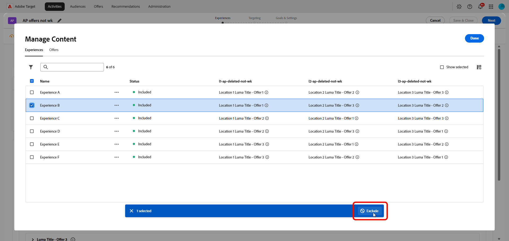
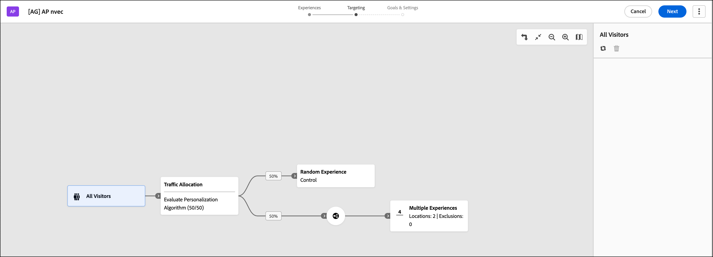

# 建立[!UICONTROL Automated Personalization]活動 {#create-ap-activity}

>[!BEGINSHADEBOX]

**在此頁面上：**&#x200B;瞭解如何在&#x200B;**[!UICONTROL 視覺化體驗撰寫器]** (VEC)中建立&#x200B;**[!UICONTROL Automated Personalization]** (AP)活動。 您可以建置體驗、設定目標定位和控制組，然後設定目標與設定。

>[!ENDSHADEBOX]

[!DNL Target]中的&#x200B;**[!UICONTROL Automated Personalization]**&#x200B;活動工作流程與其他活動型別的工作流程不同。 它會遵循&#x200B;**[!UICONTROL 視覺化體驗撰寫器]**&#x200B;中的三步驟引導式工作流程：

1. [建立體驗](#build-experiences)
1. [設定目標](#set-targeting)
1. [設定目標與設定](#configure-goals-and-settings)

## 開始之前 {#before-you-begin}

為獲得最佳效能，請將&#x200B;**[!UICONTROL Automated Personalization]**&#x200B;和&#x200B;**[!UICONTROL 自動鎖定目標]**&#x200B;活動保持在下列限制內：

* 4-6個位置，每個位置有4-6個選件。
* 總體驗少於5,000個體驗，以獲得最佳結果。 硬性限製為30,000，啟用&#x200B;**[!UICONTROL 不允許重複專案]**&#x200B;選項時，將套用相同的限制。

體驗總數會因位置和選件的卡式組合而成長。 較大的設定可能會導致&#x200B;**[!UICONTROL 視覺化體驗撰寫器]**&#x200B;中的載入或編輯速度變慢。

## 步驟1：建立體驗 {#build-experiences}

定義&#x200B;**[!UICONTROL Automated Personalization]**&#x200B;可個人化的內容變數集區。 您的體驗和選件愈豐富、愈明確，演演算法就能愈理想似地比對每位訪客的正確內容。

### 建立活動 {#create-activity}

啟動活動，並在&#x200B;**[!UICONTROL 視覺化體驗撰寫器]** (VEC)中開啟您要個人化的頁面。

1. 從[!DNL Target] **[!UICONTROL 活動]**&#x200B;清單中，按一下&#x200B;**[!UICONTROL 建立活動]** > **[!UICONTROL Automated Personalization]**。

   

1. 選擇您的體驗撰寫器：

   * 若要使用&#x200B;**[!UICONTROL 視覺化體驗撰寫器]** (VEC)，請按一下&#x200B;**[!UICONTROL Visual]**。

   * 若要使用&#x200B;**[!UICONTROL 表單式體驗撰寫器]**，請改為選取&#x200B;**[!UICONTROL 表單]**。 如需詳細資訊，請參閱[表單式體驗撰寫器](/help/main/c-experiences/form-experience-composer.md)。

     >[!NOTE]
     >
     >除了VEC和&#x200B;**[!UICONTROL 表單式體驗撰寫器]**，[!DNL Target]還提供&#x200B;**[!UICONTROL 單頁應用程式VEC]**。 如需各種撰寫器的詳細資訊，請參閱[體驗和產品建議](/help/main/c-experiences/experiences.md)。 如需VEC的疑難排解資訊，請參閱[疑難排解視覺化體驗撰寫器](/help/main/c-experiences/c-visual-experience-composer/r-troubleshoot-composer/troubleshoot-composer.md)。

     

1. （視條件而定） [選擇工作區](/help/main/administrating-target/c-user-management/property-channel/property-channel.md)。

1. 在&#x200B;**[!UICONTROL 輸入活動URL]**&#x200B;方塊中，指定您的[活動URL](/help/main/c-activities/t-test-ab/t-test-create-ab/ab-activity-url.md)。 如果您的帳戶[設定了預設的 URL](/help/main/administrating-target/visual-experience-composer-set-up.md)，該 URL 依預設會顯示。 您可以視需要將預設URL變更為其他URL。

   請注意，[!DNL Target]不會區分URL通訊協定（[!DNL https]和[!DNL http]）。 因此，[!DNL `http://www.adobe.com/tw`]和[!DNL `https://www.adobe.com/tw`]都相符。

1. 然後，按一下&#x200B;**[!UICONTROL 建立]**。 具有指定URL的頁面會在VEC中開啟。

1. 若要為活動命名，請按一下&#x200B;**[!UICONTROL 編輯]**&#x200B;圖示（）並指定活動的描述性名稱，然後按一下&#x200B;**[!UICONTROL 儲存]**。

   {{activity-name-rules}}

   

### 設計內容 {#design-content}

設定演演算法可合併的內容，並排除您不想要的任何體驗。

1. 修改頁面元素，如[視覺化體驗撰寫器選項](/help/main/c-experiences/c-visual-experience-composer/viztarget-options.md)中所述。

   * 若要快速預覽數個影像，請從Asset Manager一次選取多個影像。 然後，您可以檢視頁面，其中包含為活動設定的每個影像。
   * 若要變更優惠方案中的文字，請直接在頁面上編輯文字元素。

   當您編輯元素時，該元素上會出現橫條，表示您已變更它。

1. 按一下&#x200B;**[!UICONTROL 管理內容]**&#x200B;圖示（）來設定可用的組合。

   **[!UICONTROL 管理內容]**&#x200B;對話方塊開啟，其中包含兩個索引標籤： **[!UICONTROL 體驗]**&#x200B;和&#x200B;**[!UICONTROL 選件]**。

   

1. 在&#x200B;**[!UICONTROL 體驗]**&#x200B;索引標籤上，檢閱內容片段清單以及每個片段指派到的位置。

1. （選擇性）若要從活動中排除體驗，請選取要排除之每個體驗的核取方塊，然後按一下&#x200B;**[!UICONTROL 排除]**&#x200B;圖示。

   如需更多選項，請參閱[管理排除專案](/help/main/c-activities/t-automated-personalization/managing-exclusions.md)。

   

1. （視條件而定）按一下&#x200B;**[!UICONTROL 選件]**&#x200B;索引標籤以管理活動中的選件。

   * 若要組織報表的選件，請選取內容片段並將它們指派給報表群組。 如需詳細資訊，請參閱[Automated Personalization中的選件報表群組](/help/main/c-activities/t-automated-personalization/offer-reporting-groups-in-automated-personalization.md)。
   * 若要限制哪些人可以看到選件，請使用鎖定目標功能，僅允許特定訪客看到該選件。

<!--
1. (Conditional) Click **[!UICONTROL Exclusion Groups]** to choose any combination of elements that you want to exclude from the activity.

   

   Although you can create up to 30,000 experiences in an AP test, the algorithm performs its best when fewer than 10,000 distinct experiences are used. This same limit is applied even when the activity has enabled the **[!UICONTROL Disallow Duplicates]** option.

   If you do not currently have any exclusion groups included in your activity, click **Create Exclusion Group**. You can filter to create a list that shows only the combinations you want to exclude. Name your exclusion group, then click **Save**.

   To edit an existing exclusion group, hover over the group you want to edit, then click the pencil icon.
-->

1. 完成活動內容的設定時，請按一下&#x200B;**[!UICONTROL 完成]**。

## 步驟2：設定鎖定目標 {#set-targeting}

決定哪些訪客進入活動以及您的流量公開多少。 與控制組配對，讓[!DNL Target]可以測量個人化交付的提升度。

1. 按一下&#x200B;**[!UICONTROL 視覺化體驗撰寫器]**&#x200B;頂端的&#x200B;**[!UICONTROL 鎖定目標]**，以前往三步驟引導工作流程中的下一個步驟。

   

1. （視條件而定）按一下&#x200B;**[!UICONTROL 所有訪客]**&#x200B;控制項以[選取活動的其他對象](/help/main/c-activities/t-test-ab/t-test-create-ab/ab-audience.md)並設定其訪客百分比。

   **[!UICONTROL 所有訪客]**&#x200B;對象已設定為預設值。 如果您選取其他對象，其名稱會顯示在最左側的控制項中。 例如，您可將項目限制為所有訪客的 50%，或「加州人」客群的 45%。

1. 按一下&#x200B;**[!UICONTROL 流量分配]**&#x200B;控制項，然後選擇下列其中一個選項：

   

   +++流量分配目標選項

   | 選項 | 使用時機 |
   |--- |--- |
   | **[!UICONTROL 評估Personalization演演算法(50/50)]** | 您的目標是測試演演算法。 控制項和目標演演算法之間的訪客比例為50/50。 此分割可提供提升度最準確的預估，也是測試演演算法是否比無個人化（例如隨機提供的控制）表現更佳的最快且最準確的方式。 建議搭配使用「隨機體驗」作為控制。 |
   | **[!UICONTROL 最大化Personalization流量(90/10)]** | 您的目標是建立「隨時待命」活動。 10%的訪客會進入控制，以確保有足夠的資料供演演算法隨著時間繼續學習。 如果您不太關注確切的提升度，這是最大化個人化流量的最快、最準確的方法。 取捨是在確切的提升度方面較不精確。 無論您的目標為何，當您使用特定體驗作為控制時，建議使用此選項來分割流量。 |
   | **[!UICONTROL 自訂分配]** | 您要手動分割百分比。 |

   +++

1. （視條件而定）從&#x200B;**[!UICONTROL 控制項]**&#x200B;下拉式清單中，[選取要用來作為控制項的特定體驗](/help/main/c-activities/t-automated-personalization/experience-as-control.md)，或選取&#x200B;**[!UICONTROL 隨機體驗]**。

   控制體驗提供比較來判斷自動測試提供了多少提升度。 **[!UICONTROL Automated Personalization]**&#x200B;一律會針對控制組測量效能。 最佳作法是放置至少 10% 的加入者至控制群組。

   >[!NOTE]
   >
   >在&#x200B;**[!UICONTROL Automated Personalization]**&#x200B;活動中，會評估每個要求的輸入條件（URL鎖定目標、範本規則和對象目標）。 在舊版中，會對每個工作階段評估輸入條件。

## 步驟3：設定目標與設定 {#configure-goals-and-settings}

告訴[!DNL Target]成功的樣子。 您選擇的最佳化目標是個人化演演算法用來訓練的量度，因此請挑選對此活動最重要的結果。

1. 按一下[下一步]&#x200B;**&#x200B;**&#x200B;以顯示&#x200B;**[!UICONTROL 目標與設定]**&#x200B;頁面。

1. 使用下列設定來設定活動，然後按一下[儲存並關閉]。**&#x200B;**

   | 設定 | 說明 |
   |--- |--- |
   | **[!UICONTROL 名稱]** | 為活動命名。 請為活動提供描述清楚的名稱，讓團隊成員可以在&#x200B;**[!UICONTROL 活動]**&#x200B;清單中辨識該活動。 遵循[步驟1：建置體驗](#build-experiences)中所述的活動名稱規則。 |
   | **[!UICONTROL 目標]** | (可選) 輸入測試的目標。 目標可幫助您記住活動的目的。 |
   | **[!UICONTROL 優先順序]** | 決定有多個活動共用一個位置和一個受眾時，要顯示哪個活動。 請參閱[設定優先順序](#set-priority)。 |
   | **[!UICONTROL 持續時間]** | 設定活動的開始和結束日期。 您可以選取&#x200B;**[!UICONTROL 啟用時]**，或者您可以指定特定的日期和時間。 |
   | **[!UICONTROL 最佳化目標]** | 個人化演演算法所針對的量度。 請參閱[設定最佳化目標](#set-optimization-goal)。 |
   | **[!UICONTROL 轉換量度]** | 依預設，轉換量度與最佳化目標量度相同。 不過，您可以取消勾選&#x200B;**[!UICONTROL 與最佳化目標]**&#x200B;相同選項，以定義個別的轉換量度。 |
   | **[!UICONTROL 其他量度]** | 新增您要使用的任何其他報表量度。 您可以新增轉換或收入量度。
**注意**： **[!UICONTROL 參與]**&#x200B;量度不支援作為額外的量度。 [!DNL Target] UI可讓您選取&#x200B;**[!UICONTROL 參與]**&#x200B;量度，但資料未準確顯示在報表中。 |
   | **[!UICONTROL 報表對象]** | 新增對象以在報表中啟用按對象篩選。 依預設，報表會顯示所有合格訪客的結果。 新增對象以篩選結果，以獲得更明確的訪客子集。
**注意**：與其他活動型別不同，**[!UICONTROL Automated Personalization]**&#x200B;無法使用&#x200B;**[!UICONTROL Adobe Analytics]**&#x200B;作為其報告來源(A4T)。 |
   | **[!UICONTROL 附註]** | 輸入任何對您或其他專案團隊成員有用的活動相關資訊。 **[!UICONTROL 附註]**&#x200B;窗格可調整大小。 |

   當您命名或重新命名量度時，不允許使用下列字元： `/`、`?`、`#`、`:`、`=`、`+`、`-`和`@`。

### 設定優先順序 {#set-priority}

如果將多個活動指派至具有相同客群的相同位置，則會使用優先順序。 如果將兩個以上活動指派至位置，則會顯示具有最高優先順序的活動。

根據您的設定，**[!UICONTROL 優先順序]**&#x200B;的[!DNL Target] UI和選項會有所不同：

* **舊版優先順序（預設）：**&#x200B;如果未啟用微調優先順序，請指定優先順序&#x200B;**[!UICONTROL 低]**、**[!UICONTROL Medium]**&#x200B;或&#x200B;**[!UICONTROL 高]**。
* **微調優先順序：**&#x200B;指定從0到999的值，其中0 =低，999 =高。 若要啟用此選項，請按一下&#x200B;**[!UICONTROL 管理]** > **[!UICONTROL 報告]**，然後將&#x200B;**[!UICONTROL 啟用微調優先順序]**&#x200B;選項切換到「開啟」位置。

對於在舊版[!DNL Target Standard/Premium]中建立的活動，**[!UICONTROL 低]**&#x200B;優先順序已轉換為0，**[!UICONTROL Medium]**&#x200B;優先順序已轉換為5，而&#x200B;**[!UICONTROL 高]**&#x200B;優先順序已轉換為10。 您可以視需要調整這些值。

>[!NOTE]
>
>在使用微調優先順序後，在您可以停用這些優先順序之前，必須將所有優先順序設定回0、5和10。

### 設定最佳化目標 {#set-optimization-goal}

最佳化目標包含兩個引數：

* 要使用活動測量的項目
* 活動加入者所採取的顯示目標已實現的動作

您可以選取&#x200B;**[!UICONTROL 我的主要目標]**&#x200B;右側的三個點，以命名最佳化目標。 **[!UICONTROL Automated Personalization]**&#x200B;活動可測量&#x200B;**[!UICONTROL 轉換]**&#x200B;或&#x200B;**[!UICONTROL 收入]**。 可透過檢視頁面或檢視mbox來達到轉換。 也可以追蹤點擊。

主要目標也會變成模型系統用來計算體驗成功的模型量度。

您可以在達到模型目標之後，基於追蹤目的，讓使用者保持在活動中。 例如，通常使用&#x200B;**[!UICONTROL Automated Personalization]**&#x200B;活動來改善點按率，並且設為模型目標。 不過，瞭解點按率增加會如何導致最終轉換很重要，因此追蹤最終轉換至關重要。

#### 讓一個量度依賴另一個量度 {#add-dependency}

您可以提供多個量度上的相依性，並且具有彈性可選擇量度應為達到或未到達時計數才會增加。 您必須定義兩個 (或多個) 成功量度，之後才可以讓某個量度相依於另一個量度。 **[!UICONTROL 「新增相依性」]**&#x200B;選項允許在已達到另一個成功量度或尚未達到時遞增成功量度。

若要新增相依性:

1. 新增其他量度後，請按一下&#x200B;**[!UICONTROL 其他目標]**&#x200B;右側的三個點功能表下的&#x200B;**[!UICONTROL 進階設定]**。

1. 按一下&#x200B;**[!UICONTROL 報表設定]**&#x200B;區段底部的&#x200B;**[!UICONTROL 新增相依性]**&#x200B;選項。

1. 將需要的量度從左窗格拖曳到右窗格，然後按一下&#x200B;**[!UICONTROL 「達到」]**&#x200B;來將設定在&#x200B;**[!UICONTROL 「達到」]**&#x200B;與&#x200B;**[!UICONTROL 「未達到」]**&#x200B;之間切換。

您可以在新增相依性之後加以編輯或移除。

## 預覽您的體驗 {#preview-experiences}

在啟動活動之前，請先檢查您的網站體驗外觀。

1. 按一下&#x200B;**[!UICONTROL 儲存並關閉]**&#x200B;後，會顯示活動的&#x200B;**[!UICONTROL 概覽]**&#x200B;頁面。 按一下&#x200B;**預覽體驗**。

1. 在出現的快顯視窗中，檢視並分享網站上的AP體驗連結。 這些連結為您提供&#x200B;**[!UICONTROL Target]** **[!UICONTROL 視覺化體驗撰寫器]** (VEC)外部體驗的「真實預覽」。

   >[!NOTE]
   >
   >您必須分享來自訊息的連結以分享預覽。 按一下連結然後直接從瀏覽器複製URL無法運作。 複製連結會導致URL包含引數，只有在您從訊息中的連結存取頁面時，才會正確顯示頁面。

如需關於報告的資訊，請參閱[Automated Personalization報告](/help/main/c-reports/personalization-reports/reports-ap.md)。
