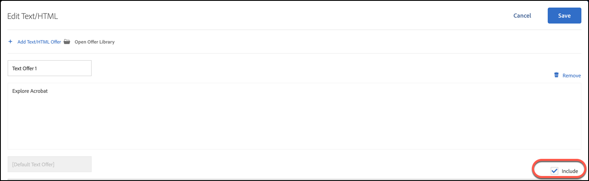

# 管理排除項目 {#manage-exclusions}

>[!BEGINSHADEBOX]

**在此頁面上：**&#x200B;瞭解如何在&#x200B;**[!UICONTROL Automated Personalization]**&#x200B;活動中防止重複選件、排除特定體驗，以及排除預設內容。

>[!ENDSHADEBOX]

排除專案可控制&#x200B;**[!UICONTROL Automated Personalization]** (AP)活動提供哪些優惠方案及體驗。 它們可防止相同選件顯示兩次、移除無法搭配使用的選件組合，以及移除預設內容，讓活動提供更乾淨、更相關的體驗，且符合您的目標和對象。

## 允許或不允許重複選件 {#allow-duplicate-offers}

在AP活動中的不同位置使用選件資料庫中的選件時，避免這些選件重複。

例如，活動可在具有12個選件的頁面上具有6個位置，因此相同選件可放置於多個位置。 不允許重複選件，以防止同一活動內的不同位置同時顯示相同選件。

1. 在[建立或編輯AP活動](/help/main/c-activities/t-automated-personalization/create-ap-activity.md#create-ap-activity)時，請按一下&#x200B;**[!UICONTROL 設定]**&#x200B;圖示（）。

1. 按一下&#x200B;**[!UICONTROL 允許重複選件]**，根據您的需求開啟或關閉此功能。

   

## 排除特定體驗 {#exclude-experiences}

排除特定體驗，以從AP活動中移除某些選件組合。 有些組合可能無法搭配使用，或者您可以限制測試的體驗數量，以降低活動的流量需求。

1. 在[建立或編輯AP活動](/help/main/c-activities/t-automated-personalization/create-ap-activity.md#create-ap-activity)時，按一下&#x200B;**[!UICONTROL 管理內容]**&#x200B;圖示（）。

   **[!UICONTROL 「體驗」]**&#x200B;清單顯示從所有內容和位置選項的排列中產生的每一個體驗。

1. 排除您不想測試的體驗。

   * 若要排除單一體驗，請按一下&#x200B;**[!UICONTROL 更多動作]**&#x200B;圖示（ ），然後按一下&#x200B;**[!UICONTROL 排除]**。
   * 若要一次排除數個體驗，請選取每個體驗的核取方塊，然後按一下[排除]。**&#x200B;** 選取一或多個體驗時，會顯示&#x200B;**[!UICONTROL 排除]**&#x200B;圖示。

   

   體驗現已從活動中排除，其&#x200B;**[!UICONTROL 狀態]**&#x200B;顯示為&#x200B;**[!UICONTROL 已排除]**。

## 排除預設內容 {#exclude-default-content}

當您不想讓預設內容成為AP活動的一部分時，請排除此預設內容，如此一來，位置就只會包含一個與預設內容不同的選件。 此方法也可讓您變更頁面其餘部分的外觀與操作方式，以符合您測試的優惠方案。 例如，若要比對選件的調色盤，您可以變更頁面的背景顏色，並排除預設的背景顏色。

1. 在[建立或編輯AP活動](/help/main/c-activities/t-automated-personalization/create-ap-activity.md#create-ap-activity)時，請選取您要取代的內容，然後按一下&#x200B;**[!UICONTROL 變更文字/HTML]**、**[!UICONTROL 變更影像選件]**&#x200B;或&#x200B;**[!UICONTROL 變更背景顏色]**。 可用的選項會依內容型別而異。

   

1. 建立您的新內容。

1. 按一下&#x200B;**[!UICONTROL 更多動作]**&#x200B;圖示（ ），然後按一下&#x200B;**排除預設選件/包含預設選件**&#x200B;切換以排除或包含預設選件。

   <!--
   Depending on the content or offer type, the [!UICONTROL Include] checkbox is in a slightly different place. 

   For Text/HTML content: 

   

   For Image/Video content: 

   

   For background color: 

   
   -->

<!--
1. Click **[!UICONTROL Save]**.

   You can see the experiences created from the offers you specified under [!UICONTROL Manage Content]. You notice that no experiences are created in [!UICONTROL Manage Content] using the default offer you excluded. 

   

**To exclude default content using the [!UICONTROL Form-Based Experience Composer]:** 

1. While creating or editing an AP activity, click **[!UICONTROL Change Text/HTML]** or **[!UICONTROL Change Image Offer]** under **[!UICONTROL Content]**. 
1. In the dialog box, create your new content and uncheck **[!UICONTROL Include]** to the right of the default content (or uncheck the Default Image/Video in the [!UICONTROL Select Content] screen). 

   Depending on the content or offer type, the [!UICONTROL Include] checkbox is in a slightly different place. 

   For Text/HTML content: 

   

   For Image/Video content: 

   

1. Click **[!UICONTROL Save]**. 

   You can see the experiences created from the offers you specified under [!UICONTROL Manage Content]. You notice that no experiences are created in [!UICONTROL Manage Content] using the default offer you excluded. 

   
-->
