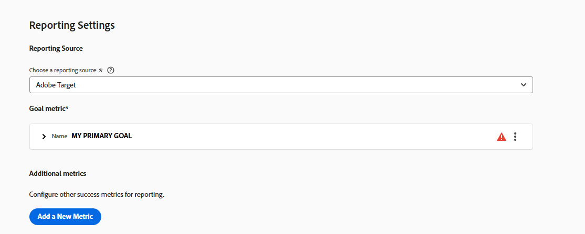

# 目標與設定 {#ab-goals-and-settings}

>[!BEGINSHADEBOX]

**在此頁面上：**&#x200B;瞭解您可以在A/B、體驗鎖定目標(XT)或多變數測試(MVT)活動的&#x200B;**[!UICONTROL 目標與設定]**&#x200B;頁面上設定哪些專案：活動設定、報表設定、進階設定和備註。

>[!ENDSHADEBOX]

[!DNL Adobe Target]中的&#x200B;**[!UICONTROL 目標與設定]**&#x200B;頁面是您指定活動目標相關資訊的位置。

可用的設定視您使用Target或[Analytics做為報表來源](/help/main/c-integrating-target-with-mac/a4t/a4t.md)而定。

相同的設定適用於[!UICONTROL 體驗鎖定目標] (XT)和[!UICONTROL 多變數測試] (MVT)活動，但[統計方法](#section_statistical-methodology)除外，其僅適用於A/B活動。

* [活動設定](#section_DCBDC354261F420EBD4B43EA34947BAC)：目標、優先順序和持續時間
* [報表設定](#section_13119392051044FBA6387D9B3B1C43CF)：報表來源、目標量度、其他量度和對象
* [進階設定](#section_E2FE441AFB324E498793ABB025ED9974)：相依性以及訪客達到目標後會發生什麼事
* [統計方法](#section_statistical-methodology)：如何分析結果
* [其他中繼資料](#section_2E8917BEFB954480A4206B9E9E917F80)：附註

## [!UICONTROL 活動設定] {#section_DCBDC354261F420EBD4B43EA34947BAC}

**[!UICONTROL 目標與設定]**&#x200B;頁面的&#x200B;**[!UICONTROL 活動設定]**&#x200B;區段可讓您設定下列選項。

### 目標 {#objective}

輸入可選目標。 目標可以是任何有助於您與您的團隊成員識別活動的資訊。

### 優先順序 {#priority}

如果將多個活動指派至具有相同客群的相同位置，則會使用優先順序。 如果將兩個以上活動指派至位置，則會顯示具有最高優先順序的活動。

根據您的設定，**[!UICONTROL 優先順序]**&#x200B;的[!DNL Target] UI和選項會有所不同：

* **舊版優先順序（預設）：**&#x200B;如果未在&#x200B;**[!UICONTROL 管理]** （預設）中啟用此選項，請指定優先順序為&#x200B;**[!UICONTROL 低]**、**[!UICONTROL Medium]**&#x200B;或&#x200B;**[!UICONTROL 高]**。
* **微調優先順序：**&#x200B;指定從0到999的值，其中0 = **[!UICONTROL 低]**&#x200B;和999 = **[!UICONTROL 高]**。

  若要啟用[微調優先順序](/help/main/administrating-target/reporting.md)，請存取&#x200B;**[!UICONTROL 管理]** > **[!UICONTROL 報告]**，然後切換&#x200B;**[!UICONTROL 啟用微調優先順序]**&#x200B;選項。

對於在舊版[!DNL Target]中建立的活動，**[!UICONTROL 低]**&#x200B;優先順序會轉換為0，**[!UICONTROL Medium]**&#x200B;會轉換為5，而&#x200B;**[!UICONTROL 高]**&#x200B;會轉換為10。 您可以視需要調整這些值。

>[!NOTE]
>
>在使用微調優先順序後，在您可以停用這些優先順序之前，必須將所有優先順序設定回0、5和10。

### 持續時間 {#duration}

活動可以在核准後開始，或者您可以設定特定的日期和時間。 同樣地，活動可以在停用時結束，或者您可以設定日期和時間。

時間選擇器使用 24 小時時鐘，午夜為 00:00。 時區會設為瀏覽器中設定的時區。 若要使用不同的時區，請將您的瀏覽器設定為其他時區並重新啟動瀏覽器。

## [!UICONTROL 報表設定] {#section_13119392051044FBA6387D9B3B1C43CF}

**[!UICONTROL 目標與設定]**&#x200B;頁面的&#x200B;**[!UICONTROL 報告設定]**&#x200B;區段可讓您設定下列選項。

### 報表來源 {#reporting-source}

指定收集來源的解決方案資料：

* [!DNL Adobe Target]

* [!DNL Adobe Analytics]

  +++ 深入瞭解Analytics作為報表來源

  請參閱 [Adobe Analytics 做為 Target的報表來源](/help/main/c-integrating-target-with-mac/a4t/a4t.md)來瞭解關於報表解決方案之間的差異與各自的優點。 選取[!DNL Analytics]做為[!DNL Target]的報告來源時，請選取[!DNL Analytics]報告套裝來接收[!DNL Target]活動資料。

  若要指定報表來源，請先從您帳戶繫結的[!DNL Analytics]家公司中選擇任一，接著為該活動選取適當的報表套裝。 只有布建為連線至[!DNL Adobe Target]的報表套裝才可供選取。 如果您沒有看到預期的報表套裝，請先嘗試登出並重新登入[!DNL Adobe Experience Cloud]以重試。 如果清單中仍缺少報表套裝，請聯絡客戶服務。

  [!DNL Analytics for Target] (A4T)需要追蹤伺服器才能正確回報結果。 預設追蹤伺服器會顯示在&#x200B;**[!UICONTROL 追蹤伺服器]**&#x200B;欄位中。 如果您使用多個追蹤伺服器，請確定您在此欄位中包含正確的追蹤伺服器。 如需詳細資訊，請參閱[使用Analytics追蹤伺服器](/help/main/c-integrating-target-with-mac/a4t/analytics-tracking-server.md#task_72077BA7E93C4A65A715A18F32228823)。
  +++

* [!DNL Adobe Customer Journey Analytics]

  +++ 深入瞭解Customer Journey Analytics作為報表來源

  請參閱 [!DNL Adobe Customer Journey Analytics]](/help/main/c-integrating-target-with-mac/cja/target-reporting-in-cja.md)中的[[!DNL Target] 報告，瞭解[!DNL Customer Journey Analytics]中支援的活動型別、沙箱和資料檢視選擇、目標量度和報告設定。
  +++

如果已在您的[帳戶設定](/help/main/administrating-target/reporting.md)中指定報表來源，則會使用指定的來源，而且此設定不會顯示。

為了讓報表保持一致，在活動上線後，您無法變更您的報表來源。

### 目標量度 {#goal-metric}

>[!NOTE]
>
>如果報表解決方案設為[!DNL Analytics]，唯一可用的目標量度是&#x200B;**[!UICONTROL 轉換]**。 無法選取[!DNL Analytics]個量度作為目標。

選取訪客為了達成目標採取的動作。 例如，選擇一個&#x200B;**[!UICONTROL 轉換]**&#x200B;量度，然後設定決定何時達到成功的引數。

如需關於設定量度的詳細資訊，請參閱[設定量度](/help/main/c-activities/t-test-ab/t-test-create-ab/ab-set-metrics.md)。

如需更多選項，請按一下目標量度旁的&#x200B;**[!UICONTROL 更多]**&#x200B;圖示，然後按一下&#x200B;**[!UICONTROL 進階設定]**。 請參閱[進階設定](#section_E2FE441AFB324E498793ABB025ED9974)。

如果已啟用，**[!UICONTROL 轉換的預計值]**&#x200B;欄位會提供目標的值，但不提供其他量度的值。 下列幾點適用於此欄位：

* 此值可讓[!DNL Target]計算收入的預估提升度。
* 欄位是選用欄位；但是，沒有它就無法計算任何非收入量度的增量收入。
* 此欄位不適用於&#x200B;**[!UICONTROL 頁面分數]**&#x200B;量度。
* 針對所有收入量度（**[!UICONTROL 每位訪客帶來的收入]**、**[!UICONTROL 平均訂單值]**、**[!UICONTROL 總銷售]**&#x200B;及&#x200B;**[!UICONTROL 訂單]**），預估會使用每位訪客帶來的&#x200B;**[!UICONTROL 收入]**。 資料類型為貨幣。

### 其他量度 {#additional-metrics}

如果報表解決方案設為[!DNL Analytics]，則無法使用此設定。 在此情況下，會套用為[!DNL Analytics]報表套裝定義的量度。

### 報表的對象 {#audiences-for-reporting}

依預設，報表會顯示所有符合資格訪客的結果。 您可以新增報表對象以顯示有關特定對象的資訊。

請注意，如果您選擇[!DNL Analytics]作為報表解決方案，則無法使用此設定。 已套用為[!DNL Analytics]報表套裝定義的對象。

## 進階設定 {#section_E2FE441AFB324E498793ABB025ED9974}

**[!UICONTROL 目標與設定]**&#x200B;頁面的&#x200B;**[!UICONTROL 進階設定]**&#x200B;區段可讓您設定進階選項。

若要指定進階設定，請按一下&#x200B;**[!UICONTROL 我的主要目標]**&#x200B;區段中的&#x200B;**[!UICONTROL 更多]**&#x200B;圖示（），然後按一下&#x200B;**[!UICONTROL 進階設定]**。

>[!NOTE]
>
>如果您使用 [!DNL Adobe Analytics] 作為您的報表來源，則設定是由 [!DNL Analytics] 伺服器管理。 進階設定選項無法使用。

### 遞增此量度時，應達到什麼成功量度? {#dependencies}

使用此選項時，如果某人先前達到不同的成功量度，則僅將其計算為達到成功量度。 例如，活動轉換可能只有在轉換之前訪客點選了選件，或達到特定頁面時才有效。

您可以提供多個量度上的相依性，並且具有彈性可選擇量度應為達到或未到達時計數才會增加。 定義兩個（或多個）成功量度，之後才可以讓某個量度相依於另一個量度。 **[!UICONTROL 「新增相依性」]**&#x200B;選項允許在已達到另一個成功量度或尚未達到時遞增成功量度。

若要新增相依性:

1. 新增其他量度後，按一下&#x200B;**[!UICONTROL 「進階設定」]**。

1. 按一下&#x200B;**[!UICONTROL 「新增相依性」]**&#x200B;選項。

1. 拖放所需的量度，然後按一下&#x200B;**[!UICONTROL 已達到]**&#x200B;以在&#x200B;**[!UICONTROL 已達到]**&#x200B;與&#x200B;**[!UICONTROL 未達到]**&#x200B;之間切換設定。

您可以在新增相依性之後加以編輯或移除。

### 使用者達到此目標量度後會發生什麼事? {#after-goal}

達到活動目標之後，訪客會繼續看見活動內容，除非該訪客符合較高優先順序活動的資格。 如果訪客再次達到目標，將會將其計為另一次轉換。 這與[!DNL Target Classic]中的預設行為不同，如果訪客再次看到活動，則會計為新訪客。

有三個選項可控制訪客達到目標量度後會發生什麼事:

* **[!UICONTROL 增加計數以及讓使用者留在活動中]**&#x200B;以指定計數的增加方式。
* **[!UICONTROL 增加計數、釋出使用者並允許重新進入]**，以指定使用者重新進入活動時看到的體驗。
* **[!UICONTROL 增加計數、釋出使用者以及禁止重新進入]**，以指定使用者會看見的內容，而非活動內容。

### 計數將如何增加? {#count-increment}

計數的遞增方式共有三個選項:

* 每個加入者&#x200B;**[!UICONTROL 一次]**
* 每次曝光時&#x200B;**[!UICONTROL （排除頁面重新整理）]**
* 每次曝光時&#x200B;****

請參閱[成功量度](/help/main/c-activities/r-success-metrics/success-metrics.md#overview)以取得關於進階設定的詳細資訊。

## 統計方法 {#section_statistical-methodology}

**[!UICONTROL 目標與設定]**&#x200B;頁面的&#x200B;**[!UICONTROL 統計方法]**&#x200B;區段可讓您選擇分析實驗結果的方式。

### 方法選項 {#methodology-options}

這個選擇會決定用於此活動的&#x200B;**[!UICONTROL 轉換]**&#x200B;目標量度的統計架構、結果量度和決定條件：

* **[!UICONTROL Bayesian]：**&#x200B;以機率為基礎的決策，可在資料到達時更新信念，並支援持續監控和較小的樣本大小。 結果是以一個變體勝過另一個變體的機率來表示，例如「92%的機率是變體B勝過控制」。
  * 最適合較小樣本量、持續監控、偏好機率的利害關係人，或您擁有過去測試的先前知識時適用。
  * 如果您需要嚴格的法規或法規簽核，或需要傳統的p值，則不理想。
  * 報表顯示&#x200B;**[!UICONTROL 擊敗控制項]**&#x200B;的機會和可信的間隔，而不是頻率最高的&#x200B;**[!UICONTROL 信賴度]**&#x200B;欄。
* **[!UICONTROL Welch的t檢定(Frequentist)]：**&#x200B;現有的傳統假設測試方法。 使用p值並需要固定的樣本大小。 報表顯示&#x200B;**[!UICONTROL 信賴]**&#x200B;百分比和信賴區間。

此設定僅適用於主要目標量度為&#x200B;**[!UICONTROL 轉換]**&#x200B;的活動。 具有&#x200B;**[!UICONTROL 收入]**&#x200B;或&#x200B;**[!UICONTROL 參與]**&#x200B;主要目標的活動一律使用&#x200B;**[!UICONTROL Welch的t檢定]**。

如需關於如何計算及報告每個方法的詳細資訊，請參閱[A/Bn測試中的統計計算](/help/main/c-reports/statistical-methodology/statistical-calculations.md)。

### Bayesian設定 {#bayesian-configuration}

此設定只有在選取&#x200B;**[!UICONTROL Bayesian]**&#x200B;做為&#x200B;**[!UICONTROL 統計方法]**&#x200B;時才會顯示。 設定以下選項:

* **[!UICONTROL 可信區間]**：設定預期實際效果落下的範圍。
* **[!UICONTROL 決定臨界值]**：設定變體在宣告獲勝者之前必須達到的最小機率（相對於&#x200B;**[!UICONTROL 控制項]**）。
* **[!UICONTROL 使用過去測試的先前知識？]**：開啟此選項以提供過去效能的先前知識，以通知&#x200B;**[!UICONTROL Bayesian]**&#x200B;計算。

## 其他中繼資料 {#section_2E8917BEFB954480A4206B9E9E917F80}

**[!UICONTROL 目標與設定]**&#x200B;頁面的&#x200B;**[!UICONTROL 其他中繼資料]**&#x200B;區段可讓您指定有關您的活動的任何資訊，這些資訊有助於您自己或其他團隊成員隨時掌握。
