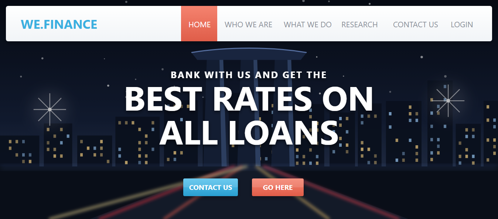

# 體驗範本 {#experience-templates}

>[!BEGINSHADEBOX]

**在此頁面上：**&#x200B;尋找可用於自訂程式碼的[!DNL Adobe Target]個體驗範本，以及每個範本的常用用途。

>[!ENDSHADEBOX]

[!DNL Adobe Target]體驗範本是預先編碼的範例，具有可設定的輸入，用來執行常見行銷人員使用案例。 開發人員與行銷人員可透過VEC或表單式體驗撰寫器，免費使用這些擴充功能作為執行常見使用案例的起點。

Adobe Marketing Cloud GitHub目前提供下列範本： [Target-Experience-Templates](https://github.com/Adobe-Marketing-Cloud/target-experience-templates)。

## Banner Carousel with Thumbnails {#banner-carousel-thumbnails}

[Banner Carousel with Thumbnails 體驗範本](https://github.com/Adobe-Marketing-Cloud/target-experience-templates/tree/master/banner-carousel-thumbnails)為旋轉輪播，通常用於首頁頁面、登陸頁面或其他高流量登入頁面。 此輪播不會自動在影像中旋轉。 您可以按一下主要影像下方的較小影像，直接與互動。

## Banner Carousel {#banner-carousel}

[Banner Carousel 體驗範本](https://github.com/Adobe-Marketing-Cloud/target-experience-templates/tree/master/banner-carousel)為旋轉輪播，通常用於首頁頁面、登陸頁面或其他高流量登入頁面。 此輪播不會自動在影像中旋轉。 您可以按一下左右箭頭，直接與進行互動。

## Banner Countdown {#banner-countdown}

[Banner Countdown 體驗範本](https://github.com/Adobe-Marketing-Cloud/target-experience-templates/tree/master/banner-countdown)為中央有倒數計時的大型橫幅，通常用於首頁頁面、登陸頁面或其他高流量登入頁面。

![Banner Countdown範本：含有以天、小時、分鐘和秒為單位之倒數計時的大型橫幅，以及[前往這裡]按鈕](assets/exp-template-banner-countdown.png)

## Button Builder {#button-builder}

[Button Builder 體驗範本](https://github.com/Adobe-Marketing-Cloud/target-experience-templates/tree/master/button)為帶有動作呼叫文字的小按鈕。 按鈕可供設定。 它可放置在頁面上的任何位置，以新增新的call to action，或使用可設定性更強的替代按鈕來取代現有按鈕。

## Lightbox with Countdown {#lightbox-countdown}

[Lightbox with Countdown 體驗範本](https://github.com/Adobe-Marketing-Cloud/target-experience-templates/tree/master/lightbox-countdown)為中央有倒數計時的燈箱覆蓋彈出式視窗，通常用於首頁頁面、登陸頁面或其他高流量登入頁面。

![包含倒數計時的燈箱範本：包含倒數計時的快顯視窗、[前往這裡]按鈕，以及[謝謝]連結](assets/exp-template-lightbox-countdown.png)

## Lightbox with Exit Intent {#lightbox-exit-intent}

[具有退出意圖的燈箱體驗範本](https://github.com/Adobe-Marketing-Cloud/target-experience-templates/tree/master/lightbox-exit-intent)為退出意圖的燈箱覆蓋彈出式視窗（將滑鼠移至熒幕右上方）。 它可部署在想最後吸引注意力的任何Web屬性上。

![Lightbox with Exit Intent範本：提供折扣的快顯視窗，包含[前往這裡]按鈕和[不謝]連結](assets/exp-template-lightbox-exit.png)

## Lightbox {#lightbox}

[燈箱體驗範本](https://github.com/Adobe-Marketing-Cloud/target-experience-templates)是具有內建延遲的燈箱覆蓋彈出式視窗，通常用於首頁頁面、登陸頁面或其他高流量登入頁面。

## Ribbon {#ribbon}

[功能區體驗範本](https://github.com/Adobe-Marketing-Cloud/target-experience-templates/tree/master/ribbon)是插入網頁最上方的100%寬度功能區。 它通常用於表示限時搶購、免運費、安全性或天氣事件，或其他重要公告。

