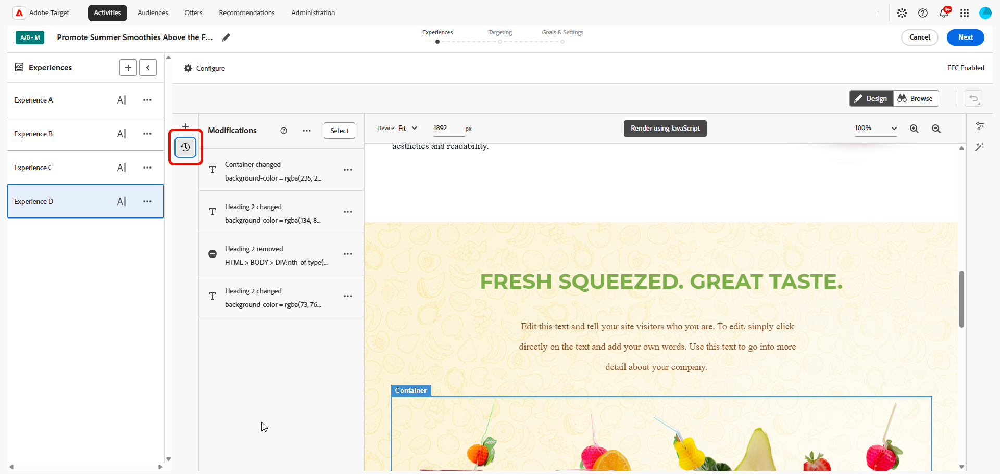
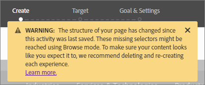

# 開始修改 {#vec-code-editor}

>[!BEGINSHADEBOX]

**在此頁面上：**&#x200B;瞭解如何在[!UICONTROL 視覺化體驗撰寫器] (VEC)的&#x200B;**[!UICONTROL 修改]**&#x200B;面板中檢視、編輯、刪除和新增修改，以及如何使用自訂程式碼。

>[!ENDSHADEBOX]

[!DNL Adobe Target]中的&#x200B;**[!UICONTROL 修改]**&#x200B;面板會顯示對[!UICONTROL 視覺化體驗撰寫器] (VEC)中的頁面所做的所有變更，並允許透過按一下頁面上的每個元素並[選取動作](/help/main/c-experiences/c-visual-experience-composer/viztarget-options.md)進行其他變更。 每個變更在&#x200B;**[!UICONTROL 修改]**&#x200B;清單中都顯示為個別的動作或元素。 修改內容也可以直接新增為下列型別： CSS選取器、Mbox及自訂程式碼。

## 修改概觀 {#modifications-overview}

**[!UICONTROL 修改]**&#x200B;頁面會對[!DNL Target]在VEC設定傳送內容的方式時選擇的選取器做些微變更。 可變更內容或HTML屬性。 您也可以編輯程式碼，在mbox中建立等同於HTML選件的專案。

的動作

**[!UICONTROL 修改]**&#x200B;頁面可用於：

* 檢視在可視化撰寫器中採取的動作。

  

* 編輯現有動作。 存取進階功能表並選取&#x200B;**[!UICONTROL 編輯]**。

  

  進行變更。

  

* 刪除現有動作。 存取進階功能表並選取&#x200B;**[!UICONTROL 刪除修改]**。

  

* 新增修改。 存取&#x200B;**[!UICONTROL 修改]**&#x200B;功能表進階功能表，並選取&#x200B;**[!UICONTROL 新增修改]**，然後指定變更，如[新增修改](#add-modifications)中所述。

  

## 新增修改 {#add-modifications}

修改是從VEC中所選體驗的&#x200B;**[!UICONTROL 修改]**&#x200B;面板新增的。

1. 若要顯示&#x200B;**[!UICONTROL 修改]**，請按一下&#x200B;**[!UICONTROL 顯示修改]**。

   在視覺化體驗撰寫器的工具列中反白顯示

   若要在表單式體驗撰寫器中開啟&#x200B;**[!UICONTROL 修改]**&#x200B;面板，請建立或編輯HTML選件。 如需詳細資訊，請參閱 [表格式體驗撰寫器](/help/main/c-experiences/form-experience-composer.md)。

1. 若要新增修改:

   * 如果之前未對體驗進行任何修改，請從&#x200B;**[!UICONTROL 修改]**&#x200B;面板按一下&#x200B;**[!UICONTROL 新增修改]**。
   * 如果之前對體驗進行了修改，請存取&#x200B;**[!UICONTROL 修改]**&#x200B;功能表進階功能表，並選取&#x200B;**[!UICONTROL 新增修改]**。

   顯示&#x200B;**[!UICONTROL 修改]**&#x200B;面板：

   ![視覺化體驗撰寫器，右側會開啟修改面板，顯示[修改型別]、[CSS元素選取器]、[動作型別]和[內容]欄位](assets/codeeditor_page_mods_add.png)

1. 從&#x200B;**[!UICONTROL 修改型別]**&#x200B;下拉式清單中，選擇所要的型別：

   | 修改型別 | 詳細資料 |
   |--- |--- |
   | CSS 選擇器 | 在&#x200B;**[!UICONTROL CSS元素選取器]**&#x200B;方塊中，指定要修改的CSS元素，選取動作型別（**[!UICONTROL 設定內容]**&#x200B;或&#x200B;**[!UICONTROL 設定屬性]**），然後填寫必要的資訊和需要的內容。 |
   | mbox | 指定mbox名稱和所需內容。 |
   | 自訂程式碼 | 指定選擇性名稱，視需要選取或取消選取`<HEAD>`區段&#x200B;**中的**&#x200B;新增程式碼核取方塊，然後新增自訂程式碼。 如需詳細資訊，請參閱[自訂程式碼](#custom-code)。 |

   >[!NOTE]
   >
   >使用at.js 2.*x*&#x200B;的頁面中，VEC不再支援mbox。 因應措施：
   >
   >* 如果使用at.js 2.*x*，請新增CSS選取器修改而非Mbox修改，並在mbox正在使用的選取器上新增內容。
   >* 使用表單式活動（適用於mbox和at.js 1.*x*&#x200B;和at.js 2.*x*）。
   >* 在VEC中使用at.js 1.*x*。

1. 視需要新增其他修改。

## 自訂程式碼 {#custom-code}

自訂程式碼提供一個非可視化介面，用於在 VEC、表單式體驗撰寫器和 HTML 產品建議編輯器中檢視、編輯和新增新動作。 該面板提供體驗的程式碼檢視，以協助建立更複雜的體驗，微調現有的體驗並疑難排解問題。

自訂程式碼適用於熟悉 HTML、JavaScript 和 CSS 的進階使用者。 程式碼檢視有助於調整或微調變更，或修正選取器問題。 也可用來新增自訂程式碼和動作。 可以新增多個自訂程式碼，也可以選擇命名每個程式碼。


自訂程式碼的行為如下：

* 選取&#x200B;**[!UICONTROL 在`<HEAD>`區段]**&#x200B;中新增程式碼時，自訂程式碼會新增至`<head>`區段，不會等候內文或頁面載入事件便開始執行。 僅新增 `<script>` 和 `<style>` 元素。 新增`<div>`標籤和其他元素可能導致剩餘的`<head>`元素出現在`<body>`中。 如果使用at.js，則所有選件都會以非同步方式傳送。
* 取消選取&#x200B;**[!UICONTROL 在`<HEAD>`區段]**&#x200B;中新增程式碼時，自訂程式碼會在`<body>`標籤之後立即執行。 請使用單一`<div>`將所有程式碼換行，以保留DOM結構。 如果使用at.js，則所有選件都會以非同步方式傳送。
* 如果`<BODY>`的HTML包含`<SCRIPT>`和`<DIV>`，則會將`<DIV>`附加至`<BODY>`並在`<HEAD>`中執行`<SCRIPT>`。 載入外部檔案的`<SCRIPT>`也會附加至`<HEAD>`。
* 指令碼會以非同步方式執行。 這表示無法使用`document.write`和類似的指令碼方法。
* 自訂程式碼目前僅適用於A/B和體驗鎖定目標(XT)活動。 如果已套用重新導向產品建議，則會停用覆蓋的自訂程式碼。

自訂程式碼支援下列使用案例:

* 新增要在頁面頂端執行的自訂JavaScript、HTML或CSS
* 檢視或編輯VEC在修改後產生的程式碼
* 設定選取器的 HTML 內容 (僅限 CSS 選取器)
* 設定 HTML 元素的屬性
* 新增要在地區 mbox 中傳送的產品建議內容
* 在 DOM 就緒時交換，使用 jQuery
* 在 DOM 就緒上交換，無 jQuery (不支援 Internet Explorer 8)
* 透過「elementOnLoad」外掛程式，與DOM輪詢交換
* 自訂重新導向

自訂程式碼提供:

* 行號讓使用性更好。
* 語法醒目提示，有助於避免HTML選件的語法不正確。
* 可建立多個自訂程式碼，並為每個程式碼提供選擇性名稱。 建立多個自訂程式碼可讓日後偵錯更加輕鬆。 例如，您可以為每個修改建立個別的自訂程式碼，並使用描述性名稱來完成，而不是建立單一自訂程式碼來完成數項修改。 獨立的自訂程式碼可讓修改更模組化且易於管理。 系統不保證會在活動中執行多個自訂程式碼，但會按照建立的順序執行。

**[!UICONTROL 修改]**&#x200B;面板在視覺模式和程式碼模式之間分割熒幕。 兩種模式會維持同步。 在視覺上所做的每一項修改，在程式碼檢視中都有相應的一列。 同樣地，程式碼檢視提交的每個變更都會顯示在視覺體驗中。 按一下程式碼檢視中的任何列，可選取視覺化頁面上的對應元素。

自訂程式碼支援 HTML、指令碼和樣式。 任何有效的 HTML 程式碼或指令碼都可新增或編輯。

## 自訂程式碼範例 {#custom-code-examples}

**[!UICONTROL 「自訂程式碼」]**&#x200B;面板包含在頁面載入開始時執行的程式碼。 可在`<head>`標籤中執行JavaScript程式碼。 程式碼執行時不會等待DOM中出現`<body>`標籤。 後續視覺化動作的選取器，會根據此標籤中新增的 HTML 元素而定。

**[!UICONTROL 自訂程式碼]**&#x200B;面板通常用於將JavaScript或CSS新增至頁面頂端。

使用&#x200B;**[!UICONTROL 「自訂程式碼」]**&#x200B;標籤來執行下列動作:

* 使用內嵌 JavaScript 或外部 JavaScript 檔案的連結

  例如，若要變更元素的顏色：

  ```javascript
  <script type="text/javascript"> 
  document.getElementById("element_id").style.color = "blue"; 
  </script> 
  ```

* 設定內嵌樣式或外部樣式表的連結

  例如，若要定義覆蓋元素的類別:

  ```html
  <style> 
  .overlay 
  { position: absolute; top:0; left: 0; right: 0; bottom: 0; background: red; } 
  </style> 
  ```

* 新增 HTML 程式碼片段來定義新元素

  例如，使用下列HTML程式碼片段，建立使用以上所定義CSS類別的覆蓋`<div>`：

  ```html
  <div class="overlay"></div>
  ```

* 在 DOM 就緒時交換，使用 jQuery

  下列範例假設當[!DNL Target]執行優惠方案時，客戶的網站在頁面上有jQuery可用。

  ```javascript
  <style>#default_content {visibility:hidden;}</style> 
  <script> 
  jQuery( document ).ready(function() { 
      jQuery("#default_content").html( "<span style='color:red'>Hello <strong>Again</strong></span>" ); 
      jQuery("#default_content").css("visibility","visible"); 
  }); 
  </script> 
  ```

* 在 DOM 就緒上交換，無 jQuery (不支援 Internet Explorer 8)

  ```javascript
  <style>#default_content {visibility:hidden;}</style> 
  <script> 
  document.addEventListener("DOMContentLoaded", function(event) {  
      document.getElementById("default_content").innerHTML = "<span style='color:red'>Hello <strong>Again</strong></span>"; 
      document.getElementById("default_content").style.visibility="visible"; 
  }); 
  </script> 
  ```

* 傳遞現有引數、`s_tnt`引數（用於與Analytics的舊版整合）、反向連結引數和mbox工作階段的自訂重新導向

  ```javascript
  <style type="text/css">body{display:none!important;}</style> 
  <script type="text/javascript"> 
   var qs='';window.location.search?qs=window.location.search+'&':qs='?'; 
   window.location.replace('//www.mywebsite.com/'+qs+'s_tnt=${campaign.id}:${campaign.recipe.id}:${campaign.recipe.trafficType}&s_tntref='+encodeURIComponent(document.referrer)+'&mboxSession='+mboxFactoryDefault.getSessionId().getId()+''+window.location.hash+''); 
  </script> 
  ```

* 新增[!DNL Adobe Target]個體驗範本以用於自訂程式碼

  體驗範本是預先編碼的範例，具有可設定的輸入，用於執行常見行銷人員使用案例。 開發人員與行銷人員可透過VEC或表單式體驗撰寫器，免費使用這些擴充功能作為執行常見使用案例的起點。 使用案例包括燈箱、輪播、倒數等專案。 如需詳細資訊，請參閱[體驗範本](/help/main/c-experiences/c-visual-experience-composer/c-vec-code-editor/experience-templates.md)。

## 自訂程式碼最佳作法 {#custom-code-best-practices}

* **請一律將自訂程式碼包裝在一個元素中。**

  例如：

```html
<div id="custom-code"> 
// My Code goes here 
</div>
```

如需修改，請在此容器中進行變更。 如果不再需要自訂程式碼，請將此容器留空，但不要將其移除。 這可確保其他體驗修改不受影響。

* **針對在程式碼編輯器中對頁面所做的修改，請勿使用元素 ID &quot;CDQID&quot;。**

  [!DNL Target]將值為「CDQID」的新元素ID套用至頁面上由[!DNL Target]修改的任何元素。 此ID由[!DNL Target]套用，因此不應該用於程式碼編輯器中的任何進一步修改或調整。

* **請勿在自訂程式碼指令碼中執行`document.write`動作。**

  指令碼會非同步執行。 這通常會導致`document.write`動作出現在頁面上的錯誤位置。 不建議在自訂程式碼中建立的指令碼中使用 `document.write`。

* **如果專案建立後修改，請勿刪除原始專案。**

  每次變更都會在&#x200B;**[!UICONTROL 修改]**&#x200B;面板中建立新元素。 第二個動作會修改元素1，因此如果元素1被刪除，該動作便沒有任何專案需要修改，且變更不再有作用。 如需詳細資訊，請參閱[疑難排解自訂程式碼](#troubleshooting-custom-code)。

* **針對相同URL的兩個活動使用自訂程式碼功能時，請小心。**

  當自訂程式碼功能用於目標為相同URL的兩個活動時，JavaScript會從兩個活動插入到頁面中。 [!DNL Target]會自動決定傳遞內容的順序。 請確定程式碼不取決於放置位置。 程式碼作者負責確保程式碼中沒有衝突。

## 疑難排解自訂程式碼 {#troubleshooting-custom-code}

+++ 為何使用`triggerView`時未執行自訂程式碼？

當使用 `{page: false}` 做為選項呼叫 `triggerView()` 時，VEC 中的自訂程式碼產品建議不會重新呈現。

+++

+++ 因頁面中的結構變更而無法套用動作的警告是什麼意思？

此訊息指出自上次儲存活動以來，頁面結構已變更。



使用「瀏覽」模式可能會遇到遺失的選取器。 Adobe建議刪除並重新建立每個體驗，以確保內容如警告訊息中所示，如預期般顯示。

+++

+++ 「刪除此動作可能會影響後續動作」警告是什麼意思？

例如，可能已採取兩個動作：

* 已新增類別至元素 1
* 已編輯元素 1 的 HTML

每次變更都會在&#x200B;**[!UICONTROL 修改]**&#x200B;面板中建立新元素。 第二個動作會修改元素1，因此如果元素1被刪除，第二個動作便沒有任何專案需要修改，且變更不再有作用。

換言之，如果元素是以文字加入，然後以個別動作中的不同文字編輯元素，**[!UICONTROL 修改]**&#x200B;面板會將兩個動作顯示為個別的元素。 編輯元素會建立可修改原始元素並包含已編輯文字的新元素。 如果隨後刪除了原始元素，則編輯的文字將找不到已編輯的元素，並且不會顯示。 第二個元素會保留在元素清單中，但不會影響頁面，因為其變更的元素已不存在。

+++

+++ 為什麼在指令碼中使用`document.write`建立的元素沒有出現在預期的地方？

指令碼會非同步執行。 這通常會導致`document.write`動作出現在頁面上的錯誤位置。 Adobe 建議不要在自訂程式碼建立的指令碼中使用 `document.write`。

+++

+++ 為何JavaScript會在自訂程式碼中顯示錯誤？

任何無效的JavaScript內嵌JavaScript都會在自訂程式碼中顯示錯誤。

+++

+++ 為何無法復原自訂程式碼中的變更？

目前，在&#x200B;**[!UICONTROL 修改]**&#x200B;面板和自訂程式碼中的編輯和刪除動作不支援復原。 復原其中一個操作可能會導致 VEC 中的體驗與自訂程式碼中可見的實際動作不一致。 不過，自訂程式碼中的動作處於正確狀態，對傳送沒有影響。 這是 UI 問題。 若要重新整理體驗，請儲存再重新開啟，或移至下一步再回來。 這兩個動作都會重新載入體驗，因此會如預期顯示，而且與&#x200B;**[!UICONTROL 修改]**&#x200B;面板中的動作一致。

+++

+++ 為何自訂程式碼在Internet Explorer 8中未產生預期結果？

[!DNL Target]不再支援Internet Explorer 8。

+++
