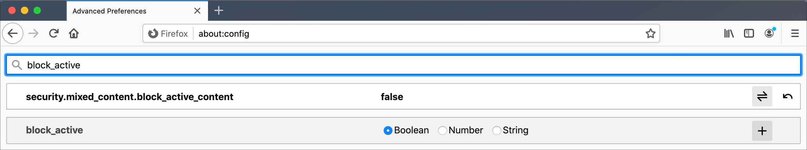

# 在瀏覽器中啟用混合式內容 {#mixed-content}

>[!BEGINSHADEBOX]

**在此頁面：**&#x200B;瞭解如何在[!DNL Google Chrome]、[!DNL Mozilla Firefox]和[!DNL Microsoft Edge]中啟用混合式內容，讓&#x200B;**[!UICONTROL 視覺化體驗撰寫器]** (VEC)可以開啟包含混合式內容的HTTP網站和網站。

>[!ENDSHADEBOX]

當透過HTTPS安全地請求頁面，但同時載入HTTPS和HTTP內容時，該頁面會包含混合式內容。 HTTPS內容是安全的，而HTTP內容則否，因此現代瀏覽器可能會封鎖此類頁面或顯示警告訊息。

當[!DNL Adobe Target]中的&#x200B;**[!UICONTROL 視覺化體驗撰寫器]** (VEC)嘗試開啟包含混合式內容的頁面時，會顯示警告訊息，並附上停用瀏覽器中封鎖的指示。 停用封鎖功能可開啟HTTP網站或具有混合式內容（HTTPS和HTTP）的網站。

先前，當不允許混合內容時，三步驟引導式工作流程步驟1中的某些動作仍可使用。 [!DNL Target]現在會封鎖步驟1中的所有動作，因此必須先啟用混合式內容，才能繼續建立活動。

瀏覽器的安全性設定可能會封鎖載入到安全(HTTPS)頁面或框架（例如VEC）的不安全(HTTP)內容。 變更這些設定的替代方案是HTTPS網站。 如果網站在不安全(HTTP)網域中執行，則必須允許VEC載入使用中的混合式內容。

>[!IMPORTANT]
>
>允許混合式內容只會影響VEC，不影響已上線的網站。

如需詳細資訊，請參閱 *Mozilla Developer Network* (MDN) 網站上的[混合式內容](https://developer.mozilla.org/en-US/docs/Web/Security/Mixed_content)。

## 在[!DNL Google Chrome]中啟用混合式內容

[!DNL Chrome]會檢查透過安全連線要求的頁面內容是否已安全地傳輸。 請參閱 Google Chrome 說明中的「[管理不安全網站的警告](https://support.google.com/chrome/answer/99020?hl=en)」。

若要搭配最新版[!DNL Chrome] （版本79.0.3945.117或更新版本）使用VEC，請依照下列方式更新網站設定。 網站的訪客不需要完成這些步驟。

1. 按一下掛鎖（警告）圖示，然後按一下&#x200B;**[!UICONTROL 網站設定]**。

   ![連線功能表已開啟且[網站]設定反白顯示的Chrome位址列](/help/main/c-experiences/c-visual-experience-composer/r-troubleshoot-composer/assets/site-settings.png)

1. 在&#x200B;**[!UICONTROL 不安全內容]**&#x200B;下，將下拉式清單中的「封鎖（預設）」變更為「允許」。

   

1. 重新載入 VEC 頁面。

## 在[!DNL Mozilla Firefox]中啟用混合式內容

根據預設，[!DNL Firefox]會封鎖混合了安全和不安全內容的頁面，因此必須永久變更此設定才能使用[!DNL Target]。 網站的訪客不需要完成這些步驟。

1. 在[!DNL Firefox]中，在位址列中輸入`about:config`。
1. 認可[!DNL Firefox]顯示的警告訊息。

   ![Firefox繼續警告頁面，顯示約:config的[接受風險並繼續]按鈕](/help/main/c-experiences/c-visual-experience-composer/r-troubleshoot-composer/assets/firefox.png)

1. 在搜尋列中輸入`block_active`。

   

1. 連按兩下`security.mixed_content.block_active_content`。

   值會從「True」變更為「False」。 當值顯示「False」時，變更即完成。

   

1. 變更此設定後，請重新啟動電腦。

## 在[!DNL Microsoft Edge]中啟用混合式內容

[!DNL Edge]會檢查透過安全連線要求的頁面內容是否已安全地傳輸。 若要搭配最新版[!DNL Edge]使用VEC，請更新網站設定，如下所示。 網站的訪客不需要完成這些步驟。

1. 在[!DNL Edge]中，按一下功能表列中的&#x200B;**[!DNL Microsoft Edge]**，按一下&#x200B;**[!UICONTROL 設定]**，然後按一下&#x200B;**Cookie與網站許可權**。
1. 捲動到&#x200B;**[!UICONTROL 不安全的內容]**&#x200B;並按一下它。
1. 在&#x200B;**[!UICONTROL 允許]**&#x200B;旁邊，按一下&#x200B;**[!UICONTROL 新增]**，輸入允許不安全內容的網站，然後按一下&#x200B;**[!UICONTROL 新增]**。
1. 重新載入 VEC 頁面。
