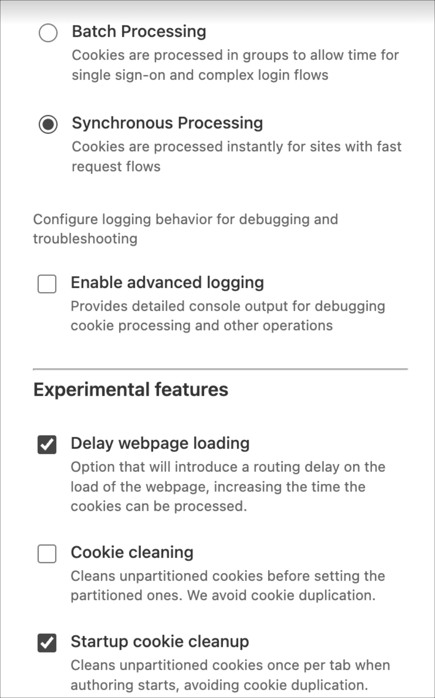

# [!UICONTROL Visual Editing Helper]擴充功能 {#visual-editing-helper}

>[!BEGINSHADEBOX]

**在此頁面上：**&#x200B;瞭解&#x200B;**[!UICONTROL Visual Editing Helper]**&#x200B;瀏覽器擴充功能如何可靠地在&#x200B;**[!UICONTROL 視覺化體驗撰寫器]** (VEC)中載入網站，以及如何安裝及使用它。

>[!ENDSHADEBOX]

[!DNL Google Chrome]的[!DNL Adobe Experience Cloud] **[!UICONTROL Visual Editing Helper]**&#x200B;瀏覽器擴充功能會在[!DNL Adobe Target] **[!UICONTROL Visual Experience Composer]** (VEC)中以可靠的方式載入網站，讓製作及檢查網頁體驗的速度更快。

>[!IMPORTANT]
>
>此擴充功能會取代之前的[Target VEC Helper瀏覽器擴充功能](/help/main/c-experiences/c-visual-experience-composer/r-troubleshoot-composer/vec-helper-browser-extension.md)，如該文章頂端的重要備註所述。 資訊清單V3引進了安全性增強功能，因此[!DNL Adobe]需要下載此新的擴充功能，才能繼續在[!DNL Target]中以視覺化方式製作網站。

## 為什麼有些網站無法在VEC中以可靠的方式開啟

網站可能無法可靠地在VEC中開啟，原因如下：

* 網站的安全性原則過於嚴格。
* 網站架設在 iFrame 中。
* 客戶的QA或測試網站為內部網站，網路外部不可用。

此擴充功能解決這些網站載入問題，若未解決，客戶將依賴[增強體驗撰寫器](/help/main/administrating-target/visual-experience-composer-set-up.md#eec)或第三方擴充功能，例如Requestly。

## 擴充功能的優點

* **已移除Iframe-busting標頭：**&#x200B;擴充功能會隱含地從網站移除`X-Frame-Options`和`Content-Security-Policy`等標頭，因此不需要複雜的Requestly規則。
* **at.js插入：**&#x200B;當網頁尚未包含[!DNL Target] at.js資料庫時，擴充功能可以插入該資料庫。 接著，您就可以為網站製作體驗，並透過預覽連結來建立及檢查活動。 使用[增強體驗撰寫器](/help/main/administrating-target/visual-experience-composer-set-up.md#eec) (EEC)時，此擴充功能不會插入at.js，但SameSite Cookie功能會保留。 若要在網頁上插入at.js，請關閉EEC。
* **行動檢視區：** [行動檢視區](/help/main/c-experiences/c-visual-experience-composer/mobile-viewports.md)即使沒有&#x200B;**[!UICONTROL 增強體驗撰寫器]** (EEC)也受到支援。
* **新[!DNL Target]客戶：**&#x200B;此擴充功能可讓您嘗試使用[!DNL Target]，即使IT開發人員尚未在網站上實作[!DNL Target]亦然。
* **合作夥伴：**&#x200B;為多位客戶的網站和[!DNL Target]帳戶提供服務的合作夥伴，可獲得一個支援VEC載入的機制，取代協力廠商工具中的多個規則。

## 取得並安裝擴充功能

在[!DNL Chrome]中安裝擴充功能可讓您可靠地在VEC中載入網站，包括封鎖iframe或尚未實作at.js的網站。

1. 移至Chrome網站商店](https://chrome.google.com/webstore/detail/adobe-experience-cloud-vi/kgmjjkfjacffaebgpkpcllakjifppnca){target=_blank}中的[[!DNL Adobe Experience Cloud] **[!UICONTROL Visual Editing Helper ]**瀏覽器擴充功能。
1. 按一下&#x200B;**[!UICONTROL 新增至Chrome]** > **[!UICONTROL 新增擴充功能]**。
1. 在 [!DNL Target] 中開啟 VEC。
1. 在VEC或QA模式中，按一下[!DNL Chrome]工具列中的&#x200B;**[!UICONTROL Visual Editing Helper]**&#x200B;瀏覽器擴充功能圖示（ ）。

   擴充功能會在[!DNL Target] VEC中開啟網站時自動啟用，以支援撰寫。 它沒有條件設定，而且會自動處理所有設定，包括SameSite Cookie設定。 如需`SameSite=None`屬性瀏覽器修正的詳細資訊，請參閱[Google Chrome SameSite Cookie原則](/help/main/c-experiences/c-visual-experience-composer/r-troubleshoot-composer/issues-related-to-the-visual-experience-composer-vec-and-enhanced-experience-composer-eec.md#samesite)。

## 使用說明

* 此擴充功能會載入[!DNL Target] UI中&#x200B;**[!UICONTROL 管理]** > **[!UICONTROL 實作]**&#x200B;下可用的最新版at.js，而且at.js會下載撰寫程式庫。
* 若要使用擴充功能在[QA模式](/help/main/c-activities/c-activity-qa/activity-qa.md)中插入at.js，必須開啟另一個Chrome索引標籤。 此索引標籤必須驗證給建立活動的相同[!DNL Adobe Experience Cloud]組織。
* VEC會顯示訊息，建議您在下列情況下安裝擴充功能：

  * 網站無法載入VEC。
  * 網站上尚未實作at.js或alloy.js。

* 如果已嘗試新的擴充功能，但再次使用[舊擴充功能](/help/main/c-experiences/c-visual-experience-composer/r-troubleshoot-composer/vec-helper-browser-extension.md)，但[!DNL Target]無法載入網站，請清除所有瀏覽器資料並停用新的擴充功能。

## 擴充功能的最新變更（2026年1月17日）

此擴充功能會將startup cookie cleanup實驗功能新增至VEC Helper。 此功能會在編寫開始時為每個索引標籤清除一次未分割的Cookie，而非持續進行，這麼做可改善效能和可靠性。 它會追蹤每個標籤的歷史記錄，以防止多餘的清除，並在標籤關閉時清除該歷史記錄，因此在標籤重新開啟時清除會正確運作。 單元測試可確保一致的行為。

## 常見問題集

+++ 當擴充功能用於[!DNL Adobe Target]或[!UICONTROL Adobe Journey Optimizer] (AJO)之外時，它是否會執行任何動作？

只有當網站載入[!DNL Adobe]產品([!DNL Target]、[!DNL AJO])的iFrame中時，擴充功能才會啟動。 在此流程之外，擴充功能不會嘗試新增、移除或修改任何標題，也不會嘗試在網站內插入任何程式碼。

+++

+++ 當擴充功能在 [!DNL Adobe Target]VEC 中處於作用中狀態時會採取什麼行動？

當網站載入[!DNL Adobe]產品([!DNL Target]、[!DNL AJO])的iFrame中時，擴充功能會將隨擴充功能整合的程式碼插入網站中，並下載來自[!DNL Adobe] CDN的說明檔案，以啟用視覺化撰寫。

+++
