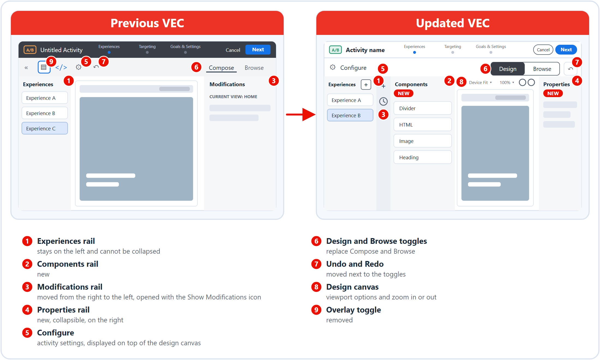

# [!UICONTROL 視覺化體驗撰寫器]變更 {#vec-changes}

>[!BEGINSHADEBOX]

**在此頁面：**&#x200B;瞭解[!DNL Adobe Target Standard/Premium] 25.2.1版本中引入的更新[!UICONTROL 視覺化體驗撰寫器] (VEC)與舊版有何不同。

>[!ENDSHADEBOX]

[!DNL Adobe Target Standard/Premium] 25.2.1版（2025年2月17日）推出更新的[!UICONTROL 視覺化體驗撰寫器] (VEC)。 本文說明VEC舊版與更新版之間的差異。

>[!IMPORTANT]
>
>更新的[!UICONTROL 視覺化體驗撰寫器]需要[!DNL Chrome Web Store]中可用的[!DNL Adobe Experience Cloud] [**[!UICONTROL Visual Editing Helper ]**擴充功能](/help/main/c-experiences/c-visual-experience-composer/r-troubleshoot-composer/visual-editing-helper-extension.md)。

VEC會在建立活動或編輯現有活動時顯示。

## VEC的重大變更

以下幾節將說明更新VEC與舊版相比的主要變更。

### [!UICONTROL 體驗]邊欄

和舊版一樣，**[!UICONTROL 體驗]**&#x200B;邊欄仍保留在VEC的左側。 無法收合&#x200B;**[!UICONTROL 體驗]**&#x200B;邊欄。

使用&#x200B;**[!UICONTROL 體驗]**&#x200B;邊欄建立、重新命名或移除體驗。

按一下「**[!UICONTROL 新增]**」圖示（「）以新增體驗。 按一下&#x200B;**[!UICONTROL 更多動作]**&#x200B;圖示（ ）以複製、刪除或重新導向體驗。

### [!UICONTROL 元件]邊欄（新）

新的&#x200B;**[!UICONTROL 元件]**&#x200B;邊欄將許多元件新增到網頁中，然後可視需要加以編輯。

若要新增元件，請從「**[!UICONTROL 元件]**」邊欄中選取所需的元件，將游標停留在頁面中的現有元素上，然後選擇在選取的元素之前或之後插入元件。

如果&#x200B;**[!UICONTROL 修改]**&#x200B;邊欄顯示在此區域中而非&#x200B;**[!UICONTROL 元件]**&#x200B;邊欄，請按一下&#x200B;**[!UICONTROL 顯示元件]**&#x200B;圖示（）。 **[!UICONTROL 顯示元件]**&#x200B;圖示（）和&#x200B;**[!UICONTROL 顯示修改]**&#x200B;圖示（）可作為顯示適當選項的切換。

若要在&#x200B;**[!UICONTROL 元件]**&#x200B;邊欄開啟時收合&#x200B;**[!UICONTROL 元件]**&#x200B;邊欄並放大&#x200B;**[!UICONTROL 設計]**&#x200B;畫布，請按一下（ ）圖示。

### [!UICONTROL 修改]邊欄

若要開啟&#x200B;**[!UICONTROL 修改]**&#x200B;邊欄，請按一下&#x200B;**[!UICONTROL 元件]**&#x200B;邊欄中的&#x200B;**[!UICONTROL 顯示修改]**&#x200B;圖示（）。 **[!UICONTROL 修改]**&#x200B;邊欄從編輯畫布的右側變更為左側。

>[!NOTE]
>
>若要在&#x200B;**[!UICONTROL 修改]**&#x200B;邊欄開啟時收合&#x200B;**[!UICONTROL 修改]**&#x200B;邊欄並放大&#x200B;**[!UICONTROL 設計]**&#x200B;畫布，請按一下&#x200B;**[!UICONTROL 顯示修改]**&#x200B;圖示（）。

**[!UICONTROL 修改]**&#x200B;邊欄會顯示對VEC中的頁面所做的所有變更，並允許其他變更（例如CSS選取器、Mbox和自訂程式碼）。

按一下&#x200B;**[!UICONTROL 更多選項]**&#x200B;圖示（）以新增修改、刪除所有修改或刪除所有無效修改。 按一下&#x200B;**[!UICONTROL Select]**&#x200B;以執行大量作業： **[!UICONTROL 套用至所有頁面]**&#x200B;或&#x200B;**[!UICONTROL 刪除]**。

若要再次顯示&#x200B;**[!UICONTROL 修改]**&#x200B;邊欄，請按一下&#x200B;**[!UICONTROL 修改]**&#x200B;邊欄中的&#x200B;**[!UICONTROL 隱藏修改]**&#x200B;圖示（）。

### [!UICONTROL 屬性]邊欄（新）

**[!UICONTROL 屬性]**&#x200B;邊欄會變更頁面上所選元素的屬性，不論這些元素是HTML元素或專屬於[!DNL Target]的物件，例如建議或選件。

按一下邊欄頂端的圖示，即可編輯HTML程式碼或刪除、複製或隱藏元素。 變更會顯示在&#x200B;**[!UICONTROL 修改]**&#x200B;邊欄中。

**[!UICONTROL 屬性]**&#x200B;邊欄可在右側邊欄中摺疊。 按一下邊欄右側的&#x200B;**[!UICONTROL 顯示/隱藏屬性]**&#x200B;圖示（）以摺疊或顯示&#x200B;**[!UICONTROL 屬性]**&#x200B;邊欄。

### 活動設定/設定

按一下設計畫布上方顯示的&#x200B;**[!UICONTROL 設定]**&#x200B;圖示（）以顯示活動屬性功能表。

不同的選項可指派屬性、編輯頁面傳送規則、指定網站偏好設定、新增其他頁面，以及啟用或停用多頁面或多個對象活動。 指派&#x200B;**[!UICONTROL 屬性]**&#x200B;是[[!DNL Target Premium]](/help/main/c-intro/intro.md#premium)功能。

位置和功能與舊版VEC UI類似。

### [!UICONTROL 設計]/[!UICONTROL 瀏覽]模式

使用&#x200B;**[!UICONTROL 屬性]**&#x200B;邊欄上方顯示的&#x200B;**[!UICONTROL 設計]**/**[!UICONTROL 瀏覽]**&#x200B;切換功能，在設計和瀏覽模式之間切換。

使用&#x200B;**[!UICONTROL 瀏覽]**&#x200B;模式瀏覽網站，並挑選要更新的檢視或頁面。 切換回&#x200B;**[!UICONTROL 設計]**&#x200B;模式以新增或編輯變更。

### [!UICONTROL 復原]/[!UICONTROL 取消復原]

按一下&#x200B;**[!UICONTROL 復原]**&#x200B;圖示（  ）即可復原變更。

VEC中的

若要重做動作，請展開&#x200B;**[!UICONTROL 復原]**/**[!UICONTROL 重做]**&#x200B;按鈕群組並選擇&#x200B;**[!UICONTROL 重做]**。

### [!UICONTROL 設計]畫布

**[!UICONTROL 設計]**&#x200B;畫布可選取檢視區，包括符合熒幕大小、**[!UICONTROL 案頭]**、**[!UICONTROL 平板電腦]**、**[!UICONTROL 行動裝置橫向]**&#x200B;以及&#x200B;**[!UICONTROL 行動裝置縱向]**。

更新的VEC也可按一下適當的圖示（ 或 ）來放大或縮小。

## 顯示UI變更的視覺化插圖

下圖顯示更新VEC後的高階UI變更。 插圖左側顯示舊版VEC UI，右側顯示更新版UI。 相符的數字會顯示各種元素已移動或變更的位置。

{width="800" zoomable="yes"}

## 有關已更新UI的更多資訊

* [[!DNL Target Standard/Premium] 25.2.1 （2025年2月17日）發行說明](/help/main/r-release-notes/release-notes-for-previous-releases.md#ui-update-2)：提供&#x200B;**[!UICONTROL 活動]**、**[!UICONTROL Recommendations]**&#x200B;和[!UICONTROL Visual Experience Composer] (VEC)在[!DNL Target]中的主要UI變更摘要。

* [[!DNL Target Standard/Premium] 25.1.1 （2025年1月9日）發行說明](/help/main/r-release-notes/release-notes-for-previous-releases.md#ui-update-1)：提供&#x200B;**[!UICONTROL 選件程式庫]**&#x200B;在[!DNL Target]中的主要UI變更摘要。

* [瞭解 [!DNL Target] UI](/help/main/c-intro/understand-the-target-ui.md)：提供[!DNL Target]的簡短概觀，其中包含更深入資訊和逐步指示的連結。

* [[!UICONTROL 視覺化體驗撰寫器]選項](/help/main/c-experiences/c-visual-experience-composer/viztarget-options.md)：說明VEC UI及其選項。

* [[!DNL Target] UI更新常見問題集](/help/main/c-intro/updated-ui-faq.md)：解決有關新[!DNL Target] UI和[!UICONTROL Visual Experience Composer] (VEC)的常見問題，包括導覽變更、功能位置以及暫時性UI版本切換的淘汰。
