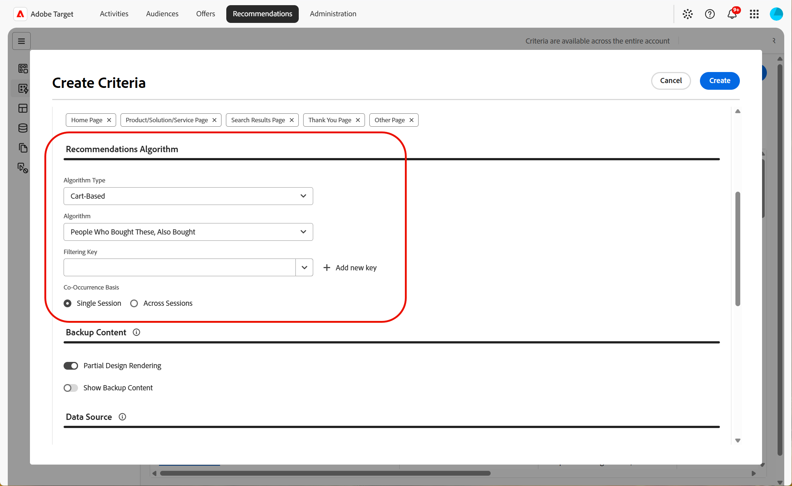

# 建立條件 {#create-criteria}

>[!BEGINSHADEBOX]

**在此頁面上：**&#x200B;瞭解如何在[!DNL Adobe Target Recommendations]中建立條件，以及如何設定條件的每個區段。

>[!ENDSHADEBOX]

[!DNL Adobe Target] [!DNL Recommendations]中的條件可控制[!DNL Recommendations]活動的內容。 條件會使用訪客的動作來決定要顯示的內容或產品，因此適當的條件會顯示最適合活動的建議。

## 存取「建立新條件」畫面 {#access-create-criteria}

有多個方式可進入&#x200B;**[!UICONTROL 「建立新條件」]**&#x200B;畫面。 部分熒幕選項會依到達熒幕的方式而有所不同。

* 在&#x200B;**[!UICONTROL Recommendations]** > **[!UICONTROL 條件]**&#x200B;資料庫畫面上，按一下&#x200B;**[!UICONTROL 建立條件]** > **[!UICONTROL 建立條件]**。 在此建立的條件會自動可供所有[!DNL Recommendations]活動使用。

  ![已開啟[建立條件]功能表的[條件]頁面，顯示[建立條件]和[建立條件順序]](../assets/criteria_create_1.png)

* 使用&#x200B;**[!UICONTROL 視覺化體驗撰寫器]** (VEC)建立[!DNL Recommendations]活動時，在選取頁面上的元素之後會立即顯示&#x200B;**[!UICONTROL Select條件]**&#x200B;畫面，並按一下&#x200B;**[!UICONTROL 使用建議取代]**、**[!UICONTROL 插入建議在前]**&#x200B;或&#x200B;**[!UICONTROL 插入建議在後]**。 Select可用條件，或按一下&#x200B;**[!UICONTROL 建立條件]**。 可以儲存新條件以搭配其他[!DNL Recommendations]活動使用。 如需詳細資訊，請參閱[建立建議活動](/help/main/c-recommendations/t-create-recs-activity/create-recs-activity.md)。

  使用「建立條件」按鈕的Recommendations活動的

* 編輯[!DNL Recommendations]活動時，請在頁面上的&#x200B;**[!UICONTROL 建議位置]**&#x200B;方塊中按一下，然後選取&#x200B;**[!UICONTROL 變更條件]**。 在&#x200B;**[!UICONTROL 選取條件]**&#x200B;畫面上，按一下&#x200B;**[!UICONTROL 建立條件]**。 可以儲存新條件以搭配其他[!DNL Recommendations]活動使用。

## [!UICONTROL 基本資訊] {#info}

基本資訊可識別條件並將其分類，以供在其他活動中重複使用。

1. 輸入&#x200B;**[!UICONTROL 條件名稱]**。

   這是用來說明條件的內部名稱。 例如，條件可以命名為「Highest margin products」，但不會公開顯示該標題。 公開的標題會在下一個步驟中設定。

1. 輸入公開顯示的&#x200B;**[!UICONTROL 顯示標題]**，以在使用此條件的任何Recommendations頁面上顯示。

   例如，使用此條件來顯示建議時，可以顯示「瀏覽過此專案、也瀏覽了其他專案的使用者」或「類似產品」。

1. 輸入條件的簡短&#x200B;**[!UICONTROL 描述]**。

   說明應該有助於識別條件，並且可能包括關於其用途的資訊。

1. Select是以Recommendations活動的目標為基礎的垂直產業。

   | 垂直產業 | 目標 |
   |--- |--- |
   | **[!UICONTROL 零售/電子商務]** | 轉換帶動購買 |
   | **[!UICONTROL 潛在客戶開發/B2B/金融服務]** | 轉換但未購買 |
   | **[!UICONTROL 媒體/出版]** | 參與度 |

   其他條件選項會根據選取的垂直產業而變更。

   

1. 選取&#x200B;**[!UICONTROL 頁面型別]**。

   可選取多種頁面型別。 產業垂直和頁面型別可共同協助將已儲存的條件分類，使其更易於對其他[!DNL Recommendations]活動重複使用條件。

## [!UICONTROL 推薦演算法] {#rec-algo}

演演算法會決定如何選取建議專案。

>[!CONTEXTUALHELP]
>id="target_recommendations_profile_attribute"
>title="輪廓屬性"
>abstract="您可以使用輪廓指令碼來建立輪廓屬性。"

1. 選取&#x200B;**[!UICONTROL 演演算法型別]**&#x200B;和&#x200B;**[!UICONTROL 演演算法]**：

   

   | 演演算法型別 | 何時使用/可用的演演算法 |
   | --- | --- |
   | **[!UICONTROL 購物車型]** | 根據使用者的購物車內容提供建議。 <ul><li>**[!UICONTROL 瀏覽過這些專案的使用者，也瀏覽了]** </li><li>**[!UICONTROL 瀏覽過這些商品的人們也購買了]**</li><li>**[!UICONTROL 已購買這些商品的人，也已購買]**</li></ul> |
   | **[!UICONTROL 以熱門程度為基礎]** | 根據網站中專案的整體人氣或使用者最喜愛或檢視次數最多類別、品牌、型別等內的專案人氣提供建議。 <ul><li>整個網站檢視次數最多&#x200B;**&#x200B;**</li><li>依類別檢視次數最多&#x200B;**&#x200B;**</li><li>**[!UICONTROL 檢視次數最多的專案屬性]**</li><li>**[!UICONTROL 依輪廓屬性的檢視次數最多項目]**</li><li>整個網站&#x200B;**[!UICONTROL 最暢銷商品]**</li><li>**[!UICONTROL 依類別排名的最暢銷商品]**</li><li>**[!UICONTROL 依專案屬性的最暢銷商品]**</li><li>**[!UICONTROL 依個人檔案屬性的最暢銷商品]**</li><li>**[!UICONTROL Analytics量度排名最前]**</li></ul> |
   | **[!UICONTROL 專案型]** | 根據與使用者目前正在檢視或最近檢視之專案相似的專案提供建議。 <ul><li>**[!UICONTROL 瀏覽過此專案、也瀏覽了其他專案的使用者]**</li><li>**[!UICONTROL 瀏覽過此專案、但購買了其他專案的使用者]**</li><li>**[!UICONTROL 購買了此專案、也購買了其他專案的使用者]**</li><li>**[!UICONTROL 具有類似屬性的專案]**</li></ul> |
   | **[!UICONTROL 以使用者為基礎]** | 根據使用者的行為提供建議。<ul><li>**[!UICONTROL 最近查看的項目]**</li><li>**[!UICONTROL 為您推薦]**</li></ul> |
   | **[!UICONTROL 自訂條件]** | 根據上傳的自訂檔案提出建議。<ul><li>自訂演演算法</li></ul> |

   >[!NOTE]
   >
   >選取&#x200B;**[!UICONTROL 專案]**/**[!UICONTROL 具有類似屬性]**&#x200B;的媒體時，可以設定[內容相似度規則](#similarity)。

1. 依需要設定演演算法，方法是選取&#x200B;**[!UICONTROL 建議索引鍵]**、**[!UICONTROL 篩選索引鍵]**、**[!UICONTROL 共同發生基礎]**、**[!UICONTROL Analytics量度]**&#x200B;和/或&#x200B;**[!UICONTROL 專案屬性]**&#x200B;和&#x200B;**[!UICONTROL 要相符的設定檔屬性]**。 可用的設定選項會依選取的演演算法而有所不同。

   如需有關選擇&#x200B;**[!UICONTROL 建議索引鍵]**&#x200B;的詳細資訊，請參閱[讓建議以建議索引鍵為依據](/help/main/c-recommendations/c-algorithms/base-the-recommendation-on-a-recommendation-key.md)。

1. （視條件而定）若為&#x200B;**[!UICONTROL 最常檢視的個人檔案屬性]**&#x200B;或&#x200B;**[!UICONTROL 最暢銷商品的個人檔案屬性]**，請選取&#x200B;**[!UICONTROL 個人檔案屬性]**&#x200B;以群組互動資料。

   個人資料屬性來自擷取訪客特性的個人資料指令碼，例如地區或國家/地區。 指令碼名稱必須包含`recsAttribute`首碼，所以會儲存為`user.recsAttribute<Name>`，例如`user.recsAttributeRegion`。 在傳遞期間，[!DNL Target]會向每位訪客提供對應至該屬性自身值的排名清單。

## [!UICONTROL 備份內容] {#content}

**[!UICONTROL 備份內容]**&#x200B;規則會決定如果建議專案的數目未填入[建議設計](/help/main/c-recommendations/c-design-overview/design-overview.md)時會發生什麼情況。 條件傳回的建議可能比設計呼叫少。 例如，如果設計有四個專案的位置，但條件導致只建議兩個專案，則其餘位置可以留空或使用備用建議填滿，或無法顯示任何建議。

1. （選用）啟用&#x200B;**[!UICONTROL 部分設計呈現]**&#x200B;選項。

   已填滿儘可能多的位置，但設計範本可能包含空白空間以放置剩餘的位置。 如果停用此選項，且內容不足以填滿所有可用的位置，則不會提供建議，而是顯示預設內容。

   啟用此選項以使用空白位置提供建議。 若要使用網站中的類似或熱門內容來填滿空白位置，請使用備份建議，如下一個步驟所述。

1. （選擇性）啟用&#x200B;**[!UICONTROL 顯示備份內容]**&#x200B;選項。

   備用建議會從整個網站隨機選取檢視次數最多的產品，以填滿設計中剩餘的空白位置，因此設計一律會填滿所有可用的位置。 以下範例使用4 x 1設計：

   

   如果條件只建議兩個專案，且已啟用&#x200B;**[!UICONTROL 部分設計呈現]**&#x200B;選項，則前兩個位置會填滿，其餘兩個位置會保持空白。 如果&#x200B;**[!UICONTROL 顯示備份內容]**&#x200B;選項已啟用，則前兩個位置會根據指定的條件填滿，其餘兩個位置則會根據備份建議填滿。

   +++ 下列矩陣顯示&#x200B;**[!UICONTROL 部分設計呈現]**&#x200B;與&#x200B;**[!UICONTROL 備份內容]**&#x200B;選項之每個組合的結果

   | 部分設計呈現 | 備份內容 | 結果 |
   |--- |--- |--- |
   | 已停用 | 已停用 | 如果傳回的建議少於設計呼叫的數目，則會以預設內容取代建議設計，並且不顯示建議。 |
   | 已啟用 | 已停用 | 設計會呈現，但如果傳回的建議比設計呼叫還少，則可能包含空格。 |
   | 已啟用 | 已啟用 | 備用建議會填滿可用的設計「槽」，以完全呈現設計。 如果因套用包含規則至備用建議而限制了合格備用建議的數量，以致設計無法填滿，則會轉譯部分設計。 如果條件未傳回任何建議，並且包含規則將備用建議限制為零，則會以預設內容來取代設計。 |
   | 已停用 | 已啟用 | 備用建議會填滿可用的設計「槽」，以完全呈現設計。 如果因套用包含規則至備用建議而限制了合格備用建議的數量，以致設計無法填滿，則會以預設內容取代設計，並且不顯示建議。 |

   如需詳細資訊，請參閱[使用備份建議](/help/main/c-recommendations/c-algorithms/backup-recs.md)。
   +++

1. （條件式）若已啟用&#x200B;**[!UICONTROL 顯示備份內容]**，也可啟用&#x200B;**[!UICONTROL 套用包含規則至備份建議]**。

   包含規則會決定要在建議中包含哪些專案。 可用選項取決於垂直產業。

   如需詳細資訊，請參閱下方的[指定包含規則](#inclusion)。

## [!UICONTROL 資料Source] {#data-source}

資料來源會決定條件使用的行為資料以及該資料的時間範圍。

1. Select所需的&#x200B;**[!UICONTROL 行為資料Source]**： **[!UICONTROL Adobe Target]**&#x200B;或&#x200B;**[!UICONTROL Analytics]**。

   >[!NOTE]
   >
   >**[!UICONTROL 行為資料Source]**&#x200B;區段只有在實作使用[Analytics for Target](/help/main/c-integrating-target-with-mac/a4t/a4t.md) (A4T)時才會顯示。

   

   針對&#x200B;**[!UICONTROL Analytics]**，請選取所需的報表套裝。

   +++ Analytics為資料來源時的條件可用性

   當[!DNL Adobe Analytics]為行為資料來源時，新條件可用之前的時間會根據其他條件是否已使用選取的報表套裝和回顧期間而定：

   * **一次性報表套裝設定**: 報表套裝第一次搭配指定資料範圍回顧期間使用時，[!DNL Target Recommendations] 可能需要二到七天才能從 [!DNL Analytics] 完全下載所選報表套裝的行為資料。 此時間範圍取決於[!DNL Analytics]系統負載。
   * **使用已可取得之報表套裝的全新或已編輯的條件**：建立新條件或編輯現有條件時，如果選取的報表套裝已搭配[!DNL Target Recommendations]使用，且資料範圍等於或大於選取的資料範圍，資料即可立即使用且不需要一次性設定。 在此情況下，或是在未修改所選報表套裝或資料範圍時已編輯演算法的設定，演算法會在 12 小時內執行或重新執行。
   * **現有演算法執行**: 資料會每天從 [!DNL Analytics] 流動到 [!DNL Target Recommendations]。 例如，針對&#x200B;**[!UICONTROL 已檢視的相似性]**&#x200B;建議，當使用者檢視某個產品時，產品檢視追蹤呼叫會近乎即時傳遞到[!DNL Analytics]。 [!DNL Analytics] 資料會在隔天很早推送到 [!DNL Target]，且 [!DNL Target] 會在 12 小時內執行演算法。

   如需詳細資訊，請參閱[使用Adobe Analytics搭配Target Recommendations](/help/main/c-recommendations/c-algorithms/use-adobe-analytics-with-recommendations.md)。

   +++

1. 設定&#x200B;**[!UICONTROL 回顧期間]**&#x200B;以決定要顯示哪些建議時，要使用的可用歷史使用者行為資料的時間範圍。 此選項適用於所有演演算法，但具有類似屬性的&#x200B;**[!UICONTROL 專案]**&#x200B;和&#x200B;**[!UICONTROL 自訂演演算法]**&#x200B;除外。

   如果網站有大量流量且行為經常變更，請選擇較短的資料時段。 較短的時段可讓[!DNL Recommendations]對市場和業務的變更更具回應力。 例如，[!DNL Recommendations]接著會在訪客開始季節性購物（例如開學購物或聖誕節）時偵測訪客行為中的變更，並建議適合這些購物季的專案。

   如果網站沒有大量資料，或訪客行為不經常變更，請選取較長的視窗。 不過，對許多網站而言，較短的期間會產生較高品質的建議。

   +++ 可用的資料範圍

   | 回顧視窗選項 | 更新頻率（懸停時顯示） | 支援的演演算法 |
   | --- | --- | --- |
   | 六小時 | 演演算法每3-6小時執行一次 | 當選取的&#x200B;**[!UICONTROL 行為資料Source]**&#x200B;為[!DNL Adobe Target]時，**[!UICONTROL 以熱門程度為基礎的]**&#x200B;演演算法 |
   | 一天 | 演演算法每12到24小時執行一次 | **[!UICONTROL 以熱門程度為基礎的演演算法]** |
   | 兩天 | 演演算法每12到24小時執行一次 | <ul><li>**[!UICONTROL 以熱門程度為基礎的演演算法]**</li><li>**[!UICONTROL 專案型]**&#x200B;演演算法</li><li>**[!UICONTROL 以使用者為基礎的]**&#x200B;演演算法</li><li>**[!UICONTROL 購物車型]**&#x200B;演演算法</li></ul> |
   | 一週 | 演演算法每24到48小時執行一次 | <ul><li>**[!UICONTROL 以熱門程度為基礎的演演算法]**</li><li>**[!UICONTROL 專案型]**&#x200B;演演算法</li><li>**[!UICONTROL 以使用者為基礎的]**&#x200B;演演算法</li><li>**[!UICONTROL 購物車型]**&#x200B;演演算法</li></ul> |
   | 兩週 | 演演算法每24到48小時執行一次 | <ul><li>**[!UICONTROL 以熱門程度為基礎的演演算法]**</li><li>**[!UICONTROL 專案型]**&#x200B;演演算法</li><li>所有&#x200B;**[!UICONTROL 使用者型]**&#x200B;演演算法</li><li>**[!UICONTROL 購物車型]**&#x200B;演演算法</li></ul> |
   | 一個月（30天） | 演演算法每24到48小時執行一次 | <ul><li>**[!UICONTROL 以熱門程度為基礎的演演算法]**</li><li>**[!UICONTROL 專案型]**&#x200B;演演算法</li><li>**[!UICONTROL 以使用者為基礎的]**&#x200B;演演算法</li><li>**[!UICONTROL 購物車型]**&#x200B;演演算法</li></ul> |
   | 兩個月（61天） | 演演算法每24到48小時執行一次 | <ul><li>**[!UICONTROL 以熱門程度為基礎的演演算法]**</li><li>**[!UICONTROL 專案型]**&#x200B;演演算法</li><li>**[!UICONTROL 以使用者為基礎的]**&#x200B;演演算法</li><li>**[!UICONTROL 購物車型]**&#x200B;演演算法</li></ul> |

   +++

## 內容相似度 {#similarity}

使用&#x200B;**[!UICONTROL 內容相似度]**&#x200B;規則根據項目或媒體屬性來提出建議。

內容相似度會比較項目屬性關鍵字並根據不同項目有多少共通的關鍵字進行建議。 根據內容相似度的建議不需要過去的資料。

內容相似度對新專案有效，使用&#x200B;*檢視過此專案、也檢視過*&#x200B;的人以及基於過去行為的其他邏輯時，這些內容不太可能出現在建議中。 它也可以為沒有過去購買或其他歷史資料的新訪客產生建議。

選取&#x200B;**[!UICONTROL 以專案為基礎的]**/**[!UICONTROL 具有類似屬性的專案]**&#x200B;時，可以建立規則以增加或減少特定專案屬性在決定建議時的重要性。 對於諸如書籍之類的專案，可提升&#x200B;*型別*、*作者*、*系列*&#x200B;等屬性的重要性以建議類似的書籍。

內容相似度使用關鍵字來比較專案，因此某些屬性（例如&#x200B;*訊息*&#x200B;或&#x200B;*描述*）可能會將「雜訊」引入比較中。 可建立規則以忽略這些屬性。

依預設，所有屬性會設為&#x200B;*「基線」*。 只需要規則即可變更此設定。

>[!NOTE]
>
>內容相似度演演算法可能會使用隨機抽樣來計算專案之間的相似度。 因此，專案之間的相似度評等可能會因演演算法執行而異。

## 包含規則 {#inclusion}

包含規則會縮小建議中顯示的專案範圍。 可在建立條件或促銷活動時使用這些變數。 包含規則為選用，但設定這些詳細資料可讓您更能掌控建議中顯示的專案。 每個已設定的詳細資料會進一步縮小顯示條件。

例如，只有存貨超過50雙且價格在$25到$45美元之間的女鞋才能顯示。 每個屬性也可以加權，以便對企業更重要的專案最有可能出現。 再舉一例，職務空缺只可顯示給從特定城市造訪網站的訪客，以及擁有必要大學學位的訪客。

包含規則選項可能因垂直產業而不同。 依預設，包含規則會套用至備用建議。 包含規則會使用AND連結，因此必須符合所有規則，才能在建議中包含專案。

>[!IMPORTANT]
>
>謹慎使用包含規則。 例如，如果組織有規則要求顯示一個品牌時不建議顯示另一個品牌，這些規則就會很有用。 不過，此功能具有機會成本：限制活動條件通常顯示的專案可能會失去提升百分比。

下列步驟會建立簡單的包含規則，只顯示存貨超過50雙且價格在$25到$45美元之間的女鞋：

1. （視條件而定）啟用&#x200B;**[!UICONTROL 允許最近購買的專案被建議]**。

   此設定是根據 `productPurchasedId`。 預設行為是不推薦先前購買的項目。 在大多數情況下，不應促銷客戶最近購買的專案。 此設定對於人們通常只購買一次的專案很有用，例如皮劃艇。 針對人們重複購買的專案，例如洗髮水或其他個人專案，請啟用此選項。

1. 設定建議產品的價格範圍。

1. 設定要建議之產品的最低庫存量。

1. 設定建議只在項目符合您的特定條件時才顯示。

   只有當清單中有一個屬性符合或不符合一個或多個指定條件時，才能包含專案。

   可用的評估器取決於在第一個下拉式清單中選擇的值。 可以列出多個專案，並使用OR評估它們。 多個規則會使用 AND 來結合。

   >[!NOTE]
   >
   >此選項會限制建議中所顯示的項目。 不會限制在哪些頁面中顯示建議。 若要限制建議顯示的位置，請在體驗撰寫器中選取頁面。

如需詳細資訊，請參閱[使用動態和靜態包含規則](/help/main/c-recommendations/c-algorithms/use-dynamic-and-static-inclusion-rules.md)。

## 屬性加權 {#weighting}

您可以新增多個規則，根據內容目錄的重要資訊或中繼資料來「微調」演演算法，以便更容易顯示某些專案。

例如，較高的加權可套用至待售專案，以便這些專案較常出現在建議中。 不完全排除非售項目，但它們的顯示頻率較低。 多種加權屬性皆可套用至相同的演算法，並能依據建議中的拆分流量測試加權屬性。

1. 選擇值。

   根據數個可用條件中的一個，值會決定較可能顯示的項目類型。

1. 選擇一個求值器。

1. 輸入關鍵字以完成規則屬性。

   例如，完整的規則可能是「類別包含子字串鞋子」。

1. 選取要指派至規則的加權。

   選項範圍從 0 到 100 (增量為 25)。

1. 如有需要，可新增其他規則。

完成時，按一下&#x200B;**[!UICONTROL 建立]**。

建立新的&#x200B;**[!UICONTROL Recommendations]**&#x200B;活動或編輯現有活動時，預設會選取&#x200B;**[!UICONTROL 儲存條件以供稍後使用]**&#x200B;核取方塊。 若要防止在其他活動中使用該條件，請在儲存前清除核取方塊。
