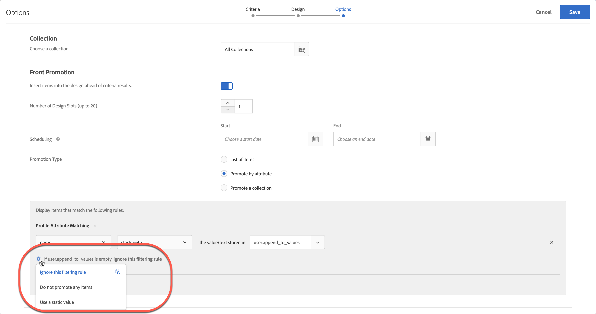

# 使用動態和靜態包含規則 {#inclusion-rules}

>[!BEGINSHADEBOX]

**在此頁面上：**&#x200B;瞭解如何在[!DNL Adobe Target Recommendations]中將動態和靜態篩選規則新增到條件與促銷活動。

>[!ENDSHADEBOX]

包含規則會縮小可出現在建議中的專案範圍。 它們是在[!DNL Adobe Target]中為條件和促銷活動建立，具有動態或靜態篩選規則。 流程、使用案例和範例在條件和促銷活動方面類似，因此本頁同時涵蓋兩者。

## 新增篩選規則 {#add-filtering-rules}

下列步驟會將篩選規則新增至條件。

1. 在[建立條件](/help/main/c-recommendations/c-algorithms/create-new-algorithm.md#create-criteria)時（**[!UICONTROL Recommendations]** > **[!UICONTROL 條件]** > **[!UICONTROL 建立條件]** > **[!UICONTROL 建立條件]**），按一下&#x200B;**[!UICONTROL 包含規則]**&#x200B;下的&#x200B;**[!UICONTROL 新增篩選規則]**。

   

1. 在「建議應遵守哪些其他規則」方塊中，按一下&#x200B;**[!UICONTROL 靜態篩選器]**&#x200B;下拉式清單，然後選取所要的選項。

   

   可用的選項依選取的行業別和建議金鑰而不同。

若要新增篩選規則至促銷活動，請在[建立促銷活動](/help/main/c-recommendations/t-create-recs-activity/adding-promotions.md)時選取&#x200B;**[!UICONTROL 依屬性促銷]**，然後按一下&#x200B;**[!UICONTROL 新增篩選規則]**。

## 篩選器型別 {#filter-types}

下列章節說明條件和促銷的&#x200B;**[!UICONTROL 動態篩選]**&#x200B;及&#x200B;**[!UICONTROL 依值篩選]**&#x200B;的篩選選項。

### 動態篩選

動態包含規則會因應訪客或請求，而靜態包含規則則使用固定值。

* 動態包含規則會透過比對使用者設定檔引數或mbox呼叫中的屬性來傳送建議。

  例如，可建立「最受歡迎條件」建議。 從傳回的建議集中，可以（即時）根據使用者存取顯示建議的頁面時傳遞的屬性篩選掉任何建議。

* 可建立任意數量的動態包含規則。 包含規則會使用AND運運算元連結，因此必須符合所有規則，才會將專案包含在建議中。

下列選項適用於動態篩選：

| 動態篩選選項 | 詳細資料 |
| --- | --- |
| [**[!UICONTROL 實體屬性比對]**](/help/main/c-recommendations/c-algorithms/entity-attribute-matching.md) | 比較一批潛在的建議專案與訪客已互動的特定專案，以動態篩選。
使用&#x200B;**[!UICONTROL 實體屬性比對]**&#x200B;來顯示最可能吸引訪客的建議，例如訪客最喜愛的品牌。 |
| [**[!UICONTROL 輪廓屬性比對]**](/help/main/c-recommendations/c-algorithms/profile-attribute-matching.md) | 比較專案（實體）與訪客設定檔中的值，以動態篩選。
使用&#x200B;**[!UICONTROL 設定檔屬性比對]**&#x200B;來顯示符合訪客設定檔中儲存之值（例如大小或最喜愛的品牌）的建議。 |
| [**[!UICONTROL 參數比對]**](/help/main/c-recommendations/c-algorithms/parameter-matching.md) | 比較專案（實體）與請求（API或mbox）中的值，以動態篩選。
使用&#x200B;**[!UICONTROL 引數比對]**&#x200B;來建議符合頁面引數或訪客引數的內容，例如裝置維度或地理位置。 |

### 按值篩選

靜態規則會限制建議中包含的專案，而不使用集合。 下列選項可依值篩選：

| 依值選項篩選 | 詳細資料 |
| --- | --- |
| [**[!UICONTROL 靜態篩選器]**](/help/main/c-recommendations/c-algorithms/static-value.md) | 依手動輸入的一或多個靜態值篩選。 |

## 可用運算子 {#operators}

下列範例說明如何將動態促銷活動和排除專案用於行銷。

>[!NOTE]
>
>「清單」運運算元要求實體和設定檔屬性都儲存為陣列。 以逗號分隔的清單無法運作。

| 運算子 | 可用於 | 範例 |
|--- |--- |--- |
| **[!UICONTROL 等於任何]** | **[!UICONTROL 實體屬性比對]**、**[!UICONTROL 設定檔屬性比對]**、**[!UICONTROL 引數比對]**&#x200B;和&#x200B;**[!UICONTROL 靜態篩選器]** | 當訪客檢視網站上的專案時（例如產品、文章或電影），使用「等於」運運算元的動態促銷活動可以促銷下列來源的其他專案：<ul><li>相同品牌</li><li>相同類別</li><li>來自自家品牌的相同類別和</li><li>相同商店</li></ul> |
| **[!UICONTROL 不等於任何]** | **[!UICONTROL 實體屬性比對]**、**[!UICONTROL 設定檔屬性比對]**、**[!UICONTROL 引數比對]**&#x200B;和&#x200B;**[!UICONTROL 靜態篩選器]** | 當訪客檢視網站上的專案時（例如產品、文章或電影），使用「**[!UICONTROL 」運運算元的動態促銷活動不等於]**」的任何運運算元都可以促銷下列來源的其他專案：<ul><li>另一部電視劇</li><li>不同的型別</li><li>不同的產品系列</li><li>不同的樣式ID</li></ul> |
| **[!UICONTROL 大於或等於]**&#x200B;的任何一個 | **[!UICONTROL 實體屬性比對]**、**[!UICONTROL 設定檔屬性比對]**、**[!UICONTROL 引數比對]**&#x200B;和&#x200B;**[!UICONTROL 靜態篩選器]** | 當訪客檢視網站上的專案時（例如產品），&quot;**[!UICONTROL 大於或等於]**&quot;運運算元可以促銷如下的其他專案：<ul><li>成本相同或更昂貴</li></ul> |
| **[!UICONTROL 小於或等於]**&#x200B;的任一項 | **[!UICONTROL 實體屬性比對]**、**[!UICONTROL 設定檔屬性比對]**、**[!UICONTROL 引數比對]**&#x200B;和&#x200B;**[!UICONTROL 靜態篩選器]** | 當訪客檢視網站上的專案時（例如產品），&quot;**[!UICONTROL 小於或等於]**&quot;運運算元可以促銷如下的其他專案：<ul><li>成本相同或較便宜</li></ul> |
| **[!UICONTROL 包含任何]** | **[!UICONTROL 實體屬性比對]**、**[!UICONTROL 設定檔屬性比對]**、**[!UICONTROL 引數比對]**&#x200B;和&#x200B;**[!UICONTROL 靜態篩選器]** | 當訪客檢視網站上的專案時（例如產品），&quot;**[!UICONTROL 包含任何]**&quot;運運算元都可以促銷如下的其他專案：<ul><li>標題包含相同品牌</li></ul> |
| **[!UICONTROL 不包含任何]** | **[!UICONTROL 實體屬性比對]**、**[!UICONTROL 設定檔屬性比對]**、**[!UICONTROL 引數比對]**&#x200B;和&#x200B;**[!UICONTROL 靜態篩選器]** | 當訪客檢視網站上的專案時（例如產品），&quot;**[!UICONTROL 不包含任何]**&quot;運運算元可以促銷如下的其他專案：<ul><li>標題不含粗字</li></ul> |
| **[!UICONTROL 以任一]**&#x200B;開始 | **[!UICONTROL 實體屬性比對]**、**[!UICONTROL 設定檔屬性比對]**、**[!UICONTROL 引數比對]**&#x200B;和&#x200B;**[!UICONTROL 靜態篩選器]** | 當訪客檢視網站上的專案時（例如產品），&quot;**[!UICONTROL 以任何]**&quot;運運算元開頭都可促銷如下的其他專案：<ul><li>產品名稱以iPhone開頭</li></ul> |
| **[!UICONTROL 結尾為]**&#x200B;的任一項 | **[!UICONTROL 實體屬性比對]**、**[!UICONTROL 設定檔屬性比對]**、**[!UICONTROL 引數比對]**&#x200B;和&#x200B;**[!UICONTROL 靜態篩選器]** | 當訪客檢視網站上的專案時（例如產品），&quot;**[!UICONTROL 結尾為]**&quot;的運運算元可以促銷如下的其他專案：<ul><li>內容結尾是EN，表示英文</li></ul> |
| **[!UICONTROL 介於]**&#x200B;之間 | **[!UICONTROL 實體屬性比對]**、**[!UICONTROL 設定檔屬性比對]**&#x200B;和&#x200B;**[!UICONTROL 引數比對]** | 當訪客檢視網站上的專案時（例如產品、文章或電影），使用&quot;**[!UICONTROL &quot;運運算元的動態促銷活動介於]**&quot;之間，可促銷如下的其他專案：<ul><li>更貴</li><li>更便宜</li><li>成本加減30%</li><li>同季的後續集數</li><li>系列中先前的書籍</li></ul> |
| **[!UICONTROL 清單包含]**&#x200B;中的專案（位於右側的清單） | **[!UICONTROL 設定檔屬性比對]**&#x200B;與&#x200B;**[!UICONTROL 引數比對]** | 在設定檔屬性比對中，當訪客檢視網站上的專案時（例如產品、文章或電影），&quot;**[!UICONTROL 清單包含]**&quot;運運算元中的專案，可促銷如下的其他專案：<ul><li>在訪客的地理位置中可用</li></ul>**範例**：建議只在訪客地理區域中可用的專案。
篩選規則可能如下所示：
`availableGeographies list contains an item in user.currentGeography`
**注意**：使用此運運算元時，規則的[右側](#caveats)應該會有清單。 |
| **[!UICONTROL 清單在]**&#x200B;中沒有包含專案（清單在右側） | **[!UICONTROL 設定檔屬性比對]**&#x200B;與&#x200B;**[!UICONTROL 引數比對]** | 在設定檔屬性比對中，當訪客檢視網站上的專案時（例如產品、文章或電影），&quot;**[!UICONTROL 清單不包含]**&quot;運運算元中的專案，即可排除下列其他專案：<ul><li>在訪客已檢視的最後10個專案清單中</li></ul>**範例**：訪客最近檢視過且沒有興趣的專案不會提升。
篩選規則可能如下所示：
`id is not contained in list user.lastViewedItems`
**注意**：使用此運運算元時，規則的[右側](#caveats)應該會有清單。 |
| **[!UICONTROL 清單包含]**&#x200B;中的專案（兩邊的清單） | **[!UICONTROL 實體屬性比對]**、**[!UICONTROL 設定檔屬性比對]**&#x200B;和&#x200B;**[!UICONTROL 引數比對]** | 在設定檔屬性比對中，當訪客檢視網站上的專案時（例如體育賽事或音樂會），&quot;**[!UICONTROL 清單包含]**&quot;運運算元中的專案，可促銷如下的其他專案：<ul><li>與訪客其中一個最喜愛的團隊相關聯</li></ul>**範例**：建議與訪客最喜愛的球隊之一相關聯的遊戲。
篩選規則可能如下所示：
`teamsPlaying list contains an item in user.favoriteTeams`
**注意**：使用此運運算元時，規則的[兩側](#caveats)應該會有清單。 |
| **[!UICONTROL 清單在]**&#x200B;中不包含專案（兩邊的清單） | **[!UICONTROL 實體屬性比對]**、**[!UICONTROL 設定檔屬性比對]**&#x200B;和&#x200B;**[!UICONTROL 引數比對]** | 在引數比對中，當訪客檢視網站上的專案時（例如產品、文章或電影），&quot;**[!UICONTROL 清單不包含]**&quot;運運算元中的專案，即可排除下列其他專案：<ul><li>包含在禁止型別清單中</li></ul>**範例**：排除僅供成人訪客使用的專案，例如菸草和酒精。
篩選規則可能如下所示：
`itemType is not contained in list mbox.prohibitedTypes`
**注意**：使用此運運算元時，規則的[兩側](#caveats)應該會有清單。 |
| **[!UICONTROL 清單包含]**&#x200B;中的所有專案 | **[!UICONTROL 實體屬性比對]**、**[!UICONTROL 設定檔屬性比對]**&#x200B;和&#x200B;**[!UICONTROL 引數比對]** | 在設定檔屬性比對中，當訪客檢視網站上的專案時（例如工作張貼或配方），&quot;**[!UICONTROL 清單包含]**&quot;運運算元中的所有專案，可以促銷如下的其他專案：<ul><li>包含一組技能</li><li>包含一組必要的要素</li></ul>**範例1**：訪客有一組技能（Java、C++和HTML）。 目錄中的專案是具有所需技能（Java和HTML）的工作。 向訪客建議工作之前，訪客設定檔必須包含所有必要的技能。
篩選規則可能如下所示：
`profile.jobSeekerSkills contains all items in entity.requiredSkills`
**範例2**：使用者有食品櫃配料清單。 配方包含所需成分的清單。 訪客設定檔必須包含所有必要的成分，才能向訪客建議配方。
篩選規則可能如下所示：
`profile.ingredientsInPantry contains all items in recipe.ingredientsRequired`
**注意**：使用此運運算元時，規則的[兩側](#caveats)應該會有清單。 |
| **[!UICONTROL 清單未包含]**&#x200B;中的所有專案 | **[!UICONTROL 實體屬性比對]**、**[!UICONTROL 設定檔屬性比對]**&#x200B;和&#x200B;**[!UICONTROL 引數比對]** | 在實體屬性比對中，當訪客檢視網站上的專案時（例如體育賽事或音樂會），&quot;**[!UICONTROL 清單未包含]**&quot;運運算元中的所有專案，可促銷如下的其他專案：<ul><li>不要包含一組團隊</li></ul>**範例**：體育賽事包含兩支球隊。 訪客的設定檔指出此訪客不想檢視這些團隊的遊戲，因此若這些團隊正在玩遊戲，則不得建議進行遊戲。
篩選規則可能如下所示：
`profile.leastfavoriteTeams does not contain all items in entity.teamsPlaying`
**注意**：使用此運運算元時，規則的[兩側](#caveats)應該會有清單。 |

## 處理空白值 {#empty-values}

當篩選條件及促銷活動時有&#x200B;**[!UICONTROL 實體屬性比對]**、**[!UICONTROL 設定檔屬性比對]**&#x200B;及&#x200B;**[!UICONTROL 引數比對]**&#x200B;時，有數個選項可以處理空白值。

以前，如果值空白，則不會傳回結果。 「如果&#x200B;*x*&#x200B;是空的」下拉式清單指定條件具有空值時要執行的動作，如下圖所示：

若要選取所需的動作，請將游標停留在齒輪圖示上（  ），然後選擇所需的動作：

| 動作 | 可用於 | 詳細資料 |
|--- |--- |--- |
| **[!UICONTROL 忽略此篩選規則]** | **[!UICONTROL 設定檔屬性比對]**&#x200B;與&#x200B;**[!UICONTROL 引數比對]** | 此動作是&#x200B;**[!UICONTROL 設定檔屬性比對]**&#x200B;和&#x200B;**[!UICONTROL 引數比對]**&#x200B;的預設值。
會忽略規則。 例如，如果有三個篩選規則，且第三個規則未傳遞任何值，則可忽略具有空白值的第三個規則，而非傳回任何結果。 |
| **[!UICONTROL 不顯示此條件的任何結果]**
（僅限條件） | **[!UICONTROL 實體屬性比對]**、**[!UICONTROL 設定檔屬性比對]**&#x200B;和&#x200B;**[!UICONTROL 引數比對]** | 此動作是&#x200B;**[!UICONTROL 實體屬性比對]**&#x200B;的預設值。
在新增此選項之前，此動作代表[!DNL Target]處理空白值的方式：不顯示此條件的結果。 |
| **[!UICONTROL 不促銷任何專案]**
（僅限促銷活動） | **[!UICONTROL 實體屬性比對]**、**[!UICONTROL 設定檔屬性比對]**&#x200B;和&#x200B;**[!UICONTROL 引數比對]** | 此動作是&#x200B;**[!UICONTROL 實體屬性比對]**&#x200B;的預設值。
在新增此選項之前，此動作代表[!DNL Target]處理空白值的方式：不顯示此促銷活動的結果。 |
| **[!UICONTROL 使用靜態值]** | **[!UICONTROL 實體屬性比對]**、**[!UICONTROL 設定檔屬性比對]**&#x200B;和&#x200B;**[!UICONTROL 引數比對]** | 當值為空時，可以使用靜態值。 |

## 注意事項 {#caveats}

>[!IMPORTANT]
>
>不同的資料型別屬性在執行階段可能與「等於」和「不等於」運運算元不相容於動態條件或促銷活動。 當左側有預先定義的屬性或自訂屬性時，請仔細選擇右側的&#x200B;**[!UICONTROL 值]**、**[!UICONTROL 利潤]**、**[!UICONTROL 詳細目錄]**&#x200B;和&#x200B;**[!UICONTROL 環境]**&#x200B;值。

下表顯示相容的規則和執行階段可能不相容的規則：

| 相容規則 | 潛在不相容的規則 |
|--- |--- |
| value - 介於 - 目前項目的 90% 和 110% - salesValue | salesValue - 介於 - 目前項目的 90% 和 110% - value |
| value - 介於 - 目前項目的 90% 和 110% - value | clearancePrice - 介於 - 目前項目的 90% 和 110% - margin |
| margin - 介於 - 目前項目的 90% 和 110% - margin | storeInventory - 等於 - 目前項目的 - 庫存 |
| inventory - 等於 - 目前項目的 - 庫存 |  |
