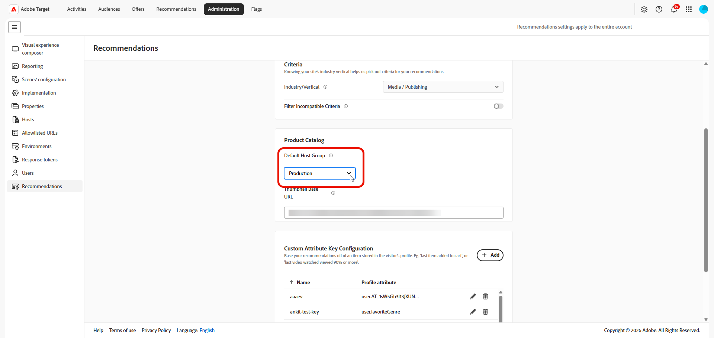

# 推薦常見問題集 {#recommendations-faq}

>[!BEGINSHADEBOX]

**在此頁面上：**&#x200B;尋找有關[!DNL Adobe Target]常見問題的解答[!DNL Recommendations]個活動。

>[!ENDSHADEBOX]

## 資料和API {#data-and-apis}

+++ 透過API建立的[!DNL Recommendations]物件是否顯示在[!DNL Target] UI中？

是. 透過API建立的[!UICONTROL Recommendations]物件（**[!UICONTROL 條件]**、**[!UICONTROL 設計]**、**[!UICONTROL 集合]**&#x200B;和&#x200B;**[!UICONTROL 排除專案]**）可在UI中使用，並可透過API或[!DNL Target] UI進行編輯。

+++

+++ 在[!DNL Target] UI中建立的視覺化選件是否可以使用[!DNL Target] API來管理？

無. 在[!DNL Target] UI中建立的具有視覺化選件的[!DNL Recommendations]活動無法透過[!DNL Target] API來管理。 這些活動會顯示在&#x200B;**[!UICONTROL 活動]**&#x200B;清單中，但無法讀取或更新它們（使用GET或PUT）。

+++

+++ 要插入或更新產品的API呼叫的大小限制是多少？ 可以在一次呼叫中更新50,000種產品，而不是在摘要中更新嗎？

[!DNL Target]在應用程式層級實施50 MB的限制，但僅當傳遞`application/x-www-form-urlencoded`內容型別標頭時。

可以嘗試包含50,000個產品的單一呼叫。 如果呼叫失敗，則可將其分割為批次。 Adobe建議批次處理5,000或10,000項產品，以降低系統負載造成逾時的可能性。

+++

+++ 用於摘要上傳之 CSV 檔案的檔案大小上限是多少？

摘要CSV檔案上傳的列數或檔案大小沒有硬性限制。 作為最佳實務，Adobe建議將CSV檔案限製為1 GB，以避免上傳期間失敗。 超過1 GB的檔案最好可以分割成多個摘要檔案。

自訂屬性欄數的上限為100，而自訂屬性限製為4096個字元。 在 [[!DNL Target] 限制頁面](/help/main/r-troubleshooting-target/target-limits.md)上有提供必要欄長度的其他限制。

+++

+++ 當搜尋包含某數值的自訂屬性時，**[!UICONTROL 目錄搜尋]**&#x200B;為何沒有顯示正確的結果？

對具有某數值的自訂屬性執行目錄搜尋時，結果會將屬性視為字串，而非數值。

目前沒有可讓客戶變更屬性型別的功能。 若要進行變更，請[開啟客戶問題](/help/main/cmp-resources-and-contact-information.md#reference_ACA3391A00EF467B87930A450050077C)，此問題會參考其型別必須從字串變更為數值的屬性。

+++

## 更新時間 {#update-timing}

+++ 目錄中的專案更新要多久的時間才會反映在網站上？

時間範圍和結果會因更新項目的方式而異。

| 更新 | 推薦 | 目錄搜尋 |
| --- | --- | --- |
| 透過mbox或API更新專案屬性 | 15分鐘內 | 目錄索引之後（3-8小時） |
| 透過摘要更新專案屬性 | 摘要擷取之後（2-8小時） | 摘要擷取（2-8小時）和後續目錄索引（3-8小時）之後，總共在5-16小時內 |
| 透過[!DNL Target] UI或API從目錄中刪除專案 | 15分鐘內 | 目錄索引之後（3-8小時） |
| 透過mbox或API新增至目錄的專案 | 在下次演演算法執行後。 對於1-2天的演演算法，每12小時安排一次演演算法執行，對於7天以上的演演算法，每24小時安排一次演演算法執行 | 目錄索引之後（3-8小時） |
| 透過摘要新增到目錄的專案 | 摘要擷取（2-8小時）和後續演演算法執行後（1-2天的演演算法會每12小時排程一次，7天以上的演演算法則每24小時排程一次，總共在2-32小時內完成） | 摘要擷取（2-8小時）和目錄索引（3-8小時）之後，總共在5-16小時內 |

在有更新可用之前，會顯示下列內容：

* 若為更新或刪除的專案，會顯示現有的建議和專案屬性。
* 對於新增的專案，如果新增的專案不是要求的索引鍵，則會顯示現有的建議。 如果新增的專案是要求的索引鍵，則會顯示備用建議。

匯入摘要檔案之後，或透過API或mbox收到實體更新之後，將會在60分鐘以內反映下列變更：

* 如果某個專案之前已排除但現在應該納入，該專案會納入下一次演演算法執行（12-24小時）。

  發生此狀況是因為 [!DNL Target] 會在線上和離線兩個狀態下讓排除生效。 如果新排除某個項目，線上排除很快就會生效。 如果新納入某個專案，線上排除很快就會消失，但離線排除要等到下一次演演算法執行後才會消失。

* 如果某個專案之前已納入但現在應該排除，則會根據表格中的時間行排除該專案，具體取決於來源：透過mbox或API為15分鐘，或透過摘要為12-24小時。

在下一個演演算法執行作業發生之前（12至24小時內），不會反映下列變更：

* 用於活動收集規則中的專案屬性。
* 促銷活動中使用的專案屬性，其基礎為屬性或與活動相關聯的集合。
* 專案類別，其中專案會在&#x200B;**[!UICONTROL 最暢銷商品]**&#x200B;或&#x200B;**[!UICONTROL 檢視次數最多]**&#x200B;演演算法中顯示為「目前類別」或「最喜愛的類別」。
* 建議專案的排名（當變更的屬性是用來作為演演算法自訂索引鍵的自訂屬性時）。
* 根據一或多個已變更屬性的建議專案排名（當建議邏輯為「具有類似屬性的專案」或當使用「內容相似度」或「屬性加權」因素時）。

>[!NOTE]
>
>在摘要檔案的狀態從「匯入項目」變更為「準備搜尋索引更新」時，摘要檔案會視為已匯入。 更新可能需要60分鐘以上的時間才會反映在&#x200B;**[!UICONTROL 目錄搜尋]**&#x200B;使用者介面中。 當摘要狀態變更為「更新完成」時，**[!UICONTROL 目錄搜尋]**&#x200B;是最新的。 即使&#x200B;**[!UICONTROL 目錄搜尋]**&#x200B;尚未處於最新狀態，網站仍會在上方所列的時間範圍內反映更新。 最近的&#x200B;**[!UICONTROL 目錄搜尋]**&#x200B;索引更新時間會顯示在&#x200B;**[!UICONTROL 目錄搜尋]**&#x200B;頁面上。

+++

+++ [!UICONTROL Recommendations]活動、優惠、促銷活動或條件設定的變更要多久的時間才會反映在網站上？

* 促銷活動設定的變更最多需要五個小時的時間才會反映在網站上。
* 其他條件設定的變更可能要等到下一次演算法執行後才會反映在網站上。

  * 某些條件設定（例如新增動態包含規則）會立即反映。
  * 其他條件設定（例如移除動態包含規則或變更回顧視窗）要等到下一次演演算法執行後才能併入。
  * 這些變更會觸發演演算法執行，而最多可能需要24小時的時間才能完成。 演演算法也會依排程執行，每12-24小時一次。

+++

+++ 使用者的行為（例如點選產品A及購買產品B）需要多久的時間才會反映在該使用者收到的建議中？

* 目前檢視或購買的產品或內容會影響使用者在相同頁面檢視或[!DNL Target]內容要求上收到的建議。
* 過去的使用者行為（例如「上次檢視的產品」、「檢視次數最多的產品」以及整體檢視和購買記錄）會更新該要求。 它會影響使用者在下一個頁面檢視或內容要求中收到的建議。 例如，**[!UICONTROL 最近檢視的專案]**&#x200B;和&#x200B;**[!UICONTROL 為您推薦的專案]**&#x200B;演演算法會隨著每個產品檢視或購買而更新，而且更新會反映在後續的內容要求中。

+++

+++ 使用者的行為需要多久的時間才會反映在其他使用者收到的建議中？

使用者的行為會以彙總方式併入離線演演算法處理中。 此處理作業會在每個演演算法執行時進行，每12-24小時一次。

+++

+++ 根據最近檢視項目的建議會針對單一訪客保存在多個裝置上嗎？

當訪客起始工作階段時，工作階段ID會繫結至單一邊緣電腦，而暫時設定檔快取會儲存在這部電腦上。 來自相同工作階段的後續要求會讀取此設定檔快取，包括最近檢視的專案。

當工作階段結束時（通常會在30分鐘沒有活動後到期），工作階段狀態（包括最近檢視的專案）會儲存在相同地理邊緣中較永久的設定檔儲存空間。 來自不同裝置的後續工作階段就可以存取這些最近檢視的專案，前提是新的工作階段透過相同的Marketing Cloud ID (MCID)、Experience Cloud ID (ECID)或CustomerID或`mbox3rdPartyId`連結至客戶設定檔。

如果訪客同時有兩個作用中工作階段，某台裝置上最近檢視的專案並不會更新另一台裝置上的最近檢視的專案，除非這些裝置被強制共用工作階段ID。 可能有因應措施，但[!DNL Target]不直接支援跨多部裝置共用工作階段ID。 客戶必須管理此ID共用。

當訪客在一部裝置上處於作用中狀態，並在幾分鐘後於另一部裝置上處於作用中狀態時，也會發生此行為。 第一個裝置的工作階段不會在30分鐘內過期，而且在設定檔狀態寫入永久狀態並進行處理之前，最多可能會發生五分鐘的延遲。 測試此行為時，請等候35分鐘讓工作階段到期並儲存設定檔。

如果訪客未同時擁有兩個作用中工作階段，只要工作階段已結束，某台裝置上最近檢視的專案就會更新另一台裝置上的最近檢視的專案。 測試此行為時，請等候35分鐘讓工作階段過期。

+++

## 條件、設計和促銷活動 {#criteria-designs-promotions}

+++ 建立[!DNL Recommendations]活動時，為何不是所有條件都可供選擇，包括自訂條件？

可用的條件取決於目前類別。 建立建議選件時，演演算法選擇器會根據類別ID顯示條件。 如果套用條件的位置不含類別ID，則某些條件不會出現在演演算法選擇器中。 如果使用mbox中存在類別ID的位置，則條件選擇器包含所有適用的條件。

[!DNL Target]的[篩選不相容的條件](https://experienceleague.adobe.com/docs/target-dev/developer/recommendations.html){target=_blank}設定可控制演演算法選擇器的智慧型篩選。 若要存取&#x200B;**[!UICONTROL 篩選不相容的條件]**&#x200B;設定，請按一下&#x200B;**[!UICONTROL 管理]** > **[!UICONTROL 建議]**。


* 如果未啟用&#x200B;**[!UICONTROL 篩選不相容的條件]**&#x200B;設定，[!DNL Target]就不會篩選演演算法選擇器中的演演算法，且所有演演算法都會顯示。
* 如果已啟用此設定，在[!UICONTROL 視覺化體驗撰寫器] (VEC)活動中，[!DNL Target]會從選取的位置讀取entityId和類別ID。 接著會根據`currentItem|currentCategory`顯示演演算法（如果該位置有個別的值）。 因此，依照預設，只有與所選位置相容的演演算法會顯示在演演算法選擇器中。 選取條件時，清除&#x200B;**[!UICONTROL 相容]**&#x200B;核取方塊，仍可檢視不相容的演演算法。

  

[!DNL Target]在下列特殊情況下不會顯示&#x200B;**[!UICONTROL 相容]**&#x200B;核取方塊：

* 位置中同時存在entityId和類別ID，因此不會篩選任何內容。
* 已使用[!DNL mbox.js]版本55或更早版本。
* 未從頁面(`!config.isAutoCreateGlobalMbox && !config.isRegionalMbox`)引發任何mbox呼叫。
* [!DNL Target] 參數未定義。

>[!NOTE]
>
>**[!UICONTROL 篩選不相容的條件]**&#x200B;設定僅適用於[!UICONTROL 視覺化體驗撰寫器] (VEC)中建立的活動。 此設定不適用於在&#x200B;**[!UICONTROL 表單式體驗撰寫器]**&#x200B;中建立的活動，因為[!DNL Target]沒有位置內容。

+++

+++ 一般屬性加權與內容相似度特有的屬性加權之間有何差異？

屬性加權有兩種形式：「標準屬性加權」和「內容相似度屬性加權」。

* 「標準屬性加權」適用於大部分的條件型別，不只是&#x200B;**[!UICONTROL 內容相似度]**。 此型別的加權會給某些屬性值更多權重。 在下列範例中，輸出推薦中會多一些 Nike 產品。

  

* 「內容相似度屬性加權」僅適用於&#x200B;**[!UICONTROL 內容相似度]**&#x200B;條件。 此型別的加權比較動態，且以目前的「建議索引鍵」（目前檢視的專案）為基礎。 在下列範例（品牌x 16）中，檢視Nike運動鞋的訪客比競爭者的運動鞋更有可能建議其他Nike產品（不一定是運動鞋）。 檢視Adidas運動鞋的訪客更可能獲得建議Adidas產品。

  的內容相似度區段

+++

+++ 建立[!DNL Recommendations]條件、促銷活動或範本測試規則時，是否必須指定mbox名稱？

根據mbox引數建立[!DNL Recommendations]條件、促銷活動或範本測試規則時，`mboxParameter`不再提示`mboxName`。 mbox 名稱現在是可選項目。 此變更允許使用來自多個mbox的引數，或尚未在邊緣上記錄的引數參照。

若要選取所需的引數，請使用下列其中一種方法：

* 建立條件、促銷活動或範本測試規則時，從清單中選擇一個參數名稱。 開始輸入引數名稱的前幾個字元，或輸入完整名稱。
* 如果mbox名稱是已知的，但引數名稱不是，請使用核取方塊來篩選傳遞所需引數的已知mbox。

使用任一方法時，mbox和引數之間都沒有連結。 條件、促銷活動或範本測試規則將根據傳遞該引數之所有mbox的引數運作。

編輯現有條件、促銷活動或範本測試規則時，篩選會顯示建立期間提供的mbox名稱。

+++

+++ 當特殊字元破壞陣列時，可以做些什麼？

在 JavaScript 中使用逸出值。 引號 ( &quot; ) 會破壞陣列。 下列程式碼片段是逸出值的範例:

```
#set($String='') 
#set($escaper=$String.class.forName('org.apache.commons.lang.StringEscapeUtils')) 
<script type="text/javascript"> 
console.log("$escaper.escapeJavaScript($entity1.name)") 
console.log("$escaper.escapeJavaScript($entity2.name)") 
console.log('$escaper.escapeJavaScript($entity3.name)') 
names.push("$escaper.escapeJavaScript($entity4.name)") 
</script>
```

+++

+++ 是否可以動態地排除實體？

是. 要從建議中排除的實體的實體ID可以在查詢字串中傳遞。 例如，可以排除已在購物車中的專案。

若要啟用排除功能，請使用 `excludedIds` mbox 參數。 此引數指向逗號分隔的實體ID清單，例如`mboxCreate(..., "excludedIds=1,2,3,4,5")`。 要求建議時會傳送值。

此排除僅針對目前的[!DNL Target]呼叫執行。 後續[!DNL Target]呼叫不會排除專案，除非再次傳遞`excludedIds`值。 若要在每個頁面將購物車中的專案從建議中排除，繼續在每個頁面傳遞`excludedIds`值。

若要排除`entityIds`，請將`&excludes=${mbox.excludedIds}`權杖附加至選件內容URL。 擷取內容URL時，目前的mbox要求引數會取代必要引數。

依預設，新建立的建議會啟用此功能。 必須儲存現有的建議以支援動態排除的實體。

>[!NOTE]
>
>如果排除太多實體，則建議會以沒有足夠實體可填入建議範本的情況來處理。

+++

+++ 定義新對象後，為何無法儲存舊版[!DNL Recommendations]活動？

請確定對象有唯一的名稱。 如果對象與現有對象同名，則無法儲存舊版[!DNL Recommendations]活動（在2016年10月之前建立的[!DNL Recommendations]活動）。

+++

+++ 在[!DNL Adobe Recommendations Classic]中建立的演演算法是否可用於[!DNL Recommendations Premium]？

[!DNL Recommendations Premium] 不支援在 [!DNL Recommendations Classic] 中建立的演算法。 舊版演演算法可能可在[!DNL Target Premium]中使用，但在[!DNL Target Premium] UI中停用或刪除活動時，可能會產生同步問題。 如需這兩個解決方案之間差異的詳細資訊，請參閱 [!DNL Target Premium]](/help/main/c-recommendations/c-recommendations-faq/recommendations-classic-versus-recommendations-activities-target-premium.md)中的[[!DNL Recommendations Classic] 與 [!DNL Recommendations] 活動。

+++

+++ 如何只推薦新文章或影片？

媒體和出版業的客戶通常希望建議專案僅包含最新的文章或影片。 例如，[!DNL Target]客戶使用以下方法，推薦60天內的文章：

1. 以YYYYMMDD格式傳遞文章發佈日期作為自訂實體屬性。 例如：

   | 實體屬性 | 範例 |
   | --- | --- |
   | issueDate | 2021218 |
   | lastViewDate | 2021701 |
   | parentCategory | commentary |
   | publishDate | 20210113 |
   | publishDateDisplay | 2021 年 1 月 13 日 |

1. 建立可傳回今天日期減去60天（同樣是YYYYMMDD格式）的設定檔指令碼。

   

1. 在條件中使用動態包含規則，讓`publish date > today's date minus 60 days`。

   中儲存的值

此範例也可以透過引數比對來完成，方法是將`priorDate60`值傳遞為mbox引數。

+++

## 疑難排解 {#troubleshooting}

+++ 為何 [!DNL Target] 有時無法顯示推薦？

[!DNL Target]有時會因為可用的建議數量不夠而無法顯示建議。

為每個條件產生的值數目是設計中指定之實體數目的三倍。 產生3倍的值之後會套用執行階段篩選（例如詳細目錄或mbox屬性比對），因此在傳送時可保留少於3倍的值。 若要減少這種情況發生，請隱藏其他實體來增加設計中的實體數量。

可以在設計開始時使用以下 JavaScript 來增加請求實體的數量。 在此範例中，請求的實體計數為30 (3x10)。

```
#foreach($entity in $entities) 
 #if( $foreach.count > 10 ) 
  #break 
 #end 
 #set ($foo = $entity.id) 
#end 
```

+++

+++ 有時會在[!DNL Recommendations]內容追蹤中傳回的NO_CONTENT回應是什麼意思？

若請求的演算法和重要組成沒有提供推薦，則會回傳 NO_CONTENT。 此情況一般發生於針對演演算法停用備份，且下列一個或多個條件為真時：

* 結果尚未準備好。

  此情形一般會在首次儲存新建立的活動時，或在活動中使用的集合、條件或促銷活動的設定發生變更後發生。

* 結果已完成，但尚未在最近的邊緣伺服器上快取所要求的演演算法和索引鍵組合。

  此請求會起始快取操作，因此此問題會在重新載入數個頁面或幾分鐘後解決。

* 結果已完成，但不適用於所提供的索引鍵值。

  此情形一般發生是在請求對最近一次演演算法執行後新增到目錄的專案進行建議時。 它會在下一次演演算法執行後解析。

* 部分範本顯示被停用，而且結果不足以將範本填滿。

  此情況通常發生在動態包含規則中，該規則積極地從可能的結果中篩選許多專案。 若要避免此情況，請啟用備份且不要將包含規則套用至備份，或依序使用較不積極的篩選條件。

+++

+++ 當[!DNL Recommendations]中的集合變成零(0)時，該怎麼做？

當先前不為零的集合變為零時，請考慮下列事項：

* 重新儲存集合，並檢查數字是否會更新。 重新儲存會重新執行所有使用該集合的演演算法。
* 檢查是否顯示正確的環境。 按一下&#x200B;**[!UICONTROL 管理]** > **[!UICONTROL 建議]**，然後檢查&#x200B;**[!UICONTROL 產品目錄]**&#x200B;區段中的&#x200B;**[!UICONTROL 預設主機群組]**&#x200B;設定。

  「管理」標籤的

* 檢查索引是否為最新狀態。 按一下&#x200B;**[!UICONTROL Recommendations]** > **[!UICONTROL 目錄搜尋]**，然後檢查索引是幾小時以前編列的（例如「3小時前已編列索引」）。 索引可視需要重新整理。
* 檢查摘要或資料層中是否有變更導致實體不再符合收集規則。 請確定大小寫相符（規則區分大小寫）。
* 檢查摘要是否成功執行，或是否有人變更了FTP目錄、密碼等。
* [!DNL Target]會儘快更新傳遞（在客戶頁面或應用程式上），且還必須在UI中為行銷人員提供表示法。 [!DNL Target] 不會為了等待 UI 更新同步而延遲傳送更新。 使用[mboxTrace](/help/main/c-activities/c-troubleshooting-activities/content-trouble.md)檢視要求傳入時系統中有哪些專案。

+++

+++ 為什麼&#x200B;**[!UICONTROL 下載資料]**&#x200B;動作在[!DNL Recommendations]活動中失敗？

在[!DNL Recommendations]活動的&#x200B;**[!UICONTROL 活動概覽]**&#x200B;頁面上按一下&#x200B;**[!UICONTROL 下載資料]**&#x200B;時，[!DNL Target]使用者介面可能會顯示錯誤`Error while fetching recommendation data file.`

此錯誤通常會在活動具有非常大的結果集時發生。 產生的CSV超過單次下載中可透過使用者介面傳回的回應大小。 建議資料本身是完整的。 只有瀏覽器內下載路徑無法傳送該大小的檔案。

+++

## 已知問題 {#known-issues}

下列是[!UICONTROL Recommendations]活動的已知問題：

* 當[!DNL Target]傳回含`getOffer()`的JSON選件時，它會傳回JSON型別。 但是，JSON [!DNL Recommendations]設計傳回HTML型別。
* 若60天內未經由動態消息或API收到更新，過期的實體即會確實過期。 不過，到期的實體不會在到期後從&#x200B;**[!UICONTROL 目錄搜尋]**&#x200B;索引中移除。 透過摘要或API刪除的實體目前也不會從&#x200B;**[!UICONTROL 目錄搜尋]**&#x200B;索引中移除。 (IRI-857)
* A/B和體驗鎖定目標活動中的[!DNL Recommendations]選件沒有顯示[!DNL Recommendations]匣的視覺預覽。 (TGT-33426)
* 條件清單（卡片）檢視中顯示的自訂條件摘要狀態每十分鐘會重新整理一次，在少數情況下，可能會過時超過十分鐘。 自訂條件編輯檢視中顯示的狀態會即時擷取，且隨時保持在最新狀態。 (TGT-35896 和 TGT-36173)
