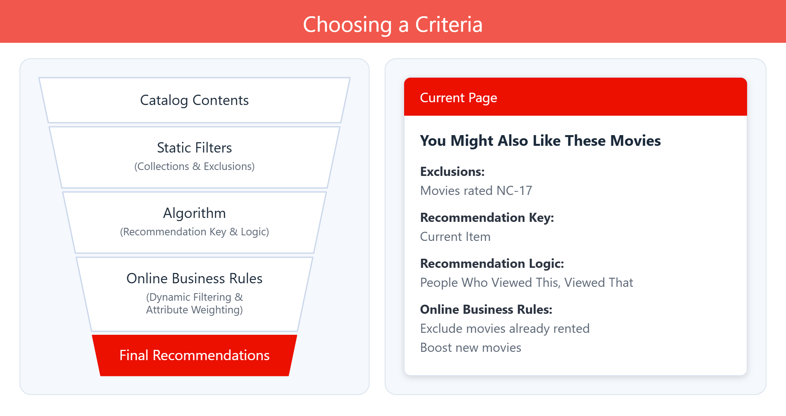
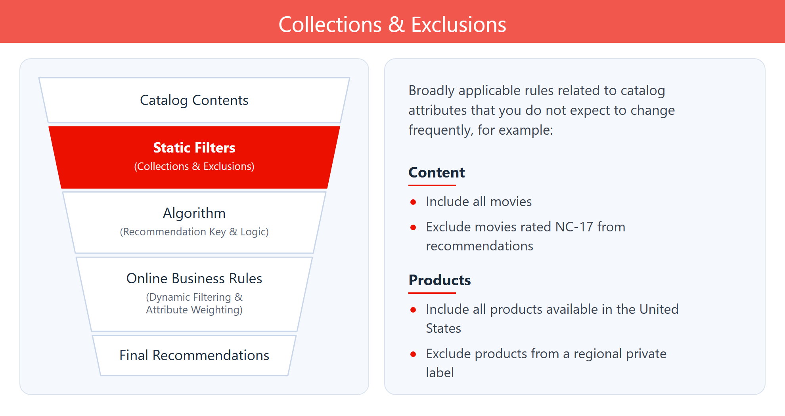
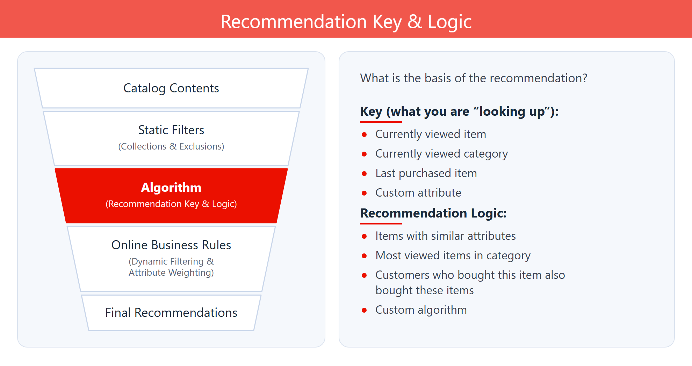
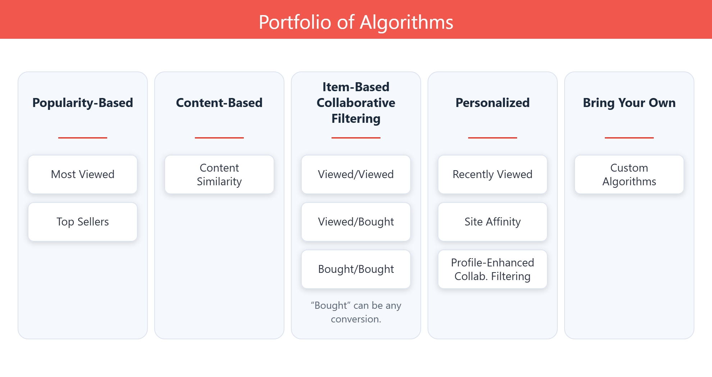
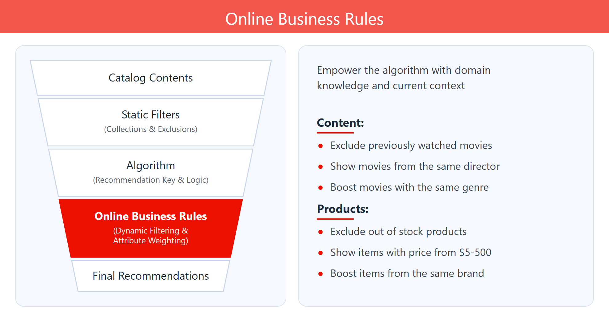

# 推薦簡介 {#introduction-to-recommendations}

>[!BEGINSHADEBOX]

**在此頁面上：**&#x200B;瞭解[!DNL Adobe Target]中的[!DNL Recommendations]活動如何向訪客顯示相關產品或內容，以及如何計畫和建置[!DNL Recommendations]實作和活動。

>[!ENDSHADEBOX]

此頁面是根據&#x200B;*Recommendations簡介*&#x200B;網路研討會。 [!DNL Recommendations]活動會根據先前的造訪最佳化即時建議，藉此自動顯示可能使客戶感興趣的產品或內容。 此頁面也說明如何在[!DNL Target] UI中建置[!DNL Recommendations]活動。

## 簡介

客戶對建議有越來越高的期望，並使用它們做為探索其他可用選項的起點。 幾乎每個人都已購買在建議中第一眼看到的產品，無論是在商店或數位屬性中。

人們使用媒體和內容的方式，越來越受到個人化建議的推動，而數位優先品牌（例如Netflix、Spotify和YouTube）透過建議開始了客戶體驗。 由於現在有更多的替代方案可用，在互動的時間點為客戶找出最相關的內容就變得至關重要。

行銷人員使用 [!DNL Adobe Target] 推動各行各業、各種客戶類型及管道的個人化體驗。 下表列出一些客戶如何使用[!DNL Target]來提供個人化建議的範例。

| 使用案例 | 範例 |
|---|---|
| 發行 | Web發行者使用[!DNL Target Recommendations]向網站訪客建議文章並促進更多互動。 |
| 教學影片 | [!DNL Adobe Creative Cloud]使用[!DNL Target]，在Photoshop應用程式中向Photoshop使用者建議影片教學課程。 |
| 遊戲 | 遊戲公司使用[!DNL Target]，在使用者的遊戲主機上向其建議遊戲和內容。 |
| B2B銷售 | 企業對企業的公司使用[!DNL Target]向B2B潛在客戶建議影片、白皮書和部落格、提供下載，以及為現有客戶提供協助。 |
| 旅行 | 德國旅行社使用[!DNL Target]向旅客建議旅館及其他內容。 如需詳細資訊，請參閱[Adobe Summit工作階段](https://2017.summit.adobe.com/na/sessions/summit-online/online-2017/#17608){target=_blank}。 |
| 零售 | 領先業界的B2B retailer使用[!DNL Target]來建議瀏覽器及其行動應用程式中回訪訪客的最熱門類別與產品。 |

## 絕佳建議的元素

絕佳建議是相關且個人化的。 三個元素推動相關性和個人化：

* **行銷人員控制**&#x200B;以產生建議專案的相關性。 行銷人員知道建議模型應考慮其產品或內容的哪些屬性。 例如，在視訊網站上，使用者可能對同一位導演的影片感興趣，但可能不會對同一位工作室的電影感興趣。 [!DNL Target]提供控制項，以使用此領域知識增強演演算法。
* **複雜的模型**，可瞭解數百萬個目錄專案和互動事件。 [!DNL Target]擁有根據長達十年經驗所打造的機器學習功能，且每年處理數十億個建議。
* **使用者內容**&#x200B;以確保建議及時且相關。 例如，建議不得包含某人剛觀看的影片，或某人剛新增至購物車的襯衫。 [!DNL Target]使用者設定檔可用於建議，以確保個人化。

## 實作 [!DNL Target] 推薦

從定義下列點的策略開始：

* **要建議的專案**：產品、影片或內容。
* **建議位置**：管道（網頁、行動裝置、店內、資訊站等）、客戶歷程部分，以及包含建議的網站頁面。
* **成功測量**：如何判斷建議是否成功，例如，比較沒有建議的體驗和有建議的體驗，或比較兩種不同型別的建議。 有些量度（例如對客戶期限值的影響）很難直接測量，因此較具體的量度通常較容易使用，例如每次造訪帶來的收入、平均訂購值或點按次數。 在某些情況下，目標是將量度最小化，例如支援呼叫的數量。

定義策略後，[!DNL Target Recommendations]的實作包含三個廣泛的步驟：

### 教導[!DNL Target]您的內容或產品

當您以[!DNL Recommendations]開始時，您傳送有關您要建議的每個專案的資訊。

最簡單且最常用的方法就是每天或每週從產品資訊管理系統或內容管理系統傳送CSV檔案。 其他選項包括使用[!DNL Adobe Target] JavaScript程式庫從頁面傳送資料層上的資訊、使用API直接從來源系統傳送資訊，或如果您已將目錄資料傳送至[!DNL Analytics]，則使用[!DNL Adobe Analytics]整合。 您可以一起使用多個選項，例如，每天透過CSV檔案傳送大部分資料，以及透過API更頻繁地傳送詳細目錄更新。 IT部門通常會參與此步驟的設定。

無論您選擇哪種方法，都將在三個類別中包含有關每個專案的中繼資料：

* **您要向收到建議的使用者顯示的資料。** 例如，電影名稱和縮圖影像 URL。
* **適合套用行銷與銷售控制的資料。** 例如，電影分級，以免建議 NC-17 電影。
* **可用來判斷專案與其他專案相似度的資料。** 例如，電影類型或電影中的演員。

### 擷取使用者行為

新增標籤或使用您現有的[!DNL Analytics]實作，讓[!DNL Target]知道您的使用者檢視和購買的專案。 如果購買與內容無關，請追蹤不同型別的轉換事件，例如下載PDF、完成調查、訂閱電子報或觀看影片。

如果您已使用[!DNL Target]在網站上執行A/B測試活動，您可能已完成此步驟。 如果您已使用[!DNL Adobe Analytics]來報告網站造訪和轉換行為，則可以使用[!DNL Analytics]作為行為資料來源。 否則，最簡單的選項是使用標籤管理員（例如[[!DNL Adobe Experience Platform]](https://experienceleague.adobe.com/docs/target-dev/developer/client-side/at-js-implementation/deploy-at-js/implement-target-using-adobe-launch.html){target=_blank}中的標籤）進行此設定。 離線或應用程式內的互動也可以透過即時API傳送給[!DNL Target]。

### 透過正確的內容取得建議

除了彙總形式的使用者行為以外，[!DNL Target]還需要顯示建議的特定內容，包括頁面的相關資訊和來自使用者設定檔的資訊。 [!DNL Target]使用此資訊來篩選專案並改善建議的個人化成效。

## 建立第一個推薦活動

[!DNL Recommendations]活動結合對象、條件和設計。 [!DNL Target]包含14個內建對象、42個內建條件，以及10個內建設計範本。 您可以逐一自訂這些專案，或新增您自己的專案。

[!DNL Target]使用條件卡的概念，就像個人化的方式。 選擇或建立正確的條件對於達成預期的個人化結果很重要。 條件卡的運作方式與funnel類似，能將您從整個目錄帶到最終的一組建議。

以下章節說明此funnel的各個環節及其在[!DNL Target]中的運作方式。

### 靜態篩選 (集合和條件)

靜態篩選是可範圍適用的規則，與您不希望經常變更的目錄屬性相關，因此您可以在多個建議中使用它們。

### 演算法 (建議索引鍵和邏輯)

下一步是選擇建議索引鍵和邏輯，這些是建議的基礎。 建議索引鍵是您「查詢」以選擇建議的內容。

[!DNL Target]包含一系列演演算法。

### 線上業務規則

最後一個步驟是套用線上商業規則，這會根據訪客正在數位屬性上執行的操作，利用領域知識和目前內容增強演演算法。

