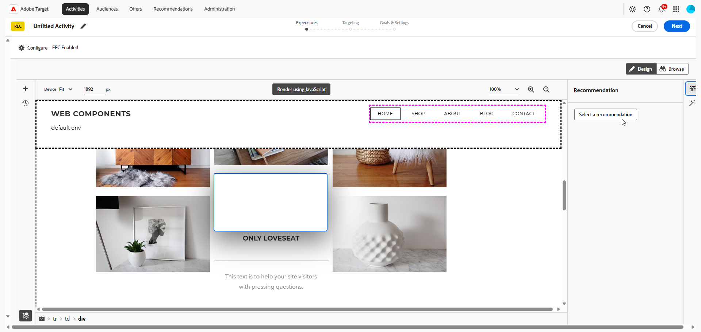

# 建立[!DNL Recommendations]活動 {#create-recs-activity}

>[!BEGINSHADEBOX]

**在此頁面上：**&#x200B;瞭解如何在[!DNL Target] **[!UICONTROL 視覺化體驗撰寫器]** (VEC)中建立[!DNL Recommendations]活動，從選取位置到設定活動。

>[!ENDSHADEBOX]

[!DNL Recommendations]活動會在頁面上顯示建議專案。 在[!DNL Target] **[!UICONTROL 視覺化體驗撰寫器]** (VEC)中建立活動，可讓建議直接放置在啟用[!DNL Target]的頁面上，與訪客應該看到的位置完全相同。

## 建立活動並選取位置 {#create-activity}

活動URL和位置會定義頁面，以及建議顯示的頁面區域。

1. 從&#x200B;**[!UICONTROL 活動]**&#x200B;功能表，按一下&#x200B;**[!UICONTROL 建立活動]** > **[!UICONTROL 建議]**。

   ![所有活動頁面，其中的[建立活動]功能表已開啟，且[建議]選項已反白顯示](../assets/create_reco_1.png)

1. Select **[!UICONTROL 視覺]** （如有必要）。

   若要改用&#x200B;**[!UICONTROL 表單式體驗撰寫器]**，請選取&#x200B;**[!UICONTROL 表單]**。 請參閱[表單式體驗撰寫器](/help/main/c-experiences/form-experience-composer.md)。 若要比較撰寫器，包括&#x200B;**[!UICONTROL 單頁應用程式]** VEC，請參閱[體驗和選件](/help/main/c-experiences/experiences.md)。 如需VEC問題，請參閱[疑難排解視覺化體驗撰寫器](/help/main/c-experiences/c-visual-experience-composer/r-troubleshoot-composer/troubleshoot-composer.md)。

1. （視條件而定）選擇[工作區](/help/main/administrating-target/c-user-management/property-channel/property-channel.md)。

1. 指定活動URL，然後按一下[建立]。**&#x200B;**

   活動URL是建議顯示的頁面。 [!DNL Target]不會區分URL通訊協定（[!DNL https]和[!DNL http]），因此`http://www.adobe.com`和`https://www.adobe.com`都相符。

   VEC隨即開啟並顯示頁面。

1. 按一下建議應顯示的元素，然後選取&#x200B;**[!UICONTROL 取代內容]** > **[!UICONTROL 建議]**。

   <!--
   * **[!UICONTROL Replace w/ Recommendations]**: Deletes the current content of the element and replaces it with the recommendations.
   * **[!UICONTROL Insert Recommendations Before]**: Places the recommendations before the element, above or to the left of it, depending on the page construction.
   * **[!UICONTROL Insert Recommendations After]**: Places the recommendations after the element, below or to the right of it, depending on the page construction.

   

   Use **[!UICONTROL Expand Selection]** to expand the selection to the parent container, so that it includes the desired page elements.
   -->

   符合建議的訪客可在指定區域檢視建議專案。 不符合資格的訪客會看到預設內容。

   >[!NOTE]
   >
   >**[!UICONTROL Recommendations]**&#x200B;活動一次僅支援一個修改或建議。 若要顯示多個建議，請建立多個[!DNL Recommendations]活動，或使用A/B或XT測試。

   

<!--
1. Select a page type: Cart Page, Category Page, Home Page, Landing Page, Product Page, Search Results Page, Thank You Page, or Other.

   

   The page type determines which criteria are suggested in the next section.
-->

1. 存取&#x200B;**[!UICONTROL 顯示屬性]**&#x200B;功能表，然後按一下&#x200B;**[!UICONTROL Select建議]**。

   

## Select條件 {#select-criteria}

條件會決定要建議哪些專案，以及如何為每位訪客選擇專案。

1. Select一或多個[條件](/help/main/c-recommendations/c-algorithms/algorithms.md)的核取方塊。

   

   選取多個條件時，流量會平均分散在各個條件之間，而且無法變更每個條件的百分比。 例如，如果選取兩個條件，而活動對20%的加入者顯示預設內容，則40%的加入者會看到每個條件的建議。

   >[!NOTE]
   >
   >不是每個條件都能在每個頁面上正確執行。 若要讓目前專案或目前類別建議相容，頁面或mbox必須傳入`entity.id`或`entity.categoryId`。 最好只顯示相容的條件。 若要讓不相容的條件可供活動使用，請清除&#x200B;**[!UICONTROL 相容]**&#x200B;核取方塊。 根據&#x200B;**[!UICONTROL 管理]** > **[!UICONTROL 建議]** > **[!UICONTROL 篩選不相容的條件]**&#x200B;設定，此核取方塊可能不會顯示。 如需詳細資訊，請參閱[設定](https://experienceleague.adobe.com/docs/target-dev/developer/recommendations.html){target=_blank}。

1. 選擇性地尋找或建立條件：

   * 若要在清單很長時搜尋現有條件，請在搜尋欄位中輸入內容，直到需要的條件出現為止。 [!DNL Recommendations]提供了部分條件，團隊也可以建立自訂條件。
   * 若要建立新條件，請按一下[建立條件] **&#x200B;**，然後輸入新條件的資訊。 請參閱[建立條件](/help/main/c-recommendations/c-algorithms/create-new-algorithm.md)。
   * 若要將條件分組到序列中，請建立條件序列。 請參閱[建立條件序列](/help/main/c-recommendations/c-algorithms/create-criteria-sequence.md)。

1. 按一下&#x200B;**[!UICONTROL 下一步]**。

## Select設計與促銷活動 {#select-design}

設計是一種範本，可決定建議在所選位置的外觀，而集合則決定哪些專案符合出現條件。 您可以選擇將促銷活動新增至建議。

1. 選取[設計](/help/main/c-recommendations/c-design-overview/design-overview.md)。

   

   * 若要使用現有設計，請選取一或多個設計的核取方塊，然後按一下[下一步]。**&#x200B;** 選取多個條件時，只能選取一個設計。
   * 若要建立自訂設計，請按一下[建立設計] **&#x200B;**，然後輸入新設計的名稱和代碼。 按[下一步]&#x200B;**&#x200B;**，選取或上傳影像，然後按一下[完成]&#x200B;**> [完成]**&#x200B;**。**

   [!DNL Target]包含數個預先設定的設計。 如需自訂設計的詳細資訊，請參閱[建立設計](/help/main/c-recommendations/c-design-overview/create-design.md#create-design)和[使用Velocity自訂設計](/help/main/c-recommendations/c-design-overview/customizing-a-template.md#customize-design)。

1. 按一下&#x200B;**[!UICONTROL 下一步]**。

1. 在&#x200B;**[!UICONTROL 選項]**&#x200B;頁面上，選取集合。

   集合會決定哪些專案符合出現在建議中的資格。 如需詳細資訊，包括如何建立集合，請參閱[在活動中使用集合](/help/main/c-recommendations/c-products/collections.md#use-collection)。

1. （選用）將前端和後端促銷活動新增至建議。 請參閱[新增促銷活動](/help/main/c-recommendations/t-create-recs-activity/adding-promotions.md#add-promotions)。

1. 按一下&#x200B;**[!UICONTROL 「儲存」]**。

   VEC畫面會在頁面上顯示建議設計。

## 檢閱並完成活動 {#complete-activity}

在儲存前先檢閱建議和活動流程，有助於確認適當的對象、條件和設計已準備就緒。

1. （選擇性）按一下&#x200B;**[!UICONTROL 預覽]**&#x200B;以檢視向訪客呈現的活動外觀。 此模式可允許與建議互動，因為訪客會與建議互動。 按一下&#x200B;**[!UICONTROL 撰寫]**&#x200B;以返回VEC。

1. 在VEC中檢閱建議，然後按一下[下一步]。**&#x200B;**

1. 在流程圖表中檢閱活動，並進行任何必要的變更。 完成時，請按一下&#x200B;**[!UICONTROL 下一步]**。

   將「所有訪客」分割為10%控制組和90%群組的

   流程圖涵蓋活動的對象、體驗和成功量度。 從圖表中，可以進行下列變更：

   * **對象**：所有訪客預設都會看到建議，但可以改為選取現有對象。 除了建立新受眾之外，您也可以建立[僅限於此活動的受眾](/help/main/c-target/creating-activity-only-audience.md#concept_A6BADCF530ED4AE1852E677FEBE68483)，或是[可結合多個受眾](/help/main/c-target/combining-multiple-audiences.md#section_2F1CE9434CC04174B4BA2BFC89B85D77)，以建立隨選受眾。
   * **條件**：檢視條件，或變更集合（**[!UICONTROL 條件]**&#x200B;標籤旁）。
   * **控制組**：變更看到控制體驗的加入者百分比。 在[!DNL Recommendations]活動中，控制群組會看見沒有任何建議的頁面。
   * **設計**：檢視設計程式碼，或變更或移除設計。

1. 指定活動設定，例如名稱（必要）和目標（選用）。 如需設定，包括活動名稱的規則，請參閱[Recommendations活動設定](/help/main/c-recommendations/t-create-recs-activity/recs-activity-settings.md#recs-activity-settings)。

1. 按一下&#x200B;**[!UICONTROL 「儲存並關閉」]**。

## 管理活動 {#manage-activity}

儲存活動後，**[!UICONTROL 總覽]**&#x200B;頁面會顯示活動的摘要。 此頁面提供下列動作：

* 啟動、編輯活動或進行QA。
* 將活動共用至Experience Cloud摘要。
* 檢視體驗URL和下載資料。
* 變更看到控制體驗的活動加入者百分比。
* 顯示或隱藏條件詳細資訊，並檢視設計的程式碼。

活動中有兩個額外頁面可供使用：

* **[!UICONTROL 報告]**：顯示[!DNL Recommendations]活動效能的報告。
* **[!UICONTROL 衝突]**：顯示可能發生的所有[活動衝突](/help/main/c-experiences/c-visual-experience-composer/activity-collisions.md)。 當多個活動將內容傳送至相同頁面時會發生衝突，並可能導致顯示非預期的內容。

## 訓練影片：建立Recommendations活動(7:15) 

>[!VIDEO](https://video.tv.adobe.com/v/27688)
