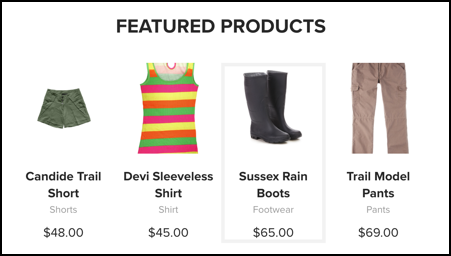
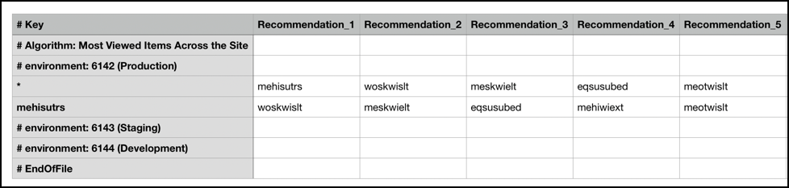

# 預覽和啟動推薦活動 {#preview-launch-recs-activity}

>[!BEGINSHADEBOX]

**在此頁面上：**&#x200B;瞭解如何檢查演演算法狀態、預覽建議，以及啟動[!DNL Recommendations]活動。

>[!ENDSHADEBOX]

在啟動活動之前預覽建議會確認結果是否可用。 這適用於包含[建議選件](/help/main/c-recommendations/recommendations-as-an-offer.md)的[!UICONTROL Recommendations]、[!UICONTROL A/B測試]和[!UICONTROL 體驗鎖定目標] (XT)活動。 [!DNL Target Recommendations]提供多種預覽建議的方式。

## 檢查演演算法狀態 {#check-status}

建立活動後，[!DNL Recommendations]會執行演演算法以產生建議。 此演演算法可能需要幾個小時的時間才能執行。

演演算法的狀態會與活動圖表中的條件一起列在[!DNL Recommendations]活動的&#x200B;**[!UICONTROL 概觀]**&#x200B;頁面上。

狀態可以是下列其中一項：

* **[!UICONTROL 結果就緒]**：演演算法已傳回結果。
* **[!UICONTROL 結果未就緒]**：演演算法尚未完成執行。
* **[!UICONTROL 摘要失敗]**：無法擷取自訂條件摘要檔案。

## 預估演演算法執行時間 {#algorithm-run-time}

儲存包含條件的活動後，[!DNL Target]會根據選取的集合、條件、設計和促銷活動計算建議。 所需時間取決於建議邏輯、資料範圍、目錄中的專案數、客戶已產生的行為資料量，以及行為資料來源。 行為資料來源對處理時間的影響最大。

### mbox

當mbox為行為資料來源時，條件會在建立後立即執行。 根據行為資料數量和目錄大小，演演算法最多可能需要12小時來執行。

變更條件設定通常會導致演演算法重新執行。 視變更而定，先前計算的建議可能要等到重新執行完成後才能使用。 若是較大的變更，則只有備份或預設內容可供使用，直到重新執行完成為止。

[!DNL Target]會根據選取的資料範圍，每12到48小時自動重新執行未修改的演演算法。

### [!DNL Adobe Analytics]

當[!DNL Adobe Analytics]為行為資料來源時，條件可用之前的時間會根據選取的報表套裝和回顧期間是否已用於其他條件而定。 報表套裝第一次搭配指定回顧期間使用時，[!DNL Target Recommendations]可能需要2到7天的時間才能從[!DNL Analytics]下載行為資料。

若要瞭解新或已編輯的條件以及進行中演演算法執行的時間點，請參閱[資料Source](/help/main/c-recommendations/c-algorithms/create-new-algorithm.md#data-source)中的資料來源&#x200B;**下拉式清單Analytics時的**&#x200B;條件可用性。

>[!NOTE]
>
>**[!UICONTROL 最近檢視的專案]**&#x200B;不需要執行離線演演算法，結果立即可用。 根據mbox資料的&#x200B;**[!UICONTROL 最常檢視專案]**&#x200B;和&#x200B;**[!UICONTROL 最暢銷商品]**&#x200B;演演算法通常可快速產生結果，因為計算更簡單。 這些演演算法是預覽設計變更或確認行為資料正確收集的較好選項。

## 使用QA連結預覽 {#preview-qa-link}

演演算法備妥結果之後，可以使用[!DNL Adobe Target]的[QA連結](/help/main/c-activities/c-activity-qa/activity-qa.md)功能預覽結果。 QA連結可在&#x200B;**[!UICONTROL 活動]**&#x200B;概觀頁面的&#x200B;**[!UICONTROL 活動位置]**&#x200B;區段中取得，並在頁面上顯示建議。

>[!NOTE]
>
>根據預設，[!DNL Target]會自動將使用者新增至QA連結的必要對象。 如果此設定為關閉且活動具有鎖定目標規則，則使用者設定檔必須符合這些鎖定目標規則，才能檢視包含建議的體驗。

QA模式有下列行為：

* [!DNL Target] QA模式儲存在Cookie中且跨頁面持續存在。 如果未退出QA模式，QA結果會在整個網站中持續顯示。 若要結束QA模式，請使用[書籤小程式](/help/main/c-activities/c-activity-qa/activity-qa-bookmark.md)。
* 在QA模式中，瀏覽網站不會影響設定檔的&#x200B;**[!UICONTROL 最近檢視的專案]**&#x200B;或&#x200B;**[!UICONTROL 最近購買的專案]**。 這種行為是特意設計的，以避免生產行為資料的無意汙染。 若要預覽&#x200B;**[!UICONTROL 最近檢視的專案]**&#x200B;或&#x200B;**[!UICONTROL 以使用者為基礎的建議]**&#x200B;條件的結果，請先在QA模式之外瀏覽網站，然後使用相同的工作階段來開啟QA模式連結。

## 使用CSV下載內容預覽 {#preview-csv}

下載結果可稽核特定的建議專案。 這對於演演算法（例如&#x200B;**[!UICONTROL 瀏覽過此專案、也瀏覽了那專案]**）特別有用，因為建議專案取決於訪客目前正在檢視的專案，而目錄可能包含數千或數百萬個不同的專案。

1. 等候直到活動中至少有一個演演算法顯示&#x200B;**[!UICONTROL 結果就緒]**&#x200B;狀態。 在那之前，無法下載結果。

1. 在&#x200B;**[!UICONTROL 活動]**&#x200B;概觀頁面上，按一下右上角的功能表圖示，然後按一下&#x200B;**[!UICONTROL 下載資料]**。

   

1. 開啟下載的CSV檔案以檢視建議專案。

   

檔案會從左到右列出建議專案，在此範例中是檢影片率最高的專案。 建議會依環境分隔。 在此範例中，只有生產環境有建議。

以星號(*)開頭的列會列出[個備份專案](/help/main/c-recommendations/c-algorithms/backup-recs.md)。 當演演算法（條件）的建議專案無法填滿設計的所有位置時，會顯示備份專案。

對於以索引鍵值為基礎的演演算法，例如&#x200B;**[!UICONTROL 檢視過此專案、也檢視過]**&#x200B;的人員，索引鍵值（「此」專案）位於最左側的欄。 建議專案（「該」專案）會由左至右列於Recommendation_X欄中。

對於具有非常大結果集的活動，**[!UICONTROL 下載資料]**&#x200B;選項可能會失敗，錯誤為`Error while fetching recommendation data file.`。當產生的CSV超過使用者介面在單一下載中可傳回的回應大小時，就會發生這種情況。

>[!NOTE]
>
>包含&#x200B;**[!UICONTROL 以使用者為基礎的建議]**&#x200B;演演算法的活動，或使用&#x200B;**[!UICONTROL 最近檢視的專案]**&#x200B;建議邏輯的條件，無法下載結果。

### 基於人氣和金鑰的演演算法的CSV下載格式 {#format}

CSV下載檔案一定會反映後端條件執行後產生的結果。

* **以熱門程度為基礎的演演算法（非金鑰型）**：檔案包含：

  * 以星號(*)為首碼的備份建議列
  * 根據演演算法設定列出建議的獨立列

* **以金鑰為基礎的演演算法**：檔案包含：

  * 備份列（如基於人氣的演演算法）
  * 鍵值格式的多列，其中第一個專案是鍵的產品ID，後面是代表建議候選人的逗號分隔產品ID

## 啟動活動 {#activate-activity}

啟動活動後，活動會啟動，其狀態會變更為&#x200B;**[!UICONTROL 即時]**。

在&#x200B;**[!UICONTROL 活動概覽]**&#x200B;標籤中，按一下&#x200B;**[!UICONTROL 狀態]**&#x200B;下拉式箭號，然後選取&#x200B;**[!UICONTROL 啟用]**。 如果活動目前處於&#x200B;**[!UICONTROL 非使用中]**&#x200B;狀態，下拉式清單會標籤為&#x200B;**[!UICONTROL 非使用中]**。 幾秒鐘到幾分鐘後，狀態會切換為&#x200B;**[!UICONTROL 即時]**。

也可以使用相同的下拉式清單來停用或封存活動。

## 變更設定時避免中斷 {#avoid-disruptions}

變更已上線活動中的[!DNL Recommendations]集合、條件、促銷活動或設計設定可能會使演演算法結果無效，並將演演算法的狀態變更為&#x200B;**[!UICONTROL 結果未就緒]**。

若要避免中斷已上線的活動，建議的方法是修改活動的復本，然後取代原始活動：

1. 複製原始活動（活動1）和要修改的條件，以建立新活動（活動2）。
1. 變更重複的活動（活動2）及其條件，然後等待演演算法產生結果。
1. 預覽修改的活動（活動2）並確認結果是否如預期。
1. 啟動新活動（活動2）。
1. 停用原始活動（活動1）。

當歷史報表結果必須保留在相同的活動中時，可能有替代方法。 此方法可能會對建議的可用性造成暫時性中斷：

1. 複製原始活動（活動1）和要修改的條件，以建立新活動（活動2）。
1. 變更重複的活動（活動2）及其條件，然後等待演演算法產生結果。
1. 預覽修改的活動（活動2）並確認結果是否如預期。
1. 暫停修改的活動（活動2），並將設定和條件交換給原始活動（活動1）。
1. 預覽原始活動（活動1）並確認結果如所需。
1. 重新啟用原始活動（活動1）。
